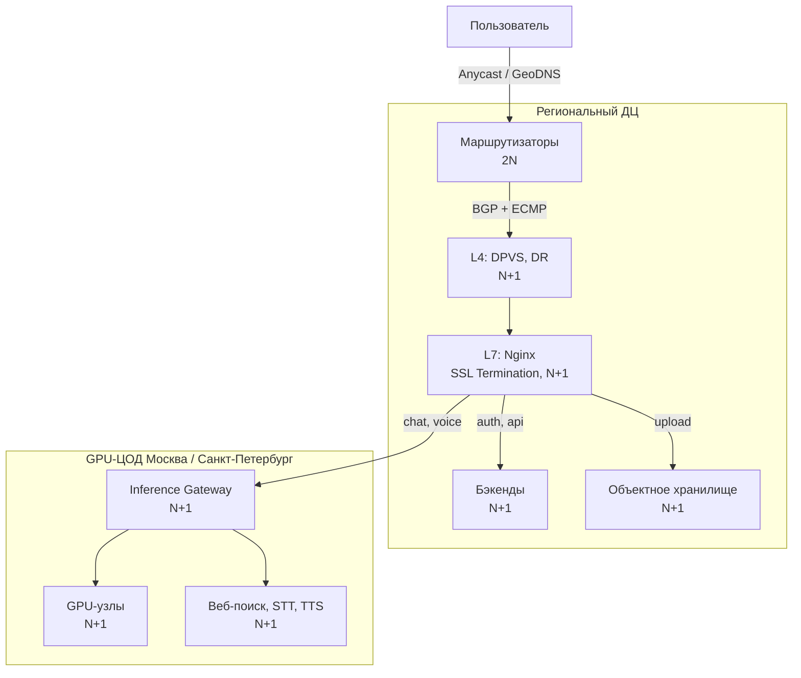
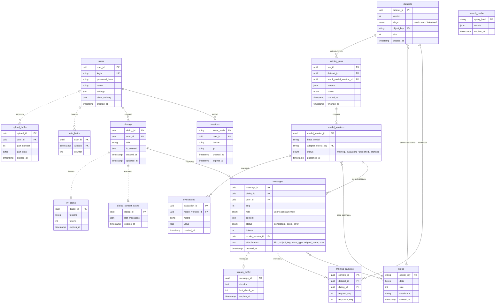

# Рассчетно-пояснительная записка для Курсовой работы по предмету "Разработка высоконагруженных приложений"

### 1. Тема и целевая аудитория

**Тип:** ИИ-сервис (аналог Алиса AI)

**Целевая аудитория:** 4,5 млн DAU, 19,0 млн WAU и 30,0 млн MAU по итогам Q4 2025[^1] (в Q2 2026 WAU достиг 33,2 млн[^2], но в отчете нет ни DAU, ни MAU, поэтому будем ориентироваться на 2025 год). Продукт ориентирован на российский рынок

**Основной функционал MVP:**

Инференс:
1. Регистрация/авторизация пользователя
2. Диалоги с ИИ
3. Голосовой ввод, голосовые ответы
4. Загрузка файлов
5. Интеграция с поиском Яндекса

Обучение:
1. Сбор данных, разрешенных для обучения
2. Подготовка обучающего датасета
3. Дообучение базовой модели
4. Оценка качества новой версии модели
5. Публикация модели в контур инференса

**Ключевые продуктовые решения:**
1. Ответ передается пользователю потоково
2. ИИ-агент самостоятельно вызывает разрешенные инструменты

---

### 2. Расчет нагрузки

Яндекс отчитался о 500-600 тыс. запросов о подборе товаров в сутки[^3]. Такие запросы составляют около 3% от общего количества[^4], поэтому получаем 16,6-20,0 млн запросов в сутки (отчеты были опубликованы с интервалом в два месяца, считаем, что метрики изменились несильно). Для расчетов принимаем среднее значение `(16,6+20,0) / 2 = 18,3`, то есть 18,3 млн. Найдем кол-во запросов в сутки одного пользователя: `18,3 / 4,5 = 4,07` запроса

**Продуктовые метрики:**

| Метрика | Значение |
|---|---:|
| DAU | 4,5 млн |
| MAU | 30,0 млн |

Предполагаем: 10% запросов голосовые, 10% содержат файл размером 10 МБ, а 60% вызывают один веб-поиск. Один поисковый запрос возвращает 5 результатов по 500 символов. Для расчетов принимаем 4 символа на токен, 2 байта на символ, скорость речи 900 символов в минуту, Opus 32 Кбит/с и коэффициент сжатия файлов 0,8 (большая часть форматов уже сжимает данные, например, JPEG, PDF, поэтому будем считать, что данные сжимаются несильно). Производные действия входят в запросы к ИИ и не суммируются с ними

Также предполагаем, что каждый DAU авторизуется или создает сессию один раз в сутки. Регистрации не учитываем, так как нагрузка существенно ниже общей нагрузки

| Тип действия | На пользователя в день | Всего в сутки |
|---|---:|---:|
| Запрос к ИИ | 4,07 | 18,30 млн |
| Голосовой запрос | 0,407 | 1,83 млн |
| Загрузка файла | 0,407 | 1,83 млн |
| Вызов веб-поиска агентом | 2,442 | 10,98 млн |
| Авторизация / создание сессии | 1,000 | 4,50 млн |

Обучение:

| Метрика | Значение |
|---|---:|
| Доля данных для обучения | 0,1% |
| Периодичность обучения | раз в месяц |
| Расчетный месяц | 30 дней |
| Размер базовой модели | 70 млрд параметров |
| Размер базовой модели в BF16 | 140 ГБ |
| Размер LoRA-адаптера | 2 ГБ |
| Хранимые адаптеры | 3 версии |
| Запас на checkpoints и оценки | 20% |

**Расчет хранилища:**

Яндекс не предоставляет публичную статистику по объему хранилища, поэтому возьмем за основу пост из блога OpenAI. OpenAI хранит более 500 ПБ данных для продуктов с аудиторией более 1 млрд пользователей в неделю[^5]. Грубо масштабируем этот объем на 19 млн WAU:

`500 ПБ * 19 млн / 1 млрд = 9,5 ПБ`.

Текущий объем хранилища — 9,5 ПБ

Возьмем из публичного датасета ShareChat средние размеры запроса/ответа: 135,04 токена в запросе и 1 115,30 токена в ответе[^6]

- Запрос: `135,04 * 4 = 540` символов
- Ответ: `1 115,30 * 4 = 4 461` символ
- Один запрос-ответ: `(540 + 4 461) * 2 = 10 002` байта
- Текст: `18,3 млн * 10 002 байта = 183 ГБ/сутки`
- Файлы после серверного сжатия: `18,3 млн * 10% * 10 МБ * 0,8 = 14,64 ТБ/сутки`
- Голосовой запрос: `540 / 900 * 60 * 4 000 = 0,144 МБ`
- Голосовой ответ: `4 461 / 900 * 60 * 4 000 = 1,19 МБ`
- Голосовые запросы: `1,83 млн * 0,144 МБ = 0,264 ТБ/сутки`
- Голосовые ответы: `1,83 млн * 1,19 МБ = 2,18 ТБ/сутки`
- Веб-поиск: `18,3 млн * 60% = 10,98 млн вызовов/сутки`; результаты не храним, но учитываем их передачу в модель: `10,98 млн * 5 * 500 * 2 = 54,90 ГБ/сутки`

Суточный прирост данных составляет 17,26 ТБ. Тогда один активный пользователь добавляет за год:

`17 260 ГБ / 4 500 000 * 365 = 1,40 ГБ/польз./год`

Прирост хранилища за год:

`17,26 ТБ * 365 = 6 299,90 ТБ = 6,30 ПБ`

Обучение:

Базовая модель в BF16 уже загружена и работает, она учитывается как исходный объем контура обучения

За месяц создается `18,3 млн * 30 = 549 млн` запрос-ответ. В один цикл обучения попадает `549 млн * 0,1% = 549 тыс.` запрос-ответ или `549 тыс. * 10 002 байта = 5,49 ГБ`

Для обучения хранятся исходная, очищенная и токенизированная версии датасета. Они занимают `5,49 ГБ * 3 = 16,47 ГБ` в месяц и `16,47 ГБ * 12 = 197,64 ГБ` за год. Три LoRA-адаптера занимают `2 ГБ * 3 = 6,00 ГБ`

Прирост хранилища обучения без резерва: `197,64 ГБ + 6,00 ГБ = 203,64 ГБ`

Резерв на checkpoints и оценку: `203,64 ГБ * 20% = 40,73 ГБ`. Поэтому полный прирост обучения за год составит `203,64 ГБ + 40,73 ГБ = 244,37 ГБ`

Внутренний сетевой трафик одного цикла (чтение выборки, три записи и передача датасета): `5,49 ГБ * 5 + 2,00 ГБ = 29,45 ГБ`. За первый год: `29,45 ГБ * 12 = 353,40 ГБ`; передача базовой модели не требуется

| Метрика | Значение |
|---|---:|
| Текущий объем хранилища инференса | 9,50 ПБ |
| Прирост на одного активного пользователя за год | 1,40 ГБ |
| Прирост хранилища инференса за год | 6,30 ПБ |
| Текущий объем хранилища обучения | 140,00 ГБ |
| Прирост хранилища обучения за год | 244,37 ГБ |

**Технические метрики:**

На основе расчетов выше легко заключить:

Объем хранилища:
| Тип данных | Количество объектов / сутки | Объем / сутки | Объем / 30 дней |
|---|---:|---:|---:|
| Текстовые сообщения | 18,30 млн | 0,18 ТБ | 5,49 ТБ |
| Загруженные файлы после сжатия | 1,83 млн | 14,64 ТБ | 439,20 ТБ |
| Голосовые запросы | 1,83 млн | 0,26 ТБ | 7,91 ТБ |
| Голосовые ответы | 1,83 млн | 2,18 ТБ | 65,31 ТБ |
| **Итого** | — | **17,26 ТБ** | **517,91 ТБ** |

Среднюю пропускную способность посчитаем как `трафик в сутки / 86 400`. Предположим, что 90% суточного трафика приходится на 6 активных часов, а остальные 10% равномерно распределены в течение оставшихся 18 часов. Средняя нагрузка в активный период составит `90% * 24 / 6 = 3,60` от среднесуточной; этот коэффициент используем для расчета пиковой нагрузки:
| Тип трафика | Объем / сутки | Средняя нагрузка | Пиковая нагрузка |
|---|---:|---:|---:|
| Текстовые сообщения | 1 464,40 Гбит | 0,02 Гбит/с | 0,06 Гбит/с |
| Загрузка файлов до серверного сжатия | 146 400,00 Гбит | 1,69 Гбит/с | 6,10 Гбит/с |
| Голосовые сообщения | 19 525,31 Гбит | 0,23 Гбит/с | 0,81 Гбит/с |
| Результаты веб-поиска | 439,20 Гбит | 0,01 Гбит/с | 0,02 Гбит/с |
| **Итого** | **167 828,91 Гбит** | **1,94 Гбит/с** | **6,99 Гбит/с** |

Аналогично посчитаем RPS как `запросов в день / 86 400`; для пикового RPS используем тот же коэффициент 3,60:
| Метод / тип запроса | Запросов в сутки | Средний RPS | Пиковый RPS |
|---|---:|---:|---:|
| Генерация ответа ИИ | 18,30 млн | 211,81 | 762,50 |
| Загрузка файла | 1,83 млн | 21,18 | 76,25 |
| Распознавание голосового ввода (STT) | 1,83 млн | 21,18 | 76,25 |
| Синтез голосового ответа (TTS) | 1,83 млн | 21,18 | 76,25 |
| Запрос к поиску | 10,98 млн | 127,08 | 457,50 |
| Авторизация / создание сессии | 4,50 млн | 52,08 | 187,50 |

В рамках инференса также посчитаем кол-во токенов в секунду. В таблице учтены пользовательские сообщения, ответы и результаты веб-поиска, без системного промпта и истории диалога

- Входные токены пользовательских сообщений: `18,3 млн * 135,04 / 86 400 = 28 602 токенов/с`
- Входные токены результатов веб-поиска: `10,98 млн * 5 * 500 / 4 / 86 400 = 79 427 токенов/с`
- Выходные токены: `18,3 млн * 1 115,30 / 86 400 = 236 227 токенов/с`
- Нагрузка в активный период: `средняя нагрузка * 3,60`

| Тип токенов | Среднее значение, токенов/с | Нагрузка в активный период, токенов/с |
|---|---:|---:|
| Входные токены пользовательских сообщений | 28 602 | 102 968 |
| Входные токены результатов веб-поиска | 79 427 | 285 938 |
| **Всего входных токенов** | **108 029** | **388 906** |
| Выходные токены | 236 227 | 850 416 |

---

### 3. Глобальная балансировка нагрузки

Ключевым в сервисе являются GPU-кластеры, поэтому многое будет зависеть от их расположения. Такие крупные центры обработки данных (ЦОД) требуют больших вложений и развитой инфраструктуры вокруг (например, наличие мощных электростанций), поэтому много где построить не получится

Большая часть населения РФ проживает в европейской части страны (порядка 4/5 населения[^7]), поэтому инфраструктура там развита хорошо, поэтому и кластеры должны быть там. Крупными городами являются Москва и Санкт-Петербург - размещать GPU-кластеры будем рядом с ними

Хоть и кластеры будут только в двух крупных ЦОД, точка входа для пользователя необязательна находится там же. Вся обработка, связанныая с инференсом LLM и работой агента должны происходить в ЦОД, а отдача статики, загрузка файлов, реплики данных можно распределить по стране, большую часть разместить в западной части и несколько дата-центров (ДЦ) в Сибири (Новосибирск) и на Дальнем Востоке (Хабаровск). Запросы от модели как правило небыстрые и пользователи знают об этом и могут подождать, но если главная страница будет загружаться долго или вход в аккаунт будет тормозить, то пользователи просто уйдут

Anycast лучше всего использовать для CDN, потому что это stateless запросы. Для коротких запросов, например, регистрация/авторизация, загрузка диалогов, также подойдет Anycast

DNS балансировку надо использовать для загрузки файлов и для потоковой передачи ответа пользователю, так как это долгие stateful операции

Таким образом, получаем разбиение по доменам

| Домен | Назначение | Балансировка |
|---|---|---|
| `ai.domain.ru` | Главная страница, статика (CDN) | Anycast |
| `auth.ai.domain.ru` | Регистрация, авторизация | Anycast |
| `api.ai.domain.ru` | История диалогов, настройки | Anycast |
| `chat.ai.domain.ru` | Потоковая передача ответа ИИ | DNS |
| `voice.ai.domain.ru` | Голосовой ввод и ответ | DNS |
| `upload.ai.domain.ru` | Загрузка файлов | DNS |

Так как пользователи напрямую не будут делать запросы в ЦОД, то для выполнения запроса будет выбираться наименее нагруженный ЦОД. Причем сессию пользователя необходимо закрепить за конкретным ЦОД на некоторое время, потому что там может сохранится KV-кэш предыдущего контекста

Будем считать, что распределение запросов будет примерно соответствовать распределению населения по стране, то есть на ДЦ в западной части страны будет приходится порядка 80% запросов

---

### 4. Локальная балансировка нагрузки

**Резервирование:**

| Уровень | Резервирование |
|---|---|
| Маршрутизаторы | 2N |
| DPVS | N+1 |
| Nginx | N+1 |
| Бэкенды, хранилище | N+1 |
| Inference Gateway | N+1 |
| GPU-узлы | N+1 |
| GPU-ЦОД | Второй GPU-ЦОД |

2N - для маршрутизаторов, так как их отказ отключает весь ДЦ. N+1 - для взаимозаменяемых узлов, отказ одного снижает только общую мощность

**L4 и L7:**

L4 - DPVS в режиме Direct Route (DR): пересылает входящие пакеты на Nginx, ответы идут клиенту напрямую. Узел Nginx выбирается через Maglev hashing, поэтому отказ узла DPVS не обрывает соединения

L7 - Nginx: SSL Termination и маршрутизация по домену

**Балансировка входящих запросов:**

Короткие запросы `auth` и `api` распределяются через round robin, а долгие `upload`, `chat` и `voice` через least connections

**Балансировка межсервисных запросов:**

Внутри ДЦ - service discovery и балансировка на стороне клиента (sidecar Envoy)

| Откуда - куда | Алгоритм |
|---|---|
| Бэкенды - бэкенды | Round robin |
| Бэкенды - БД | Запись в мастер, чтение round robin по репликам |
| Inference Gateway - GPU-узлы | Взвешенный consistent hashing по `dialog_id` |
| Inference Gateway - веб-поиск, STT, TTS | Least request |

Веса GPU-узлов пропорциональны их фактической скорости генерации; узел с заполненным KV-кэшем временно исключается

**Ограничители: SSL Termination и пропускная способность**

DPVS в режиме DR пропускает только входящий трафик и ограничителем не является, поэтому считаем L7

Пиковый RPS: `187,50 (auth) + 762,50 (chat) + 152,50 (voice) + 76,25 (upload) = 1 178,75`. Нагрузку на `api` в разделе 2 не считали. Предполагаем, что на каждый запрос к ИИ клиент делает 2 запроса к `api`: загрузка списка диалогов и истории выбранного диалога: `762,50 * 2 = 1 525,00`. Итого `2 704 RPS`. Статику отдает CDN

Считаем, что каждый запрос открывает новое TLS-соединение (оценка сверху)

- По данным 2017 года (RSA 2048, 428 CPS на ядро[^8]): `2 704 / 428 = 6,32 => 7 ядер`
- По данным 2019 года (4 433 TPS на ядро[^9]): `2 704 / 4 433 = 0,61 => 1 ядро`
- Сеть: пик 6,99 Гбит/с; 10 GbE при загрузке 70% - 7 Гбит/с

Распределение по ДЦ (80% - западная часть страны). Ядра CPU считаем по более строгим данным 2017 года: `RPS / 428`. Одного сервера (16 ядер, 10 GbE) хватает для каждого ДЦ, с резервом N+1 - по 2 сервера DPVS и 2 сервера Nginx

| ДЦ | Доля | Пиковый RPS | Пиковый трафик | Ядер CPU на SSL | Серверов DPVS | Серверов Nginx |
|---|---:|---:|---:|---:|---:|---:|
| Москва | 55% | 1 487,1 | 3,84 Гбит/с | 4 | 2 | 2 |
| Санкт-Петербург | 25% | 675,9 | 1,75 Гбит/с | 2 | 2 | 2 |
| Новосибирск | 12% | 324,5 | 0,84 Гбит/с | 1 | 2 | 2 |
| Хабаровск | 8% | 216,3 | 0,56 Гбит/с | 1 | 2 | 2 |
| **Итого** | 100% | 2 703,8 | 6,99 Гбит/с | - | **8** | **8** |

При отказе ДЦ в Москве Санкт-Петербург получает 80% нагрузки: 5,59 Гбит/с и `2 163 / 428 = 5,05 => 6 ядер`. Помещается в один сервер

Итого: 8 серверов DPVS, 8 серверов Nginx и 4 Inference Gateway (по 2 в каждом GPU-ЦОД)

**Итоговая схема балансировки:**

---

### 5. Логическая схема БД

**Описание таблиц:**

| Таблица | Назначение |
|---|---|
| users | Профили пользователей |
| sessions | Сессии |
| dialogs | Диалоги |
| messages | Сообщения и вложения |
| blobs | Содержимое файлов, голоса, датасетов, весов |
| model_versions | Версии модели |
| training_samples | Примеры для обучения |
| datasets | Версии датасета |
| training_runs | Запуски обучения |
| evaluations | Оценки моделей |
| dialog_context_cache | Контекст диалога |
| kv_cache | KV-кэш модели |
| stream_buffer | Чанки ответа |
| search_cache | Результаты веб-поиска |
| rate_limits | Счетчики запросов |
| upload_buffer | Части загружаемых файлов |

**Расчеты:**

Допущения:

- Обычные таблицы считаем за год, кэши и буферы по пику. Пиковый QPS берем из раздела 2, средний = `пик / 3,60`
- Размер строки считаем как сумму полей: `uuid` 16 Б, `timestamp` 8 Б, `int` 4 Б, `float` 8 Б, `bool` и `enum` по 1 Б. Для строк, `json` и `bytes` берем среднюю длину
- Пользователей в 2 раза больше MAU, в диалоге 4,62 запроса (среднее по датасету ShareChat[^6])
- Сессия живет 24 часа, коэффициент наложения 1,5
- Вложение внутри сообщения занимает `1 + 36 (ключ) + 16 (MIME) + 64 (имя файла) + 4 = 121 Б`, на сообщение в среднем `5,49 млн / 36,6 млн * 121 = 18 Б`
- TTL: контекст диалога 30 мин, чанки ответа 5 мин, результаты поиска 1 час, доля попаданий в поиске 30%
- Модель генерирует 50 токенов/с, ответ в среднем 1 115 токенов, поэтому одна генерация идет 22,3 с. Ответ отдается чанками по 20 токенов, в тексте он занимает 8 922 Б
- Контекст запроса: `500 (системный промпт) + 135 (запрос) + 375 (поиск) + 2 250 (история, около 1,8 обмена при 4,62 запроса в диалоге) + 1 115 (ответ) = 4 375` токенов
- KV-кэш модели 70B занимает 320 КБ на токен
- Файл 10 МБ грузится 8 с (канал 10 Мбит/с) частями по 5 МБ

| Таблица | Строк | Размер строки | Объем |
|---|---|---|---|
| users | `30 млн * 2 = 60 млн` | `16 + 32 (логин) + 60 (bcrypt) + 32 (имя) + 256 (настройки) + 1 + 8 = 405 Б` | 24,3 ГБ |
| sessions | `4,5 млн * 1,5 = 6,75 млн` | `32 (SHA-256) + 16 + 64 (устройство) + 16 (IPv6) + 8 + 8 = 144 Б` | 0,97 ГБ |
| dialogs | `18,3 млн / 4,62 * 365 = 1,45 млрд` | `16 + 16 + 100 (название) + 1 + 8 + 8 = 149 Б` | 215 ГБ |
| messages | `18,3 млн * 2 * 365 = 13,36 млрд` | `16 + 16 + 16 + 4 + 1 + 5 001 (текст) + 1 + 4 + 16 + 18 (вложения) + 8 = 5 101 Б` | 68,1 ТБ |
| blobs | `1,83 млн * 3 * 365 = 2,00 млрд` | `17,08 ТБ * 365 / 2,00 млрд = 3,1 МБ` | 6,24 ПБ |
| model_versions | 12 | `16 + 32 + 36 + 1 + 8 = 93 Б` | 1,1 КБ |
| training_samples | `549 тыс. * 12 = 6,59 млн` | `16 * 3 + 4 + 4 = 56 Б` | 0,37 ГБ |
| datasets | `3 * 12 = 36` | `16 + 4 + 1 + 36 + 4 + 8 = 69 Б` | 2,5 КБ |
| training_runs | 12 | `16 * 3 + 512 (параметры) + 1 + 8 + 8 = 577 Б` | 6,9 КБ |
| evaluations | `12 * 50 = 600` | `16 + 16 + 32 + 8 + 8 = 80 Б` | 48 КБ |
| dialog_context_cache | `762,5 * 1 800 = 1,37 млн` | `16 + 4 375 токенов * 4 * 2 + 8 = 35 КБ` | 48 ГБ |
| kv_cache | `762,5 * 22,3 = 17 тыс.` | `4 375 токенов * 320 КБ = 1,43 ГБ` | 24,4 ТБ |
| stream_buffer | `17 тыс. + 762,5 * 300 = 246 тыс.` | `16 + 8 922 + 4 + 8 = 8,95 КБ` | 2,2 ГБ |
| search_cache | `320 * 3 600 = 1,15 млн` | `32 + 5 000 (5 результатов) + 8 = 5,04 КБ` | 5,8 ГБ |
| rate_limits | 4,5 млн | `16 + 8 + 4 = 28 Б` | 0,13 ГБ |
| upload_buffer | `76,25 * 8 * 2 = 1 220` | 5 МБ | 6,1 ГБ |

| Таблица | Чтение, пик QPS | Запись, пик QPS |
|---|---|---|
| users | 188 | < 1 |
| sessions | `1 525 (api) + 762,5 (chat) + 152,5 (voice) + 76,25 (upload) = 2 516` | 188 |
| dialogs | `762,5 * 2 = 1 525` | `762,5 / 4,62 + 762,5 = 928` |
| messages | 763 | `762,5 * 3 = 2 288` |
| blobs | `76,25 * 3 = 229` | 229 |
| model_versions | < 1 | < 1 |
| training_samples | < 1 | < 1 |
| datasets | < 1 | < 1 |
| training_runs | < 1 | < 1 |
| evaluations | < 1 | < 1 |
| dialog_context_cache | 763 | 1 525 |
| kv_cache | 850 416 | 850 416 |
| stream_buffer | `850 416 / 20 = 42 521` | 42 521 |
| search_cache | 458 | `457,5 * 0,7 = 320` |
| rate_limits | `762,5 + 76,25 + 76,25 = 915` | 915 |
| upload_buffer | `76,25 * 2 = 153` | 153 |

**Схема:**

Пунктиром отмечены кэши и буферы

**Денормализация:**

- Вложения хранятся списком внутри messages, поэтому история с файлами читается одним запросом и отдельной таблицы attachments нет
- `user_id` продублирован в messages, чтобы удалять данные пользователя, не заходя в dialogs
- `user_id` хранится в sessions, поэтому запрос авторизуется без чтения users
- training_samples ссылается на ключ сообщения `(dialog_id, seq)`. Пример отбираем с вероятностью 0,1% при записи ответа, messages не сканируем
- dialog_context_cache - копия последних сообщений диалога для Inference Gateway

**Консистентность:**

- Строго нужны уникальный логин, отзыв сессии, публикация версии модели и порядок сообщений (`seq`)
- Пользователь должен сразу видеть свое сообщение в messages, на других устройствах можно отстать. Диалоги и данные обучения согласуются в итоге
- blobs пишется раньше сообщения со ссылкой на него, а объекты без ссылок потом чистит фоновая задача
- Кэши и буферы собираются заново из messages или повторным prefill, их потеря не критична

**Распределение нагрузки по ключам:**

- `user_id` - равномерно: пользователь в среднем делает всего 4 запроса в сутки, поэтому горячих ключей нет. Ботов и скрипты отсекает rate_limits
- `dialog_id` - почти вся нагрузка на диалоги последних часов, старые данные холодные; kv_cache привязан к GPU-узлу через consistent hashing
- `query_hash` - популярные запросы вроде погоды, курсов и новостей дают большую часть обращений, это горячие ключи
- `message_id` в stream_buffer - ключ живет несколько минут, но операций на него приходится больше всего

---

### 6. Физическая схема БД

**Выбор СУБД:**

| Таблицы | СУБД | Почему |
|---|---|---|
| users, dialogs, model_versions, datasets, training_samples, training_runs, evaluations | PostgreSQL | Небольшие таблицы, нужны транзакции |
| messages | ScyllaDB | 68,1 ТБ в год, много записи, чтение по `dialog_id` |
| blobs, upload_buffer | Ceph | Петабайты файлов, S3 API, erasure coding |
| sessions, rate_limits, dialog_context_cache, stream_buffer, search_cache | Redis | Данные в памяти с коротким TTL |
| kv_cache | Память GPU (SGLang) | Живет рядом с вычислением |

**Индексы:**

| Таблицы | Ключи и индексы |
|---|---|
| users | `UNIQUE (login)` |
| dialogs | `INDEX (user_id, updated_at DESC) WHERE NOT is_deleted` |
| model_versions | `UNIQUE (status) WHERE status = 'published'` |
| datasets | `UNIQUE (version, stage)` |
| training_samples, training_runs | `INDEX (dataset_id)` |
| evaluations | `INDEX (model_version_id)` |
| messages | Ключ партиции `dialog_id`, сортировка `seq DESC` |
| blobs, upload_buffer | Ключ `object_key` в бакете |
| sessions | Ключ `session:{token_hash}`, обратный индекс `user_sessions:{user_id}` |
| rate_limits | Ключ `rl:{user_id}:{minute}` |
| dialog_context_cache, stream_buffer, search_cache | Ключи `ctx:{dialog_id}`, `stream:{message_id}`, `search:{query_hash}` |
| kv_cache | Ключ `dialog_id` |

**Шардирование и резервирование:**

| Таблицы | Шардирование | Резервирование |
|---|---|---|
| users | Нет | Мастер, синхронная реплика в другом ЦОД, асинхронные в регионах |
| dialogs | 16 логических шардов по `hash(user_id)` на 4 узлах | Как у users |
| model_versions, datasets, training_samples, training_runs, evaluations | Нет | Мастер и синхронная реплика |
| messages | Кольцо токенов по `dialog_id` | RF 3 в Москве и СПб |
| blobs, upload_buffer | CRUSH по `object_key` | EC 8+3, репликация Москва - СПб |
| sessions | Нет | Мастер в Москве, реплика в каждом ДЦ |
| rate_limits | Нет, отдельно в каждом ДЦ | Реплика |
| dialog_context_cache, stream_buffer, search_cache | 6 шардов по CRC16 | Реплика на шард |
| kv_cache | Consistent hashing по `dialog_id` | Нет, пересчитывается |

Объем с учетом резервирования за год:

| Таблицы | Расчет |
|---|---|
| messages | `68,1 ТБ * 3 (RF) / 2 (сжатие) = 102 ТБ`, 13 узлов по 8 ТБ |
| blobs | `6,24 ПБ * 11 / 8 (EC) = 8,58 ПБ` |
| dialogs | `215 ГБ / 4 = 54 ГБ` на узел |
| dialog_context_cache, stream_buffer, search_cache | `48 + 2,2 + 5,8 = 56 ГБ`, на шард 9,3 ГБ и `88,1 тыс. / 6 = 14,7 тыс.` операций/с |

**Балансировка и мультиплексирование:**

| СУБД | Как балансируем |
|---|---|
| PostgreSQL | PgBouncer (transaction) сводит тысячи соединений к ~100, мастера выбирает Patroni, чтение round robin по репликам |
| PostgreSQL (dialogs) | Шард выбирает приложение: `hash(user_id) % 16`, узел шарда берется из etcd |
| ScyllaDB | Драйвер шлет запрос сразу на нужный узел и ядро, в ближайший ЦОД |
| Redis Cluster | Клиент хранит карту слотов, переходит по `MOVED` |
| Ceph | Несколько RGW за Nginx, least connections |

**Резервное копирование:**

| СУБД | Схема |
|---|---|
| PostgreSQL | WAL-G: полный бэкап раз в неделю, инкрементальный раз в сутки, архив WAL, хранение 30 дней |
| ScyllaDB | Scylla Manager: снапшот раз в сутки, хранение 30 дней |
| Ceph | Полной копии нет: EC, репликация между ЦОД, версионирование 7 дней |
| Redis (sessions) | RDB раз в час и AOF |
| Остальные кэши и буферы | Не бэкапим |

---

### 7. Алгоритмы

**Агент**

| Алгоритм | Описание |
|---|---|
| ReAct | 1. Thought: модель решает, чего не хватает для ответа 2. Action: вызывает инструмент 3. Observation: получает результат 4. Повторяет шаги до финального ответа, с лимитом итераций |
| Tool calls | 1. Инструменты описаны в системном промпте JSON-схемой 2. Модель генерирует вызов: `{"name": "web_search", "arguments": {...}}` 3. Шлюз проверяет его по списку разрешенных и выполняет 4. Результат возвращается в контекст с ролью `tool` |
| Structured output | 1. JSON-схема превращается в грамматику 2. На каждом шаге запрещенные токены маскируются 3. Модель не может выдать невалидный вызов |

**Инференс (SGLang)**

| Алгоритм | Описание |
|---|---|
| RadixAttention | 1. KV-кэш уже обработанных токенов хранится в памяти GPU 2. Общие префиксы (системный промпт, история диалога) хранятся в дереве и переиспользуются 3. Считается только новый запрос 4. Старое вытесняется по LRU |
| Тензорный параллелизм | 1. Каждый слой режется по 4–8 GPU одного узла 2. Каждая карта считает свою часть 3. Результаты собираются через all-reduce |
| Конвейерный параллелизм | 1. Слои делятся на группы по узлам 2. Данные проходят узлы по очереди, как на конвейере 3. Нужен, если модели не хватает одного узла |
| Speculative decoding | 1. Легкая модель предлагает несколько токенов 2. Основная модель проверяет их за один проход 3. Ответ генерируется в 2–3 раза быстрее, результат тот же |

**Обучение**

| Алгоритм | Описание |
|---|---|
| LoRA | 1. Веса базовой модели заморожены 2. Обучаются только небольшие матрицы-адаптеры (2 ГБ) 3. Откат делается сменой адаптера |
| MapReduce | 1. Map: воркеры параллельно чистят и токенизируют свои части данных 2. Shuffle: тексты группируются по хэшу 3. Reduce: удаляются дубли, собирается датасет |
| Квантование FP8 | 1. После обучения веса переводятся из 16 в 8 бит 2. Модель весит 70 ГБ вместо 140 3. Перед публикацией модель проходит оценку качества |

---

### Список источников

[^1]: [Финансовый отчет Яндекса Q4 2025](https://yandex.ru/company/news/17-02-2026)
[^2]: [Финансовый отчет Яндекса Q2 2026](https://yandex.ru/company/news/29-07-2026)
[^3]: [Яндекс дообучил Алису AI для удобного подбора товаров прямо в чате](https://yandex.ru/company/news/14-01-2026-01)
[^4]: [Яндекс рассказал, как применяют Алису AI в бытовых и профессиональных задачах](https://ir.yandex.ru/press-releases?id=06-03-2026-01&year=2026)
[^5]: [Scaling storage to one billion users (Part 1)](https://openai.com/index/scaling-storage-one-billion-users-part-one)
[^6]: [ShareChat: A Dataset of Chatbot Conversations in the Wild](https://github.com/raye22/ShareChat)
[^7]: [Территория и население России](https://basrah.mid.ru/ru/o_rossii/territoriya_i_naselenie_rossii/)
[^8]: [Testing the Performance of NGINX and NGINX Plus Web Servers](https://blog.nginx.org/blog/testing-the-performance-of-nginx-and-nginx-plus-web-servers)
[^9]: [Testing the Performance of NGINX Ingress Controllers in a Kubernetes Environment](https://blog.nginx.org/blog/testing-performance-nginx-ingress-controller-kubernetes)
