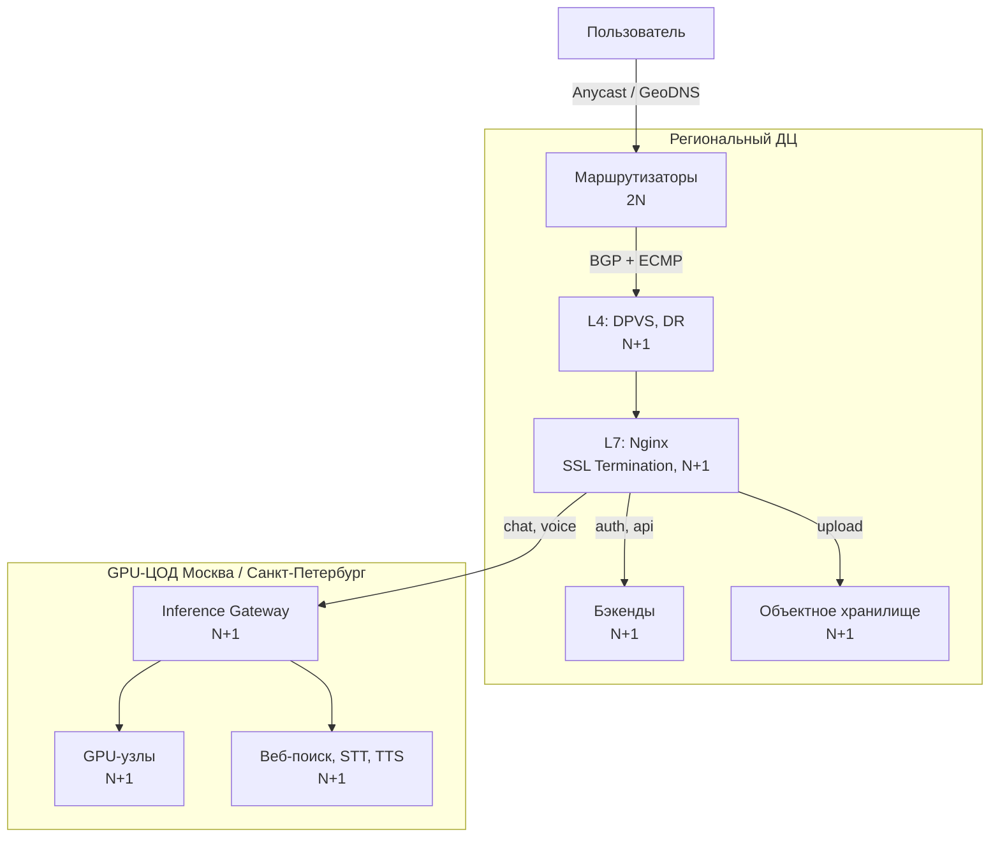
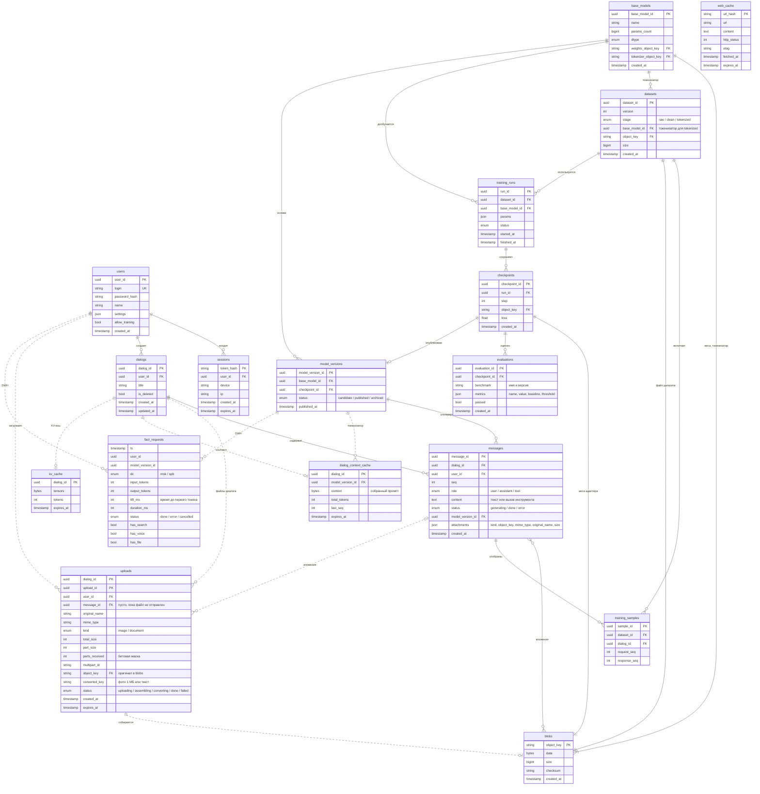
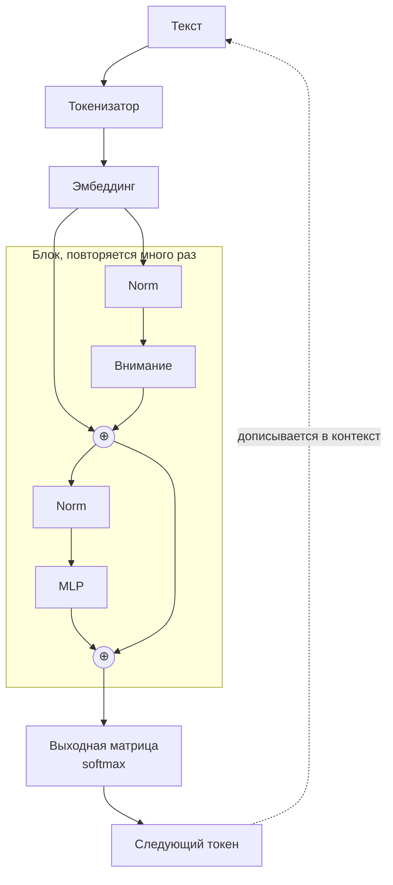
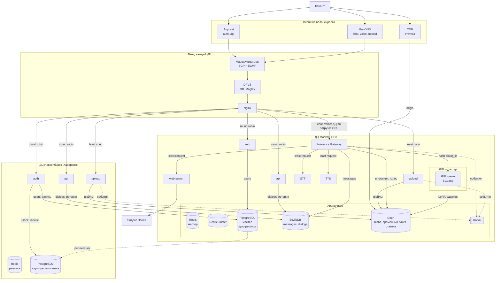
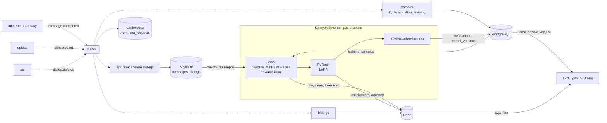

# Рассчетно-пояснительная записка для Курсовой работы по предмету "Разработка высоконагруженных приложений"

### 1. Тема и целевая аудитория

**Тип:** ИИ-сервис (аналог Алиса AI)

**Целевая аудитория:** 4,5 млн DAU, 19,0 млн WAU и 30,0 млн MAU по итогам Q4 2025[^1] (в Q2 2026 WAU достиг 33,2 млн[^2], но в отчете нет ни DAU, ни MAU, поэтому будем ориентироваться на 2025 год). Продукт ориентирован на российский рынок

**Основной функционал MVP:**

Инференс:
1. Регистрация/авторизация пользователя
2. Диалоги с ИИ
3. Голосовой ввод, голосовые ответы
4. Загрузка файлов
5. Интеграция с поиском Яндекса

Обучение:
1. Сбор данных, разрешенных для обучения
2. Подготовка обучающего датасета
3. Дообучение базовой модели
4. Оценка качества новой версии модели
5. Публикация модели в контур инференса

**Ключевые продуктовые решения:**
1. Ответ передается пользователю потоково
2. ИИ-агент самостоятельно вызывает разрешенные инструменты

---

### 2. Расчет нагрузки

Яндекс отчитался о 500-600 тыс. запросов о подборе товаров в сутки[^3]. Такие запросы составляют около 3% от общего количества[^4], поэтому получаем 16,6-20,0 млн запросов в сутки (отчеты были опубликованы с интервалом в два месяца, считаем, что метрики изменились несильно). Для расчетов принимаем среднее значение `(16,6+20,0) / 2 = 18,3`, то есть 18,3 млн. Найдем кол-во запросов в сутки одного пользователя: `18,3 / 4,5 = 4,07` запроса

**Продуктовые метрики:**

| Метрика | Значение |
|---|---:|
| DAU | 4,5 млн |
| MAU | 30,0 млн |

Предполагаем: 10% запросов голосовые, 10% содержат файл размером 10 МБ, а 60% вызывают один веб-поиск. Один поисковый запрос возвращает 5 результатов по 500 символов. Для расчетов принимаем 4 символа на токен, 2 байта на символ, скорость речи 900 символов в минуту, Opus 32 Кбит/с и коэффициент сжатия файлов 0,8 (большая часть форматов уже сжимает данные, например, JPEG, PDF, поэтому будем считать, что данные сжимаются несильно). Производные действия входят в запросы к ИИ и не суммируются с ними

Также предполагаем, что каждый DAU авторизуется или создает сессию один раз в сутки. Регистрации не учитываем, так как нагрузка существенно ниже общей нагрузки

| Тип действия | На пользователя в день | Всего в сутки |
|---|---:|---:|
| Запрос к ИИ | 4,07 | 18,30 млн |
| Голосовой запрос | 0,407 | 1,83 млн |
| Загрузка файла | 0,407 | 1,83 млн |
| Вызов веб-поиска агентом | 2,442 | 10,98 млн |
| Авторизация / создание сессии | 1,000 | 4,50 млн |

Обучение:

| Метрика | Значение |
|---|---:|
| Доля данных для обучения | 0,1% |
| Периодичность обучения | раз в месяц |
| Расчетный месяц | 30 дней |
| Размер базовой модели | 70 млрд параметров |
| Размер базовой модели в BF16 | 140 ГБ |
| Размер LoRA-адаптера | 2 ГБ |
| Хранимые адаптеры | 3 версии |
| Запас на checkpoints и оценки | 20% |

**Расчет хранилища:**

Яндекс не предоставляет публичную статистику по объему хранилища, поэтому возьмем за основу пост из блога OpenAI. OpenAI хранит более 500 ПБ данных для продуктов с аудиторией более 1 млрд пользователей в неделю[^5]. Грубо масштабируем этот объем на 19 млн WAU:

`500 ПБ * 19 млн / 1 млрд = 9,5 ПБ`.

Текущий объем хранилища — 9,5 ПБ

Возьмем из публичного датасета ShareChat средние размеры запроса/ответа: 135,04 токена в запросе и 1 115,30 токена в ответе[^6]

- Запрос: `135,04 * 4 = 540` символов
- Ответ: `1 115,30 * 4 = 4 461` символ
- Один запрос-ответ: `(540 + 4 461) * 2 = 10 002` байта
- Текст: `18,3 млн * 10 002 байта = 183 ГБ/сутки`
- Файлы после серверного сжатия: `18,3 млн * 10% * 10 МБ * 0,8 = 14,64 ТБ/сутки`
- Голосовой запрос: `540 / 900 * 60 * 4 000 = 0,144 МБ`
- Голосовой ответ: `4 461 / 900 * 60 * 4 000 = 1,19 МБ`
- Голосовые запросы: `1,83 млн * 0,144 МБ = 0,264 ТБ/сутки`
- Голосовые ответы: `1,83 млн * 1,19 МБ = 2,18 ТБ/сутки`
- Веб-поиск: `18,3 млн * 60% = 10,98 млн вызовов/сутки`; результаты не храним, но учитываем их передачу в модель: `10,98 млн * 5 * 500 * 2 = 54,90 ГБ/сутки`

Суточный прирост данных составляет 17,26 ТБ. Тогда один активный пользователь добавляет за год:

`17 260 ГБ / 4 500 000 * 365 = 1,40 ГБ/польз./год`

Прирост хранилища за год:

`17,26 ТБ * 365 = 6 299,90 ТБ = 6,30 ПБ`

Обучение:

Базовая модель в BF16 уже загружена и работает, она учитывается как исходный объем контура обучения

За месяц создается `18,3 млн * 30 = 549 млн` запрос-ответ. В один цикл обучения попадает `549 млн * 0,1% = 549 тыс.` запрос-ответ или `549 тыс. * 10 002 байта = 5,49 ГБ`

Для обучения хранятся исходная, очищенная и токенизированная версии датасета. Они занимают `5,49 ГБ * 3 = 16,47 ГБ` в месяц и `16,47 ГБ * 12 = 197,64 ГБ` за год. Три LoRA-адаптера занимают `2 ГБ * 3 = 6,00 ГБ`

Прирост хранилища обучения без резерва: `197,64 ГБ + 6,00 ГБ = 203,64 ГБ`

Резерв на checkpoints и оценку: `203,64 ГБ * 20% = 40,73 ГБ`. Поэтому полный прирост обучения за год составит `203,64 ГБ + 40,73 ГБ = 244,37 ГБ`

Внутренний сетевой трафик одного цикла (чтение выборки, три записи и передача датасета): `5,49 ГБ * 5 + 2,00 ГБ = 29,45 ГБ`. За первый год: `29,45 ГБ * 12 = 353,40 ГБ`; передача базовой модели не требуется

| Метрика | Значение |
|---|---:|
| Текущий объем хранилища инференса | 9,50 ПБ |
| Прирост на одного активного пользователя за год | 1,40 ГБ |
| Прирост хранилища инференса за год | 6,30 ПБ |
| Текущий объем хранилища обучения | 140,00 ГБ |
| Прирост хранилища обучения за год | 244,37 ГБ |

**Технические метрики:**

На основе расчетов выше легко заключить:

Объем хранилища:
| Тип данных | Количество объектов / сутки | Объем / сутки | Объем / 30 дней |
|---|---:|---:|---:|
| Текстовые сообщения | 18,30 млн | 0,18 ТБ | 5,49 ТБ |
| Загруженные файлы после сжатия | 1,83 млн | 14,64 ТБ | 439,20 ТБ |
| Голосовые запросы | 1,83 млн | 0,26 ТБ | 7,91 ТБ |
| Голосовые ответы | 1,83 млн | 2,18 ТБ | 65,31 ТБ |
| **Итого** | — | **17,26 ТБ** | **517,91 ТБ** |

Среднюю пропускную способность посчитаем как `трафик в сутки / 86 400`. Предположим, что 90% суточного трафика приходится на 6 активных часов, а остальные 10% равномерно распределены в течение оставшихся 18 часов. Средняя нагрузка в активный период составит `90% * 24 / 6 = 3,60` от среднесуточной; этот коэффициент используем для расчета пиковой нагрузки:
| Тип трафика | Объем / сутки | Средняя нагрузка | Пиковая нагрузка |
|---|---:|---:|---:|
| Текстовые сообщения | 1 464,40 Гбит | 0,02 Гбит/с | 0,06 Гбит/с |
| Загрузка файлов до серверного сжатия | 146 400,00 Гбит | 1,69 Гбит/с | 6,10 Гбит/с |
| Голосовые сообщения | 19 525,31 Гбит | 0,23 Гбит/с | 0,81 Гбит/с |
| Результаты веб-поиска | 439,20 Гбит | 0,01 Гбит/с | 0,02 Гбит/с |
| **Итого** | **167 828,91 Гбит** | **1,94 Гбит/с** | **6,99 Гбит/с** |

Аналогично посчитаем RPS как `запросов в день / 86 400`; для пикового RPS используем тот же коэффициент 3,60:
| Метод / тип запроса | Запросов в сутки | Средний RPS | Пиковый RPS |
|---|---:|---:|---:|
| Генерация ответа ИИ | 18,30 млн | 211,81 | 762,50 |
| Загрузка файла | 1,83 млн | 21,18 | 76,25 |
| Распознавание голосового ввода (STT) | 1,83 млн | 21,18 | 76,25 |
| Синтез голосового ответа (TTS) | 1,83 млн | 21,18 | 76,25 |
| Запрос к поиску | 10,98 млн | 127,08 | 457,50 |
| Авторизация / создание сессии | 4,50 млн | 52,08 | 187,50 |

В рамках инференса также посчитаем кол-во токенов в секунду. В таблице учтены пользовательские сообщения, ответы и результаты веб-поиска, без системного промпта и истории диалога

- Входные токены пользовательских сообщений: `18,3 млн * 135,04 / 86 400 = 28 602 токенов/с`
- Входные токены результатов веб-поиска: `10,98 млн * 5 * 500 / 4 / 86 400 = 79 427 токенов/с`
- Выходные токены: `18,3 млн * 1 115,30 / 86 400 = 236 227 токенов/с`
- Нагрузка в активный период: `средняя нагрузка * 3,60`

| Тип токенов | Среднее значение, токенов/с | Нагрузка в активный период, токенов/с |
|---|---:|---:|
| Входные токены пользовательских сообщений | 28 602 | 102 968 |
| Входные токены результатов веб-поиска | 79 427 | 285 938 |
| **Всего входных токенов** | **108 029** | **388 906** |
| Выходные токены | 236 227 | 850 416 |

---

### 3. Глобальная балансировка нагрузки

Ключевым в сервисе являются GPU-кластеры, поэтому многое будет зависеть от их расположения. Такие крупные центры обработки данных (ЦОД) требуют больших вложений и развитой инфраструктуры вокруг (например, наличие мощных электростанций), поэтому много где построить не получится

Большая часть населения РФ проживает в европейской части страны (порядка 4/5 населения[^7]), поэтому инфраструктура там развита хорошо, поэтому и кластеры должны быть там. Крупными городами являются Москва и Санкт-Петербург - размещать GPU-кластеры будем рядом с ними

Хоть и кластеры будут только в двух крупных ЦОД, точка входа для пользователя необязательна находится там же. Вся обработка, связанныая с инференсом LLM и работой агента должны происходить в ЦОД, а отдача статики, загрузка файлов, реплики данных можно распределить по стране, большую часть разместить в западной части и несколько дата-центров (ДЦ) в Сибири (Новосибирск) и на Дальнем Востоке (Хабаровск). Запросы от модели как правило небыстрые и пользователи знают об этом и могут подождать, но если главная страница будет загружаться долго или вход в аккаунт будет тормозить, то пользователи просто уйдут

Anycast лучше всего использовать для CDN, потому что это stateless запросы. Для коротких запросов, например, регистрация/авторизация, загрузка диалогов, также подойдет Anycast

DNS балансировку надо использовать для загрузки файлов и для потоковой передачи ответа пользователю, так как это долгие stateful операции

Таким образом, получаем разбиение по доменам

| Домен | Назначение | Балансировка |
|---|---|---|
| `ai.domain.ru` | Главная страница, статика (CDN) | Anycast |
| `auth.ai.domain.ru` | Регистрация, авторизация | Anycast |
| `api.ai.domain.ru` | История диалогов, настройки | Anycast |
| `chat.ai.domain.ru` | Потоковая передача ответа ИИ | DNS |
| `voice.ai.domain.ru` | Голосовой ввод и ответ | DNS |
| `upload.ai.domain.ru` | Загрузка файлов | DNS |

Так как пользователи напрямую не будут делать запросы в ЦОД, то для выполнения запроса будет выбираться наименее нагруженный ЦОД. Причем сессию пользователя необходимо закрепить за конкретным ЦОД на некоторое время, потому что там может сохранится KV-кэш предыдущего контекста

Будем считать, что распределение запросов будет примерно соответствовать распределению населения по стране, то есть на ДЦ в западной части страны будет приходится порядка 80% запросов

---

### 4. Локальная балансировка нагрузки

**Резервирование:**

| Уровень | Резервирование |
|---|---|
| Маршрутизаторы | 2N |
| DPVS | N+1 |
| Nginx | N+1 |
| Бэкенды, хранилище | N+1 |
| Inference Gateway | N+1 |
| GPU-узлы | N+1 |
| GPU-ЦОД | Второй GPU-ЦОД |

2N - для маршрутизаторов, так как их отказ отключает весь ДЦ. N+1 - для взаимозаменяемых узлов, отказ одного снижает только общую мощность

**L4 и L7:**

L4 - DPVS в режиме Direct Route (DR): пересылает входящие пакеты на Nginx, ответы идут клиенту напрямую. Узел Nginx выбирается через Maglev hashing, поэтому отказ узла DPVS не обрывает соединения

L7 - Nginx: SSL Termination и маршрутизация по домену

**Балансировка входящих запросов:**

Короткие запросы `auth` и `api` распределяются через round robin, а долгие `upload`, `chat` и `voice` через least connections

**Балансировка межсервисных запросов:**

Внутри ДЦ - service discovery и балансировка на стороне клиента (sidecar Envoy)

| Откуда - куда | Алгоритм |
|---|---|
| Бэкенды - бэкенды | Round robin |
| Бэкенды - БД | Запись в мастер, чтение round robin по репликам |
| Inference Gateway - GPU-узлы | Взвешенный consistent hashing по `dialog_id` |
| Inference Gateway - веб-поиск, STT, TTS | Least request |

Веса GPU-узлов пропорциональны их фактической скорости генерации; узел с заполненным KV-кэшем временно исключается

**Ограничители: SSL Termination и пропускная способность**

DPVS в режиме DR пропускает только входящий трафик и ограничителем не является, поэтому считаем L7

Пиковый RPS: `187,50 (auth) + 762,50 (chat) + 152,50 (voice) + 76,25 (upload) = 1 178,75`. Нагрузку на `api` в разделе 2 не считали. Предполагаем, что на каждый запрос к ИИ клиент делает 2 запроса к `api`: загрузка списка диалогов и истории выбранного диалога: `762,50 * 2 = 1 525,00`. Итого `2 704 RPS`. Статику отдает CDN

Считаем, что каждый запрос открывает новое TLS-соединение (оценка сверху)

- По данным 2017 года (RSA 2048, 428 CPS на ядро[^8]): `2 704 / 428 = 6,32 => 7 ядер`
- По данным 2019 года (4 433 TPS на ядро[^9]): `2 704 / 4 433 = 0,61 => 1 ядро`
- Сеть: пик 6,99 Гбит/с; 10 GbE при загрузке 70% - 7 Гбит/с

Распределение по ДЦ (80% - западная часть страны). Ядра CPU считаем по более строгим данным 2017 года: `RPS / 428`. Одного сервера (16 ядер, 10 GbE) хватает для каждого ДЦ, с резервом N+1 - по 2 сервера DPVS и 2 сервера Nginx

| ДЦ | Доля | Пиковый RPS | Пиковый трафик | Ядер CPU на SSL | Серверов DPVS | Серверов Nginx |
|---|---:|---:|---:|---:|---:|---:|
| Москва | 55% | 1 487,1 | 3,84 Гбит/с | 4 | 2 | 2 |
| Санкт-Петербург | 25% | 675,9 | 1,75 Гбит/с | 2 | 2 | 2 |
| Новосибирск | 12% | 324,5 | 0,84 Гбит/с | 1 | 2 | 2 |
| Хабаровск | 8% | 216,3 | 0,56 Гбит/с | 1 | 2 | 2 |
| **Итого** | 100% | 2 703,8 | 6,99 Гбит/с | - | **8** | **8** |

При отказе ДЦ в Москве Санкт-Петербург получает 80% нагрузки: 5,59 Гбит/с и `2 163 / 428 = 5,05 => 6 ядер`. Помещается в один сервер

Итого: 8 серверов DPVS, 8 серверов Nginx и 4 Inference Gateway (по 2 в каждом GPU-ЦОД)

**Итоговая схема балансировки:**



---

### 5. Логическая схема БД



---

### 6. Физическая схема БД

**Выбор СУБД:**

| Таблицы | СУБД | Почему |
|---|---|---|
| users, base_models, model_versions, datasets, training_samples, training_runs, checkpoints, evaluations | PostgreSQL | Небольшие таблицы, нужны транзакции |
| messages, dialogs | ScyllaDB | 70 ТБ и 1,45 млрд диалогов в год, много записи, чтение по ключу партиции |
| blobs | Ceph | Петабайты файлов, S3 API, erasure coding |
| Данные uploads | Ceph, временный бакет | Части загрузки через S3 Multipart и результаты преобразования, lifecycle-политика удаляет данные по TTL |
| sessions, dialog_context_cache, web_cache, метаданные uploads | Redis | Данные в памяти с коротким TTL |
| kv_cache | Память GPU (SGLang) | Живет рядом с вычислением |
| fact_requests | ClickHouse | Колоночное хранение, агрегаты по миллиардам строк |

dialogs в ScyllaDB: 1,45 млрд строк в год, транзакции не нужны, список читается по `user_id`

Контекст диалога - Redis-хэш `ctx:{dialog_id}`: `model_version_id`, `total_tokens`, `last_seq` и `context` (промпт, сжатый zstd, 35 -> 12 КБ)

**Индексы:**

| Таблицы | Ключи и индексы |
|---|---|
| users | `UNIQUE (login)` |
| model_versions | `UNIQUE (status) WHERE status = 'published'` |
| datasets | `UNIQUE (version, stage)` |
| training_samples, training_runs | `INDEX (dataset_id)` |
| checkpoints | `INDEX (run_id)` |
| evaluations | `INDEX (checkpoint_id)` |
| messages | Ключ партиции `dialog_id`, сортировка `seq DESC` |
| dialogs | `dialogs`: партиция `user_id`, сортировка `dialog_id`; `dialogs_by_updated`: партиция `user_id`, сортировка `(updated_at DESC, dialog_id)` |
| blobs | Ключ `object_key` в бакете |
| uploads | Redis-хэш `uploads:{dialog_id}`, поле - `upload_id`. Данные по `tmp/{upload_id}/...` во временном бакете |
| sessions | Ключ `session:{token_hash}`, обратный индекс `user_sessions:{user_id}` |
| dialog_context_cache, web_cache | Ключи `ctx:{dialog_id}`, `web:{url_hash}` |
| kv_cache | Ключ `dialog_id` |
| fact_requests | `PARTITION BY toYYYYMM(ts)`, `ORDER BY (ts, user_id)` |

При новом сообщении строка в `dialogs_by_updated` пересоздается с новым `updated_at` одним batch внутри партиции

**Шардирование и резервирование:**

| Таблицы | Шардирование | Резервирование |
|---|---|---|
| users | Нет | Мастер, синхронная реплика в другом ЦОД, асинхронные в регионах |
| base_models, model_versions, datasets, training_samples, training_runs, checkpoints, evaluations | Нет | Мастер и синхронная реплика |
| messages | Кольцо токенов по `dialog_id` | RF 3 в Москве и СПб |
| dialogs | Кольцо токенов по `user_id` | RF 3 в Москве и СПб |
| blobs | CRUSH по `object_key` | EC 8+3, репликация Москва - СПб |
| Временный бакет | CRUSH по `object_key` | 2 реплики внутри ЦОД, данные живут часы |
| sessions | Нет | Мастер в Москве, реплика в каждом ДЦ |
| dialog_context_cache, web_cache, метаданные uploads | 6 шардов по CRC16 | Реплика на шард |
| kv_cache | Consistent hashing по `dialog_id` | Нет, пересчитывается |
| fact_requests | Нет | 2 реплики через ClickHouse Keeper, в Москве и СПб |

Объем с учетом резервирования за год:

| Таблицы | Расчет |
|---|---|
| messages, dialogs | dialogs с `dialogs_by_updated`: `1,45 млрд * (149 + 140) Б = 0,42 ТБ`. `(69,6 + 0,42) ТБ * 3 (RF) / 2 (сжатие) = 105 ТБ`. Диски заполняем наполовину, остальное нужно для compaction: `105 / 0,5 / 8 = 27` узлов по 8 ТБ |
| blobs | `6,24 ПБ * 11 / 8 (EC) = 8,58 ПБ` |
| Временный бакет | `(6,1 ГБ (части загрузок) + 961 ГБ (результаты преобразования)) * 2 = 2,13 ТБ` |
| dialog_context_cache, web_cache, uploads | `1,37 млн * 12 КБ + 59 + 0,57 = 76 ГБ`, на шард 12,7 ГБ и `(2 288 + 3 889 + 610) / 6 = 1,1 тыс.` операций/с |
| fact_requests | `407 ГБ / 5 (сжатие) * 2 (реплики) = 163 ГБ` |

**Балансировка и мультиплексирование:**

| СУБД | Как балансируем |
|---|---|
| PostgreSQL | PgBouncer (transaction) сводит тысячи соединений к ~100, мастера выбирает Patroni, чтение round robin по репликам |
| ScyllaDB | Драйвер шлет запрос сразу на нужный узел и ядро, в ближайший ЦОД |
| Redis Cluster | Клиент хранит карту слотов, переходит по `MOVED` |
| Ceph | Несколько RGW за Nginx, least connections |
| ClickHouse | Запись пачками через Kafka engine, чтение с любой из двух реплик |

**Резервное копирование:**

| СУБД | Схема |
|---|---|
| PostgreSQL | WAL-G: полный бэкап раз в неделю, инкрементальный раз в сутки, архив WAL, хранение 30 дней |
| ScyllaDB | Scylla Manager: снапшот messages и dialogs раз в сутки, хранение 30 дней |
| Ceph | blobs: полной копии нет, EC, репликация между ЦОД, версионирование 7 дней. Временный бакет не бэкапим |
| Redis (sessions) | RDB раз в час и AOF |
| ClickHouse | clickhouse-backup раз в сутки в Ceph, хранение 30 дней |
| Остальные кэши и временные данные | Не бэкапим |

---

### 7. Алгоритмы

#### Трансформер

Модель решает одну задачу: по последовательности токенов предсказывает следующий токен[^13]. Ответ получается повторением этого шага: предсказанный токен дописывается в конец, и модель запускается снова



Путь одного токена:

1. Токенизация. Текст режется на токены - частые куски слов из фиксированного словаря. Одно слово - один или несколько токенов
2. Эмбеддинг. Номер токена заменяется на вектор из `d` чисел - строку обучаемой таблицы размера `V * d`, где `V` - размер словаря
3. `L` блоков (число блоков модели). Каждый блок уточняет вектор в два шага: внимание подмешивает информацию из предыдущих токенов, MLP обрабатывает каждый токен отдельно
4. Выход. Вектор последнего токена умножается на матрицу `d * V` и дает логиты - оценку каждого токена словаря. Softmax превращает логиты в вероятности, по ним выбирается следующий токен

Блок не заменяет вектор, а прибавляет к нему поправку (остаточная связь). Norm приводит вектор к стабильному масштабу:

```
x = x + Attention(Norm(x))
x = x + MLP(Norm(x))
```

Поэтому при обучении градиент доходит до первых блоков без затухания, а каждый блок учит только небольшое уточнение

MLP - два линейных слоя с нелинейностью между ними: `MLP(x) = W2 * act(W1 * x)`. Вектор расширяется в несколько раз и сжимается обратно

**Внимание (self-attention)**

Внимание отвечает на вопрос, какие из предыдущих токенов важны для текущего. Во фразе «Кошка не перешла дорогу, потому что она устала» вектор токена «она» должен получить информацию от токена «кошка», а не «дорога»

Из вектора `x` каждого токена получаются три вектора:

- запрос `q = x * W_Q` - что токен ищет
- ключ `k = x * W_K` - что токен может предложить
- значение `v = x * W_V` - что токен передаст, если его выберут

Дальше для токена с номером `i`:

1. Считается близость его запроса к ключам всех токенов `j <= i`: `s_ij = (q_i · k_j) / sqrt(d_k)`. Скалярное произведение тем больше, чем лучше ключ подходит к запросу. Здесь `d_k` - размер векторов `q` и `k`. Деление на `sqrt(d_k)` не дает значениям расти вместе с размерностью, иначе softmax выбирал бы один токен и градиент пропадал
2. Близости превращаются в веса: `a_ij = softmax(s_ij)` по всем `j`
3. Выход - взвешенная сумма значений: `out_i = sum(a_ij * v_j)`

То же в матричном виде для всей последовательности:

```
Attention(Q, K, V) = softmax(Q * K^T / sqrt(d_k) + M) * V
```

`M` - причинная маска: `-inf` там, где `j > i`, поэтому токен не видит будущих токенов. Благодаря маске модель обучается на всех позициях текста сразу

**Головы внимания**

Голова - один экземпляр внимания со своими матрицами `W_Q`, `W_K`, `W_V`. В блоке `h` голов, они считаются параллельно и независимо:

1. Каждая голова получает из вектора токена свои `q`, `k`, `v` размера `d_k = d / h`
2. Каждая считает внимание по формуле выше. Матрицы у голов разные, поэтому разные головы выделяют разные связи между токенами
3. Выходы голов склеиваются в вектор размера `h * d_k = d` и умножаются на выходную матрицу `W_O`

Вычислений столько же, сколько у одной головы размера `d`: головы делят вектор, а не копируют его

- GQA (grouped-query attention): `h` голов запросов делят между собой меньшее число `h_kv` голов ключей и значений. Качество почти не меняется, а ключей и значений хранится в `h / h_kv` раз меньше
- RoPE: порядок токенов кодируется поворотом векторов `q` и `k` на угол, пропорциональный позиции. Скалярное произведение тогда зависит от расстояния между токенами, а не от их абсолютных позиций

**KV-кэш, prefill и decode**

Из-за причинной маски ключи и значения уже обработанных токенов не зависят от следующих. Их считают один раз и хранят - это KV-кэш. На один токен он занимает:

```
2 (K и V) * L * h_kv * d_k * b
```

где `b` - размер одного числа в байтах (2 Б для BF16)

Генерация делится на две фазы:

- Prefill: все токены промпта проходят через модель одним параллельным проходом, заполняется KV-кэш. Фаза упирается в вычисления, от нее зависит время до первого токена
- Decode: на каждом шаге через `L` блоков идет только один новый токен, а внимание читает прошлое из кэша. Фаза упирается в скорость чтения памяти: на каждом шаге читаются все веса и весь кэш

Кэш можно переиспользовать и между запросами: если начало нового промпта совпадает с уже обработанным, prefill считается только для новой части. Для поиска общего префикса кэш хранят в префиксном дереве (RadixAttention[^10])

#### Параллелизм

Веса модели с `Ψ` параметров занимают `2Ψ` байт в BF16. Наша модель - 140 ГБ, GPU - 80 ГБ, узел - 8 GPU. Модель не помещается в одну GPU ни при инференсе, ни при обучении, поэтому ее делят между несколькими

| Вид | Что делится между GPU | Обмен данными | Инференс | Обучение |
|---|---|---|---|---|
| По данным | Запросы или батч, на каждой GPU своя копия модели | Инференс - нет, обучение - градиенты | Между узлами: узел - копия модели | ZeRO-3 внутри узла |
| Тензорный | Матрицы внутри каждого слоя | Два all-reduce на блок | Внутри узла, `t = 8` | Нет |
| Конвейерный | Слои: первые на одной GPU, следующие на другой | Активации на границах стадий | Нет | Нет |

**Уровни вложенности**

Внутри узла GPU связаны NVLink, между узлами - сетью, она на порядок медленнее. Поэтому чем чаще вид параллелизма обменивается данными, тем глубже он стоит:

```
Кластер: N копий модели                  <- по данным, обмена нет
└── Копия: p узлов                       <- конвейерный, активации на границах
    └── Узел: 8 GPU по NVLink            <- тензорный, 2L all-reduce на токен
```

Число GPU на копию - `t * p`, всего - `t * p * N`

- Инференс (SGLang): `t = 8`, `p = 1` - 70B помещается в узел: 17,5 ГБ весов на GPU, остальное под KV-кэш. Копии модели - узлы, запросы между ними распределяет Inference Gateway по `dialog_id`
- Обучение (DeepSpeed): один узел, ZeRO-3 на 8 GPU. Тензорный и конвейерный не нужны: веса делит ZeRO-3, а обучается только адаптер. Если одного узла не хватит, ZeRO-3 растягивается на несколько, `N` растет

**Тензорный параллелизм (у нас - инференс)**

Идея Megatron[^14]: разрезать матрицы так, чтобы почти весь блок каждая GPU считала сама, а обмен был нужен только в конце. Число GPU обозначим `t`

MLP, `y = W2 * act(W1 * x)`. Вход `x` одинаков на всех GPU, а после all-reduce полный `y` есть у каждой:

1. `W1` делится по выходам на `t` частей. GPU с номером `i` хранит `W1_i` и считает свою часть скрытого вектора: `u_i = act(W1_i * x)`. Нелинейность применяется к каждому числу отдельно, поэтому обмен не нужен
2. `W2` делится по входам на те же `t` частей. GPU считает частичный результат `y_i = W2_i * u_i`
3. Полный результат - сумма частичных: `y = y_1 + ... + y_t`. Ее считает all-reduce: каждая GPU отправляет свое слагаемое и получает общую сумму

Внимание:

1. Головы делятся между GPU: на карту приходится `h / t` голов. Головы независимы, поэтому `Q`, `K`, `V`, softmax и взвешенную сумму каждая GPU считает сама
2. KV-кэш делится так же: каждая GPU хранит кэш своих голов. Если голов ключей и значений меньше, чем GPU (`h_kv < t`), каждая такая голова хранится на нескольких картах
3. `W_O` делится по входам, частичные результаты складывает второй all-reduce

Получается два all-reduce на блок и `2L` на проход одного токена. Поэтому тензорный параллелизм используют только внутри узла. Память весов на каждой GPU уменьшается в `t` раз: `2Ψ / t`

**Конвейерный параллелизм (у нас не нужен)**

Модель режется по слоям на стадии: GPU 1 считает первые блоки, GPU 2 - следующие. Между стадиями передаются только активации, один вектор на токен, поэтому способ подходит для связи между узлами[^12]

Недостаток - простои: пока GPU 2 обрабатывает батч, GPU 1 ждет. Батч режут на микробатчи и пускают друг за другом, но часть времени все равно теряется («пузырь» конвейера). Каждая граница стадий добавляет задержку

**Параллелизм по данным и ZeRO (у нас - обучение)**

При инференсе параллелизм по данным - это просто несколько копий модели, обмена между ними нет. Дальше речь об обучении

DDP: на каждой GPU полная копия модели, батч делится на `N` частей, каждая карта считает градиенты по своей части. Затем градиенты усредняются через all-reduce, и все копии делают одинаковый шаг оптимизатора

Проблема - память. При обучении со смешанной точностью и оптимизаторе Adam на каждый параметр хранится 16 Б:

- 2 Б - вес в FP16
- 2 Б - градиент в FP16
- 12 Б - состояние оптимизатора в FP32: копия веса, момент и дисперсия

Всего `16Ψ` на каждой GPU, причем все `N` карт хранят одно и то же. Сюда не входит память под активации: ZeRO ее не уменьшает

ZeRO (Zero Redundancy Optimizer)[^15] убирает дублирование: данные делятся на `N` частей по числу GPU, каждая карта хранит и обновляет только свою часть

| Стадия | Что делится | Память на GPU |
|---|---|---|
| DDP | Ничего | `16Ψ` |
| ZeRO-1 | Состояние оптимизатора | `4Ψ + 12Ψ / N` |
| ZeRO-2 | И градиенты | `2Ψ + 14Ψ / N` |
| ZeRO-3 | И веса | `16Ψ / N` |

Как работает ZeRO-3:

1. Веса каждого слоя разделены на `N` частей, GPU постоянно хранит только свою
2. Прямой проход: перед вычислением слоя карты обмениваются частями его весов (all-gather). Каждая GPU собирает слой целиком, считает его на своей части батча и сразу освобождает чужие части
3. Обратный проход: слой так же собирается на время вычисления градиента
4. Градиенты сводятся операцией reduce-scatter: каждая GPU получает усредненный градиент только для своей части параметров и обновляет ее своей частью состояния Adam

Плата за экономию памяти - обмен данными: ZeRO-3 пересылает в 1,5 раза больше, чем DDP, потому что на каждом шаге передаются еще и веса

С LoRA `16Ψ` относится только к параметрам адаптера, замороженные веса базы занимают `2Ψ`. ZeRO-3 делит их на 8 GPU: `140 / 8 = 17,5 ГБ` на карту

#### LoRA

Полное дообучение требует `16Ψ` памяти и каждый раз создает новую копию весов. LoRA (Low-Rank Adaptation)[^16] вместо этого обучает небольшую добавку к весам

**Идея**

При дообучении матрица весов меняется на `ΔW`: `W' = W + ΔW`. Авторы LoRA показали, что `ΔW` имеет низкий ранг: дообучение меняет модель в небольшом числе направлений. Матрицу низкого ранга можно записать как произведение двух узких матриц:

```
W' = W + (α / r) * B * A
```

- `W` - исходная матрица `d_out * d_in`, заморожена
- `A` - матрица `r * d_in`, сжимает вход до `r` чисел
- `B` - матрица `d_out * r`, разворачивает их обратно
- `r` - ранг, намного меньше `d`
- `α` - коэффициент, задает силу адаптера. Благодаря делению на `r` ранг можно менять, не подбирая заново скорость обучения

Прямой проход: `y = W * x + (α / r) * B * (A * x)`

**Сколько параметров обучается**

Вместо `d_out * d_in` параметров обучается `r * (d_in + d_out)`. Для квадратной матрицы `d * d` это `2 * r * d` против `d^2`: при `d = 8 192` и `r = 64` получается 1,05 млн против 67,1 млн, то есть в 64 раза меньше. Адаптеры ставят на проекции внимания и на матрицы MLP

**Обучение**

1. `A` заполняется случайными числами, `B` - нулями. Тогда `B * A = 0`, и в начале модель ведет себя точно как базовая
2. Прямой проход идет через замороженные `W` и адаптеры. Ошибка - кросс-энтропия между предсказанным и настоящим следующим токеном на ответах из датасета
3. Обратный проход идет через всю сеть, в том числе через замороженные слои, но градиенты весов считаются и хранятся только для `A` и `B`, оптимизатор обновляет только их. Память под активации остается такой же, как при полном дообучении

**Что это дает**

- Хранение и откат: базовая модель лежит один раз, каждая версия - небольшой адаптер, прошлую версию возвращает подключение прошлого адаптера
- Скорость инференса не меняется. Время слоя - `O(T_base + T_LoRA)`, где `T_base ~ d_in * d_out`, а `T_LoRA ~ r * (d_in + d_out)`. При `d = 8 192` и `r = 64` добавка - 1,6%. Если сложить адаптер с весами, `W' = W + (α / r) * B * A`, добавки нет совсем, но тогда копия весов работает только с одним адаптером

---

### 8. Технологии

**Разработка**

| Технология | Где используется | Альтернативы | Почему выбрали |
|---|---|---|---|
| Go | Бэкенды `auth`, `api`, `upload` и Inference Gateway | Java / Kotlin, Rust, C++ | Тысячи долгих стриминговых соединений держатся на дешевых горутинах, а не на потоках ОС |
| TypeScript | Код веб-клиента | JavaScript, Dart (Flutter Web) | Ошибки типов ловятся при сборке, а не у пользователя, типы API генерируются из контрактов бэкенда |
| Svelte | UI чата: список диалогов, потоковый вывод ответа, загрузка файлов | React, Vue, SolidJS | Компилируется без виртуального DOM, бандл маленький, и главная открывается быстро. Синтаксис проще, чем у SolidJS, и экосистема больше |
| gRPC | Взаимодействие бэкендов между собой, Inference Gateway - веб-поиск, STT, TTS | REST / JSON | Строгий контракт в `.proto` вместо расходящегося JSON, Protobuf компактнее, HTTP/2 со стримингом |
| HTTP/2, REST + JSON | Клиентский API `auth`, `api`, `upload`. Поверх HTTP/2 идут SSE и gRPC | HTTP/1.1, HTTP/3 (QUIC), GraphQL | Запросы идут параллельно в одном TLS-соединении. HTTP/3 лучше на мобильных сетях, но при смене сети меняется адрес клиента, и Maglev теряет соединение |
| SSE | Потоковая передача ответа клиенту на `chat` и `voice` | WebSocket, long polling | Ответ генерируется около 22 с и идет только от сервера к клиенту. После обрыва генерация продолжается, готовый ответ клиент забирает через `api` |

**Хранение данных**

Выбор СУБД обоснован выше, здесь добавлены альтернативы

| Технология | Где используется | Альтернативы | Почему выбрали |
|---|---|---|---|
| PostgreSQL | users, base_models, model_versions, данные обучения | MySQL, CockroachDB, MongoDB | Транзакции и уникальные ключи для небольших связанных таблиц, частичные индексы, Patroni, PgBouncer, WAL-G |
| ScyllaDB | messages, dialogs | Apache Cassandra | 70 ТБ в год с интенсивной записью. Совместима с Cassandra, но на C++ и shard-per-core: без пауз GC |
| Redis | sessions, dialog_context_cache, web_cache, метаданные uploads | Memcached, Tarantool | Данные читаются на каждом запросе, нужна память. TTL, хэши и шардирование в Redis Cluster из коробки |
| Ceph | blobs, временный бакет для uploads | MinIO | Петабайты в своих ЦОД: S3 API с Multipart и удалением по TTL, erasure coding 8+3 вместо тройной репликации, репликация между площадками |

**Асинхронное взаимодействие**

| Технология | Где используется | Альтернативы | Почему выбрали |
|---|---|---|---|
| Kafka | Шина событий: готовые ответы идут в отбор training_samples, логи и fact_requests в ClickHouse, задачи на очистку blobs | RabbitMQ | События не теряются при отказе получателя: лог хранится и перечитывается. Есть коннекторы к Spark и ClickHouse |

**Инференс**

| Технология | Где используется | Альтернативы | Почему выбрали |
|---|---|---|---|
| SGLang | Сервинг LLM на GPU-узлах | vLLM, TGI, TensorRT-LLM | По скорости сопоставим с vLLM, берем за RadixAttention[^10]: кэш префикса переиспользуется между запросами одного диалога, а 70B-модель делим по 8 GPU узла тензорным параллелизмом `--tp 8`[^11] |
| Whisper | Сервис STT для `voice` | NVIDIA NeMo (Parakeet), GigaAM, Vosk, Dessa | Открытые веса, хорошо распознает русский, голос не уходит во внешний сервис |
| Silero TTS | Сервис TTS для `voice` | XTTS-v2, CosyVoice, Piper, Dessa | Обучен на русском, сам ставит ударения и «ё». Быстрее реального времени на CPU, GPU остаются для LLM |

**Обучение**

| Технология | Где используется | Альтернативы | Почему выбрали |
|---|---|---|---|
| Apache Spark | Подготовка датасета: очистка, MinHash + LSH дедупликация, токенизация | Apache Flink, Ray Data | Задача решается и на Hadoop MapReduce, Spark берем за готовый `MinHashLSH` и запуск в Kubernetes без кластера Hadoop |
| PyTorch | Дообучение LoRA-адаптера базовой модели | TensorFlow, JAX | Стандарт для LLM: PEFT для LoRA, веса сразу подходят SGLang |
| DeepSpeed | Распределение обучения по 8 GPU узла, ZeRO-3 | PyTorch FSDP, PyTorch DDP | Веса (140 ГБ) не помещаются в одну GPU на 80 ГБ, ZeRO-3 делит их между 8 картами. DeepSpeed[^17] подключается к Hugging Face Trainer одним конфигом |
| lm-evaluation-harness | Оценка версии модели, результаты пишутся в evaluations | OpenCompass | Проверяет, что новая версия не хуже текущей: готовые бенчмарки и свои задачи на русском |

**Инфраструктура**

| Технология | Где используется | Альтернативы | Почему выбрали |
|---|---|---|---|
| Kubernetes | Оркестрация всех сервисов, включая GPU-узлы | Nomad, Docker Swarm, Podman | Сотни сервисов разворачиваются, масштабируются и перезапускаются сами. GPU через device plugin, стандарт индустрии |
| Helm | Шаблоны манифестов для каждого сервиса и ЦОД | Kustomize, Jsonnet | Один шаблон вместо копий манифестов на каждый ЦОД, релизы с откатом, Argo CD поддерживает нативно |
| Nginx | L7-балансировщик за DPVS | HAProxy, Envoy, Traefik | Быстрая TLS-терминация[^8][^9], маршрутизация по домену, стриминг без буферизации, `limit_req` против ботов |
| Service Mesh (Istio, Envoy) | Sidecar Envoy для межсервисной балансировки и mTLS | Consul Connect | Discovery, ретраи и mTLS без кода в сервисах, Envoy умеет least request и consistent hashing |
| Terraform | Описание инфраструктуры ЦОД в коде | OpenTofu, Pulumi | Серверы, сети и DNS описаны декларативно и не расходятся, план изменений виден до применения |
| Ansible | Настройка ОС, драйверов GPU, DPVS и узлов Kubernetes на серверах ЦОД | Puppet, Chef, SaltStack | Одинаково настраивает тысячи серверов по SSH без агента, повторный запуск безопасен |

**CI/CD**

| Технология | Где используется | Альтернативы | Почему выбрали |
|---|---|---|---|
| GitLab CI | Сборка, тесты, публикация Docker-образов | GitHub Actions, Jenkins | Разворачивается у себя, репозиторий, CI и registry в одном месте |
| Argo CD | GitOps-доставка в кластеры всех ЦОД | Flux | Кластеры всех ЦОД сами синхронизируются с git вместо ручного `kubectl apply`, откат одним действием |

**Наблюдаемость**

| Технология | Где используется | Альтернативы | Почему выбрали |
|---|---|---|---|
| Prometheus | Сбор метрик сервисов, GPU и SGLang в каждом ДЦ, алерты через Alertmanager | Zabbix, Graphite | Отказ видно до жалоб пользователей. Экспортеры почти для всего, алерты работают даже без связи между ДЦ |
| Grafana Mimir | Долгосрочное хранение метрик всех ДЦ, Prometheus пишет через `remote_write` | VictoriaMetrics, Thanos | Хранит метрики в Ceph по S3 и масштабируется горизонтально, полностью совместим с PromQL |
| OpenTelemetry Collector | Прием трейсов и логов со всех сервисов по OTLP, сэмплирование | Fluent Bit, Vector | Одна точка приема по открытому стандарту, отправляет трейсы в Tempo, а логи в ClickHouse |
| Grafana Tempo | Хранение трейсов | Jaeger, Zipkin | Показывает, где задержка на пути Nginx - бэкенд - Gateway - GPU. Индексирует только `trace_id` и хранит в Ceph, поэтому трейсы дешево хранить почти все |
| Grafana | Дашборды | Kibana, Zabbix | Mimir, Tempo и ClickHouse в одном интерфейсе, переход от графика метрики к трейсу |
| ClickHouse | Логи и DWH: таблица fact_requests | Elasticsearch, Grafana Loki | Колонки хорошо сжимают логи, агрегаты по миллиардам строк за секунды, читает из Kafka |

**Тестирование**

| Технология | Где используется | Альтернативы | Почему выбрали |
|---|---|---|---|
| testify | Unit-тесты и моки для сервисов на Go | go test | `assert`, `require` и `mock` вместо ручных проверок и заглушек, `-race` и бенчмарки go test остаются |
| Яндекс.Танк | Нагрузочные тесты на 2 704 RPS, включая потоковые ответы | k6, JMeter, Gatling, Locust | Phantom держит десятки тысяч RPS с одной машины, в Pandora сценарии для gRPC и SSE пишутся на Go |

---

### 10. Схема проекта

Сплошные стрелки - синхронные вызовы, пунктир - асинхронные события и репликация. Москва и СПб одновременно региональные ДЦ и GPU-ЦОД

**Схема 1. Онлайн-контур:**



**Схема 2. Асинхронный контур и обучение:**



**Сервисы:**

| Сервис | Где | Тип | Данные |
|---|---|---|---|
| auth | Все ДЦ | Stateless, runtime, синхронный | users, sessions |
| api | Все ДЦ | Stateless, runtime, синхронный, API Composition | dialogs, чтение messages |
| upload | Все ДЦ | Stateless, runtime, синхронный | uploads, blobs |
| Inference Gateway | GPU-ЦОД | Stateless (состояние в Redis), runtime, API Gateway для `chat` и `voice` | Запись messages, dialog_context_cache, голос в blobs |
| SGLang | GPU-ЦОД | Stateful (kv_cache), runtime, служебный | kv_cache |
| STT, TTS | GPU-ЦОД | Stateless, runtime, служебный | - |
| web-search | GPU-ЦОД | Stateless, runtime, доступ к внешнему ресурсу | web_cache |
| sampler, blob-gc, обновление dialogs | GPU-ЦОД | Асинхронные, internal | training_samples, blobs, dialogs |
| Spark, PyTorch, lm-evaluation-harness | Один из GPU-ЦОД | Асинхронные, по расписанию, internal | datasets, training_runs, checkpoints, evaluations, model_versions |

Каждая таблица принадлежит одному сервису (Database per service). Исключения:

- messages: пишет Gateway, читает api. Иначе каждый токен ответа шел бы через лишний сетевой переход
- uploads: пишет upload, результат преобразования читает Gateway
- fact_requests: ClickHouse сам читает `message.completed` из Kafka, отдельного сервиса нет

**Потоки данных:**

1. Главная страница: клиент получает статику из ближайшего узла CDN, origin - Ceph
2. Авторизация: Anycast приводит в ближайший ДЦ, Nginx отдает запрос в `auth`. Пароль проверяется по users в PostgreSQL, новая сессия пишется в мастер Redis в Москве и реплицируется во все ДЦ. Дальше каждый сервис проверяет сессию по локальной реплике
3. Список диалогов и история: `api` читает список из `dialogs_by_updated` и сообщения из messages в ScyllaDB ближайшего ЦОД - два запроса по ключу партиции, ответ собирается в памяти (API Composition)
4. Загрузка файла: GeoDNS ведет на `upload` ближайшего ДЦ. Сервис создает запись в uploads диалога, части по 5 МБ идут во временный бакет Ceph (S3 Multipart), полученные отмечаются в `parts_received`. После обрыва клиент запрашивает `parts_received` и досылает недостающие части. После последней части объект собирается в blobs, фото уменьшается, из документа извлекается текст, ключ результата пишется в `converted_key`. Клиент получает `upload_id` и прикладывает его к сообщению, `message_id` записывается в uploads
5. Запрос к ИИ:
    1. Клиент открывает SSE на `chat`, Nginx регионального ДЦ проксирует его в Inference Gateway выбранного GPU-ЦОД
    2. Частоту запросов уже ограничил `limit_req` в Nginx. Gateway проверяет сессию и пишет сообщение пользователя в messages
    3. Контекст берется из dialog_context_cache, при промахе - из последних сообщений в ScyllaDB. Вложения берутся по `converted_key` из uploads диалога, после истечения TTL преобразуются заново из blobs
    4. Промпт уходит на GPU-узел по `dialog_id`, где уже лежит KV-кэш диалога
    5. Если модель вызывает `web_search`, Gateway идет в web-search. Тот запрашивает Яндекс Поиск и открывает 5 страниц: сначала web_cache, при промахе загружает страницу по HTTP. Фрагменты страниц возвращаются модели, вызов пишется в messages с `role = tool`
    6. Токены чанками по 20 уходят клиенту по SSE через Nginx. При обрыве соединения генерация не прерывается
    7. Готовый ответ пишется в messages, контекст обновляется, в Kafka уходит `message.completed`. После обрыва клиент читает ответ через `api`
6. Голос: как п. 5, но Gateway пишет аудио запроса в blobs и отдает его в STT, а ответ по предложениям синтезирует TTS и отправляет клиенту аудиочанками. Аудио ответа после генерации сохраняется в blobs
7. Асинхронные события: по `message.completed` обновляется `updated_at` в dialogs, sampler отбирает 0,1% ответов с `allow_training` в training_samples, строка fact_requests и логи уходят в ClickHouse. По `dialog.deleted` blob-gc удаляет файлы без ссылок
8. Обучение раз в месяц: Spark читает training_samples и тексты из ScyllaDB, чистит и токенизирует датасет в Ceph. PyTorch обучает LoRA-адаптер и сохраняет 5 чекпоинтов, lm-evaluation-harness прогоняет на каждом бенчмарки и пишет evaluations. Чекпоинт, прошедший все пороги, публикуется в model_versions, GPU-узлы подгружают его адаптер из Ceph

**Балансировка:**

| Участок | Механизм | Алгоритм |
|---|---|---|
| Клиент - статика (`ai`) | CDN | Ближайший узел по Anycast |
| Клиент - ДЦ (`auth`, `api`) | Anycast | Ближайший ДЦ по BGP, при отказе анонс снимается |
| Клиент - ДЦ (`chat`, `voice`, `upload`) | GeoDNS | ДЦ по региону клиента, неисправный исключается по health check |
| Маршрутизатор - DPVS | BGP + ECMP | Хэш по 5-tuple |
| DPVS - Nginx | DR | Maglev hashing |
| Nginx - `auth`, `api` | Upstream Nginx | Round robin |
| Nginx - `upload` | Upstream Nginx | Least connections |
| Nginx - Inference Gateway | Upstream Nginx, веса из service discovery | GPU-ЦОД с меньшей загрузкой GPU, закрепление по cookie на 30 мин (время жизни контекста), внутри ЦОД least connections |
| Бэкенд - бэкенд | Sidecar Envoy | Round robin |
| Gateway - GPU-узлы | Sidecar Envoy | Взвешенный consistent hashing по `dialog_id` |
| Gateway - STT, TTS, web-search | Sidecar Envoy | Least request |
| Сервисы - PostgreSQL | PgBouncer, Patroni | Запись в мастер, чтение round robin по репликам |
| Сервисы - ScyllaDB | Token-aware драйвер | Узел-владелец партиции в ближайшем ЦОД |
| Сервисы - Redis Cluster | Карта слотов в клиенте | CRC16 ключа |
| Сервисы - Ceph | Nginx перед RGW | Least connections |
| Продюсеры - Kafka | Ключ партиции `dialog_id` | Consumer group делит партиции между потребителями |

---

### Список источников

[^1]: [Финансовый отчет Яндекса Q4 2025](https://yandex.ru/company/news/17-02-2026)
[^2]: [Финансовый отчет Яндекса Q2 2026](https://yandex.ru/company/news/29-07-2026)
[^3]: [Яндекс дообучил Алису AI для удобного подбора товаров прямо в чате](https://yandex.ru/company/news/14-01-2026-01)
[^4]: [Яндекс рассказал, как применяют Алису AI в бытовых и профессиональных задачах](https://ir.yandex.ru/press-releases?id=06-03-2026-01&year=2026)
[^5]: [Scaling storage to one billion users (Part 1)](https://openai.com/index/scaling-storage-one-billion-users-part-one)
[^6]: [ShareChat: A Dataset of Chatbot Conversations in the Wild](https://github.com/raye22/ShareChat)
[^7]: [Территория и население России](https://basrah.mid.ru/ru/o_rossii/territoriya_i_naselenie_rossii/)
[^8]: [Testing the Performance of NGINX and NGINX Plus Web Servers](https://blog.nginx.org/blog/testing-the-performance-of-nginx-and-nginx-plus-web-servers)
[^9]: [Testing the Performance of NGINX Ingress Controllers in a Kubernetes Environment](https://blog.nginx.org/blog/testing-performance-nginx-ingress-controller-kubernetes)
[^10]: [SGLang: Efficient Execution of Structured Language Model Programs](https://arxiv.org/abs/2312.07104)
[^11]: [SGLang: Server Arguments](https://docs.sglang.io/advanced_features/server_arguments.html)
[^12]: [SGLang: Pipeline Parallelism for Long Context](https://docs.sglang.io/advanced_features/pipeline_parallelism.html)
[^13]: [Attention Is All You Need](https://arxiv.org/abs/1706.03762)
[^14]: [Megatron-LM: Training Multi-Billion Parameter Language Models Using Model Parallelism](https://arxiv.org/abs/1909.08053)
[^15]: [ZeRO: Memory Optimizations Toward Training Trillion Parameter Models](https://arxiv.org/abs/1910.02054)
[^16]: [LoRA: Low-Rank Adaptation of Large Language Models](https://arxiv.org/abs/2106.09685)
[^17]: [DeepSpeed: Zero Redundancy Optimizer](https://www.deepspeed.ai/tutorials/zero/)
