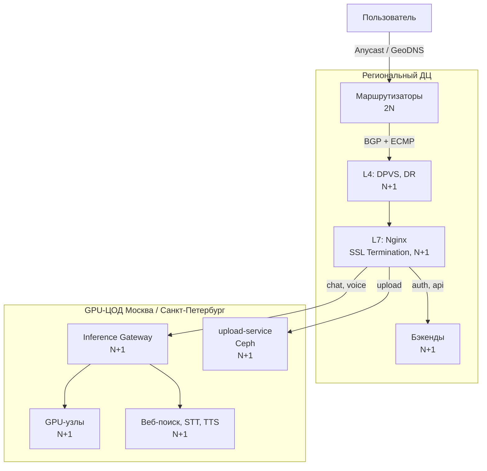
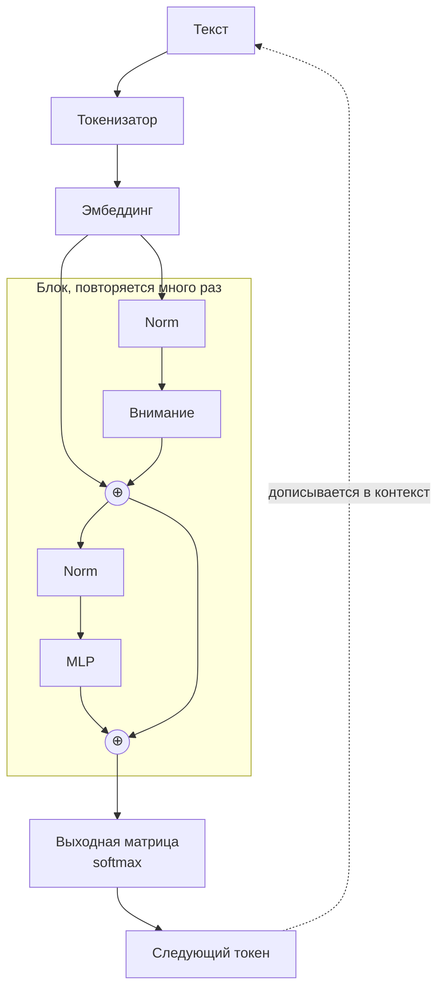
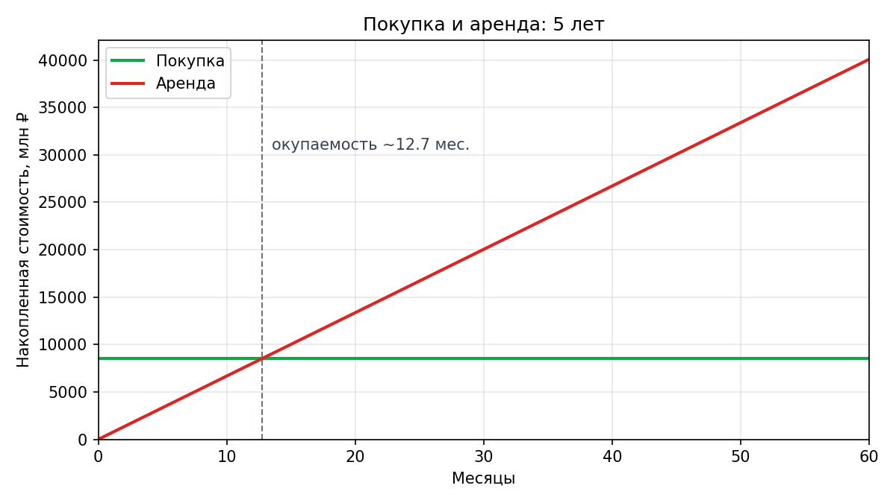

# Рассчетно-пояснительная записка для Курсовой работы по предмету "Разработка высоконагруженных приложений"

### 1. Тема и целевая аудитория

**Тип:** ИИ-сервис (аналог Алиса AI)

**Целевая аудитория:** 4,5 млн DAU, 19,0 млн WAU и 30,0 млн MAU по итогам Q4 2025[^1] (в Q2 2026 WAU достиг 33,2 млн[^2], но в отчете нет ни DAU, ни MAU, поэтому будем ориентироваться на 2025 год). Продукт ориентирован на российский рынок

**Основной функционал MVP:**

Инференс:
1. Регистрация/авторизация пользователя
2. Диалоги с ИИ
3. Голосовой ввод, голосовые ответы
4. Загрузка файлов
5. Интеграция с поиском Яндекса

Обучение:
1. Сбор данных, разрешенных для обучения
2. Подготовка обучающего датасета
3. Дообучение базовой модели
4. Оценка качества новой версии модели
5. Публикация модели в контур инференса

**Ключевые продуктовые решения:**
1. Ответ передается пользователю потоково
2. ИИ-агент самостоятельно вызывает разрешенные инструменты

---

### 2. Расчет нагрузки

Яндекс отчитался о 500-600 тыс. запросов о подборе товаров в сутки[^3]. Такие запросы составляют около 3% от общего количества[^4], поэтому получаем 16,6-20,0 млн запросов в сутки (отчеты были опубликованы с интервалом в два месяца, считаем, что метрики изменились несильно). Для расчетов принимаем среднее значение `(16,6+20,0) / 2 = 18,3`, то есть 18,3 млн. Найдем кол-во запросов в сутки одного пользователя: `18,3 / 4,5 = 4,07` запроса

**Продуктовые метрики:**

| Метрика | Значение |
|---|---:|
| DAU | 4,5 млн |
| MAU | 30,0 млн |

Предполагаем:
- 10% запросов голосовые, 60% вызывают один веб-поиск. Один поисковый запрос возвращает 5 результатов по 500 символов
- 10% запросов содержат вложение: 7% - изображение, 3% - документ
- Среднее изображение - 3 МБ: фото в JPEG и HEIC, скриншоты в PNG. Средний документ - 1,6 МБ: медиана PDF около 0,4 МБ, а среднее в 3-5 раз больше медианы[^5], берем в 4 раза
- Файлы на сервере не сжимаем: JPEG, HEIC, PNG, PDF и DOCX уже сжаты внутри формата (PNG сжат DEFLATE, DOCX - это ZIP-архив). Сжимаются только TXT и DOC, их доля мала
- Файлы хранятся, пока существует чат. Удаление чатов не учитываем, это оценка сверху
- Голосовые запросы храним 30 дней, синтезированные ответы - 7 дней как кэш для повтора, позже ответ синтезируется заново
- Сервис работает год, текущий объем хранилища - данные за год при текущей нагрузке
- 4 символа на токен, 2 байта на символ, скорость речи 900 символов в минуту, Opus 32 Кбит/с
- Текст в ScyllaDB сжимается в 2 раза, для compaction оставляем 30% свободного места, служебные данные в Ceph (бэкапы, метрики, трейсы, веса моделей) занимают 0,1 ПБ

Производные действия входят в запросы к ИИ и не суммируются с ними

Также предполагаем, что каждый DAU авторизуется или создает сессию один раз в сутки. Регистрации не учитываем, так как нагрузка существенно ниже общей нагрузки

| Тип действия | На пользователя в день | Всего в сутки |
|---|---:|---:|
| Запрос к ИИ | 4,07 | 18,30 млн |
| Голосовой запрос | 0,407 | 1,83 млн |
| Загрузка файла | 0,407 | 1,83 млн |
| Вызов веб-поиска агентом | 2,442 | 10,98 млн |
| Авторизация / создание сессии | 1,000 | 4,50 млн |

Обучение:

| Метрика | Значение |
|---|---:|
| Доля данных для обучения | 0,1% |
| Периодичность обучения | раз в месяц |
| Расчетный месяц | 30 дней |
| Размер базовой модели | 70 млрд параметров |
| Размер базовой модели в BF16 | 140 ГБ |
| Размер LoRA-адаптера | 2 ГБ |
| Хранимые адаптеры | 3 версии |
| Запас на checkpoints и оценки | 20% |

**Расчет хранилища:**

Возьмем из публичного датасета ShareChat средние размеры запроса/ответа: 135,04 токена в запросе и 1 115,30 токена в ответе[^6]

- Запрос: `135,04 * 4 = 540` символов
- Ответ: `1 115,30 * 4 = 4 461` символ
- Один запрос-ответ: `(540 + 4 461) * 2 = 10 002` байта
- Текст: `18,3 млн * 10 002 байта = 183 ГБ/сутки`
- Изображения: `18,3 млн * 7% * 3 МБ = 3,84 ТБ/сутки`
- Документы: `18,3 млн * 3% * 1,6 МБ = 0,88 ТБ/сутки`
- Голосовой запрос: `540 / 900 * 60 * 4 000 = 0,144 МБ`
- Голосовой ответ: `4 461 / 900 * 60 * 4 000 = 1,19 МБ`
- Голосовые запросы: `1,83 млн * 0,144 МБ = 263,5 ГБ/сутки`, хранятся 30 дней: `263,5 ГБ * 30 = 7,91 ТБ`
- Голосовые ответы: `1,83 млн * 1,19 МБ = 2,18 ТБ/сутки`, хранятся 7 дней: `2,18 ТБ * 7 = 15,26 ТБ`
- Веб-поиск: `18,3 млн * 60% = 10,98 млн вызовов/сутки`; результаты не храним, но учитываем их передачу в модель: `10,98 млн * 5 * 500 * 2 = 54,90 ГБ/сутки`

Голос хранится ограниченное время, поэтому его объем не растет: `7,91 + 15,26 = 23,17 ТБ`. Суточный прирост составляют текст и файлы: `0,18 + 3,84 + 0,88 = 4,90 ТБ`. Тогда один активный пользователь добавляет за год:

`4 904 ГБ / 4 500 000 * 365 = 0,40 ГБ/польз./год`

Прирост хранилища за год:

`4,90 ТБ * 365 = 1 790 ТБ = 1,79 ПБ`

Текущий объем хранилища - данные за год работы и голос: `1,79 ПБ + 23,17 ТБ = 1,81 ПБ`

Обучение:

Базовая модель в BF16 уже загружена и работает, она учитывается как исходный объем контура обучения

За месяц создается `18,3 млн * 30 = 549 млн` запрос-ответ. В один цикл обучения попадает `549 млн * 0,1% = 549 тыс.` запрос-ответ или `549 тыс. * 10 002 байта = 5,49 ГБ`

Для обучения хранятся исходная, очищенная и токенизированная версии датасета. Они занимают `5,49 ГБ * 3 = 16,47 ГБ` в месяц и `16,47 ГБ * 12 = 197,64 ГБ` за год. Три LoRA-адаптера занимают `2 ГБ * 3 = 6,00 ГБ`

Прирост хранилища обучения без резерва: `197,64 ГБ + 6,00 ГБ = 203,64 ГБ`

Резерв на checkpoints и оценку: `203,64 ГБ * 20% = 40,73 ГБ`. Поэтому полный прирост обучения за год составит `203,64 ГБ + 40,73 ГБ = 244,37 ГБ`

Внутренний сетевой трафик одного цикла (чтение выборки, три записи и передача датасета): `5,49 ГБ * 5 + 2,00 ГБ = 29,45 ГБ`. За первый год: `29,45 ГБ * 12 = 353,40 ГБ`; передача базовой модели не требуется

| Метрика | Значение |
|---|---:|
| Текущий объем хранилища инференса | 1,81 ПБ |
| Прирост на одного активного пользователя за год | 0,40 ГБ |
| Прирост хранилища инференса за год | 1,79 ПБ |
| Текущий объем хранилища обучения | 140,00 ГБ |
| Прирост хранилища обучения за год | 244,37 ГБ |

**Технические метрики:**

На основе расчетов выше легко заключить:

Объем хранилища:
| Тип данных | Количество объектов / сутки | Объем / сутки | Хранится через 30 дней |
|---|---:|---:|---:|
| Текстовые сообщения | 18,30 млн | 0,18 ТБ | 5,49 ТБ |
| Изображения | 1,28 млн | 3,84 ТБ | 115,29 ТБ |
| Документы | 0,55 млн | 0,88 ТБ | 26,35 ТБ |
| Голосовые запросы, 30 дней | 1,83 млн | 0,26 ТБ | 7,91 ТБ |
| Голосовые ответы, 7 дней | 1,83 млн | 2,18 ТБ | 15,26 ТБ |
| **Итого** | — | **7,35 ТБ** | **170,30 ТБ** |

Среднюю пропускную способность посчитаем как `трафик в сутки / 86 400`. Предположим, что 90% суточного трафика приходится на 6 активных часов, а остальные 10% равномерно распределены в течение оставшихся 18 часов. Средняя нагрузка в активный период составит `90% * 24 / 6 = 3,60` от среднесуточной; этот коэффициент используем для расчета пиковой нагрузки:
| Тип трафика | Объем / сутки | Средняя нагрузка | Пиковая нагрузка |
|---|---:|---:|---:|
| Текстовые сообщения | 1 464,40 Гбит | 0,02 Гбит/с | 0,06 Гбит/с |
| Загрузка файлов | 37 771,20 Гбит | 0,44 Гбит/с | 1,57 Гбит/с |
| Голосовые сообщения | 19 525,31 Гбит | 0,23 Гбит/с | 0,81 Гбит/с |
| Результаты веб-поиска | 439,20 Гбит | 0,01 Гбит/с | 0,02 Гбит/с |
| **Итого** | **59 200,11 Гбит** | **0,69 Гбит/с** | **2,47 Гбит/с** |

Аналогично посчитаем RPS как `запросов в день / 86 400`; для пикового RPS используем тот же коэффициент 3,60:
| Метод / тип запроса | Запросов в сутки | Средний RPS | Пиковый RPS |
|---|---:|---:|---:|
| Генерация ответа ИИ | 18,30 млн | 211,81 | 762,50 |
| Загрузка файла | 1,83 млн | 21,18 | 76,25 |
| Распознавание голосового ввода (STT) | 1,83 млн | 21,18 | 76,25 |
| Синтез голосового ответа (TTS) | 1,83 млн | 21,18 | 76,25 |
| Запрос к поиску | 10,98 млн | 127,08 | 457,50 |
| Авторизация / создание сессии | 4,50 млн | 52,08 | 187,50 |

В рамках инференса также посчитаем кол-во токенов в секунду. В таблице учтены пользовательские сообщения, ответы и результаты веб-поиска, без системного промпта и истории диалога

- Входные токены пользовательских сообщений: `18,3 млн * 135,04 / 86 400 = 28 602 токенов/с`
- Входные токены результатов веб-поиска: `10,98 млн * 5 * 500 / 4 / 86 400 = 79 427 токенов/с`
- Выходные токены: `18,3 млн * 1 115,30 / 86 400 = 236 227 токенов/с`
- Нагрузка в активный период: `средняя нагрузка * 3,60`

| Тип токенов | Среднее значение, токенов/с | Нагрузка в активный период, токенов/с |
|---|---:|---:|
| Входные токены пользовательских сообщений | 28 602 | 102 968 |
| Входные токены результатов веб-поиска | 79 427 | 285 938 |
| **Всего входных токенов** | **108 029** | **388 906** |
| Выходные токены | 236 227 | 850 416 |

---

### 3. Глобальная балансировка нагрузки

Ключевым в сервисе являются GPU-кластеры, поэтому многое будет зависеть от их расположения. Такие крупные центры обработки данных (ЦОД) требуют больших вложений и развитой инфраструктуры вокруг (например, наличие мощных электростанций), поэтому много где построить не получится

Большая часть населения РФ проживает в европейской части страны (порядка 4/5 населения[^7]), поэтому инфраструктура там развита хорошо, поэтому и кластеры должны быть там. Крупными городами являются Москва и Санкт-Петербург - размещать GPU-кластеры будем рядом с ними

Хоть и кластеры будут только в двух крупных ЦОД, точка входа для пользователя необязательна находится там же. Вся обработка, связанныая с инференсом LLM и работой агента должны происходить в ЦОД, а отдача статики и реплики данных можно распределить по стране, большую часть разместить в западной части и несколько дата-центров (ДЦ) в Сибири (Новосибирск) и на Дальнем Востоке (Хабаровск). Запросы от модели как правило небыстрые и пользователи знают об этом и могут подождать, но если главная страница будет загружаться долго или вход в аккаунт будет тормозить, то пользователи просто уйдут

Anycast лучше всего использовать для CDN, потому что это stateless запросы. Для коротких запросов, например, регистрация/авторизация, загрузка диалогов, также подойдет Anycast

DNS балансировку надо использовать для загрузки файлов и для потоковой передачи ответа пользователю, так как это долгие stateful операции

Таким образом, получаем разбиение по доменам

| Домен | Назначение | Балансировка |
|---|---|---|
| `ai.domain.ru` | Главная страница, статика (CDN) | Anycast |
| `auth.ai.domain.ru` | Регистрация, авторизация | Anycast |
| `api.ai.domain.ru` | История диалогов, настройки | Anycast |
| `chat.ai.domain.ru` | Потоковая передача ответа ИИ | DNS |
| `voice.ai.domain.ru` | Голосовой ввод и ответ | DNS |
| `upload.ai.domain.ru` | Загрузка файлов | DNS |

Так как пользователи напрямую не будут делать запросы в ЦОД, то для выполнения запроса будет выбираться наименее нагруженный ЦОД. Причем сессию пользователя необходимо закрепить за конкретным ЦОД на некоторое время, потому что там может сохранится KV-кэш предыдущего контекста

Будем считать, что распределение запросов будет примерно соответствовать распределению населения по стране, то есть на ДЦ в западной части страны будет приходится порядка 80% запросов

---

### 4. Локальная балансировка нагрузки

**Резервирование:**

| Уровень | Резервирование |
|---|---|
| Маршрутизаторы | 2N |
| DPVS | N+1 |
| Nginx | N+1 |
| Бэкенды, хранилище | N+1 |
| Inference Gateway | N+1 |
| GPU-узлы | N+1 |
| GPU-ЦОД | Второй GPU-ЦОД |

2N - для маршрутизаторов, так как их отказ отключает весь ДЦ. N+1 - для взаимозаменяемых узлов, отказ одного снижает только общую мощность

**L4 и L7:**

L4 - DPVS в режиме Direct Route (DR): пересылает входящие пакеты на Nginx, ответы идут клиенту напрямую. Узел Nginx выбирается через Maglev hashing, поэтому отказ узла DPVS не обрывает соединения

L7 - Nginx: SSL Termination и маршрутизация по домену

**Балансировка входящих запросов:**

Короткие запросы `auth` и `api` распределяются через round robin, а долгие `upload`, `chat` и `voice` через least connections

**Балансировка межсервисных запросов:**

Внутри ДЦ - service discovery и балансировка на стороне клиента (sidecar Envoy)

| Откуда - куда | Алгоритм |
|---|---|
| Бэкенды - бэкенды | Round robin |
| Бэкенды - БД | Запись в мастер, чтение round robin по репликам |
| inference-router - GPU-узлы | Взвешенный consistent hashing по `dialog_id` |
| inference-router - веб-поиск, STT, TTS | Least request |

Веса GPU-узлов пропорциональны их фактической скорости генерации; узел с заполненным KV-кэшем временно исключается

**Ограничители: SSL Termination и пропускная способность**

DPVS в режиме DR пропускает только входящий трафик и ограничителем не является, поэтому считаем L7

Пиковый RPS: `187,50 (auth) + 762,50 (chat, включая голосовые) + 76,25 (upload) = 1 026,25`. Нагрузку на `api` в разделе 2 не считали. Предполагаем, что на каждый запрос к ИИ клиент делает 2 запроса к `api`: загрузка списка диалогов и истории выбранного диалога: `762,50 * 2 = 1 525,00`. Итого `2 551 RPS`. Статику отдает CDN

Считаем, что каждый запрос открывает новое TLS-соединение (оценка сверху)

- По данным 2017 года (RSA 2048, 428 CPS на ядро[^8]): `2 551 / 428 = 5,96 => 6 ядер`
- По данным 2019 года (4 433 TPS на ядро[^9]): `2 551 / 4 433 = 0,58 => 1 ядро`
- Сеть: пик 2,47 Гбит/с; 10 GbE при загрузке 70% - 7 Гбит/с

Распределение по ДЦ (80% - западная часть страны). Ядра CPU считаем по более строгим данным 2017 года: `RPS / 428`. Одного сервера (16 ядер, 10 GbE) хватает для каждого ДЦ, с резервом N+1 - по 2 сервера DPVS и 2 сервера Nginx

| ДЦ | Доля | Пиковый RPS | Пиковый трафик | Ядер CPU на SSL | Серверов DPVS | Серверов Nginx |
|---|---:|---:|---:|---:|---:|---:|
| Москва | 55% | 1 403,2 | 1,36 Гбит/с | 4 | 2 | 2 |
| Санкт-Петербург | 25% | 637,8 | 0,62 Гбит/с | 2 | 2 | 2 |
| Новосибирск | 12% | 306,1 | 0,30 Гбит/с | 1 | 2 | 2 |
| Хабаровск | 8% | 204,1 | 0,20 Гбит/с | 1 | 2 | 2 |
| **Итого** | 100% | 2 551,3 | 2,47 Гбит/с | - | **8** | **8** |

При отказе ДЦ в Москве Санкт-Петербург получает 80% нагрузки: 1,97 Гбит/с и `2 041 / 428 = 4,77 => 5 ядер`. Помещается в один сервер

Итого: 8 серверов DPVS, 8 серверов Nginx и 8 Inference Gateway (по 4 в каждом GPU-ЦОД)

**Итоговая схема балансировки:**



---

### 5. Логическая схема БД

```mermaid
erDiagram
    users ||--|| credentials : "учетные данные"
    users ||--o{ sessions : "входит"
    users ||--o{ subscriptions : "история подписок"
    plans ||--o{ subscriptions : "тариф"
    users ||--o{ payments : "история оплат"
    subscriptions ||--o{ payments : "оплачена"
    currencies ||--o{ plans : "валюта"
    currencies ||--o{ payments : "валюта"
    users ||--o{ payment_methods : "способы оплаты"
    payment_methods ||--o{ payments : "списание"
    payments ||--o{ payment_events : "вебхуки"
    payments ||--o{ refunds : "возвраты"
    refunds |o--o{ payment_events : "вебхуки возврата"
    users ||--o{ dialogs : "создает"
    dialogs ||--o{ messages : "содержит"
    messages }o--o{ blobs : "вложения"
    model_versions ||--o{ messages : "сгенерировала"
    messages ||--o{ training_samples : "отобраны"
    datasets ||--o{ training_samples : "включает"
    datasets ||--|| blobs : "файл датасета"
    base_models ||--|{ blobs : "веса, токенизатор"
    base_models ||--o{ datasets : "токенизатор"
    base_models ||--o{ training_runs : "дообучается"
    base_models ||--o{ model_versions : "основа"
    datasets ||--o{ training_runs : "используется"
    training_runs ||--o{ checkpoints : "сохраняет"
    checkpoints ||--|| blobs : "веса адаптера"
    checkpoints ||--o{ evaluations : "оценен"
    checkpoints ||--o| model_versions : "опубликован"

    users ||..o{ uploads : "загружает"
    dialogs ||..o{ uploads : "файлы диалога"
    messages |o..o{ uploads : "вложения"
    uploads ||..o| blobs : "собирается"
    dialogs ||..o| dialog_context_cache : "контекст"
    model_versions ||..o{ dialog_context_cache : "токенизатор"
    dialogs ||..o| kv_cache : "KV-кэш"
    users ||..o{ fact_requests : "DWH"
    plans ||..o{ fact_requests : "DWH"
    model_versions ||..o{ fact_requests : "DWH"

    credentials {
        uuid user_id PK, FK
        string login UK
        string password_hash
    }
    users {
        uuid user_id PK
        string login UK
        string name
        json settings
        bool allow_training
        timestamp created_at
    }
    sessions {
        string token_hash PK
        uuid user_id FK
        string device
        string ip
        timestamp created_at
        timestamp expires_at
    }
    currencies {
        string currency_code PK "ISO 4217: RUB"
        string name
    }
    plans {
        uuid plan_id PK
        string name
        bigint price
        string currency_code FK
        json limits "запросов в день, голос, файлы"
        bool is_active
    }
    subscriptions {
        uuid subscription_id PK
        uuid user_id FK
        uuid plan_id FK
        enum status "active / cancelled / expired"
        bool auto_renew
        timestamp started_at
        timestamp ended_at
    }
    payments {
        uuid payment_id PK
        uuid user_id FK
        uuid subscription_id FK
        uuid payment_method_id FK
        bigint amount "копейки, центы"
        string currency_code FK
        enum status "pending / succeeded / failed / refunded"
        string provider_payment_id UK
        string idempotency_key UK
        timestamp created_at
        timestamp paid_at
    }
    payment_methods {
        uuid payment_method_id PK
        uuid user_id FK
        enum type "card / sbp / yoomoney"
        string provider_token "токен провайдера, не номер карты"
        string title "Visa *1234"
        bool is_default
        bool is_deleted
        timestamp created_at
    }
    payment_events {
        string provider PK "yookassa / cloudpayments"
        string event_id PK "id события у провайдера"
        uuid payment_id FK
        uuid refund_id FK "пусто, если событие не о возврате"
        enum event_type "succeeded / failed / refunded"
        json payload "тело вебхука"
        enum status "received / processed / ignored"
        timestamp received_at
        timestamp processed_at
    }
    refunds {
        uuid refund_id PK
        uuid payment_id FK
        bigint amount "копейки, центы; не больше суммы платежа"
        string reason
        enum status "pending / succeeded / failed"
        string provider_refund_id UK
        string idempotency_key UK
        timestamp created_at
        timestamp refunded_at
    }
    dialogs {
        uuid dialog_id PK
        uuid user_id FK
        string title
        bool is_deleted
        timestamp created_at
        timestamp updated_at
    }
    messages {
        uuid message_id PK
        uuid dialog_id FK
        uuid user_id FK
        int seq
        enum role "user / assistant / tool"
        text content "текст или вызов инструмента"
        enum status "generating / done / error"
        uuid model_version_id FK
        json attachments "kind, object_key, mime_type, original_name, size"
        timestamp created_at
    }
    blobs {
        string object_key PK
        bytes data
        bigint size
        string checksum
        timestamp created_at
    }
    uploads {
        uuid dialog_id PK
        uuid upload_id PK
        uuid user_id FK
        uuid message_id FK "пусто, пока файл не отправлен"
        string original_name
        string mime_type
        enum kind "image / document"
        int total_size
        int part_size
        int parts_received "битовая маска"
        string multipart_id
        string object_key FK "оригинал в blobs"
        string converted_key "ключ в Ceph"
        enum status "uploading / assembling / converting / done / failed"
        timestamp created_at
        timestamp expires_at
    }
    base_models {
        uuid base_model_id PK
        string name
        bigint params_count
        enum dtype
        string weights_object_key FK
        string tokenizer_object_key FK
        timestamp created_at
    }
    model_versions {
        uuid model_version_id PK
        uuid base_model_id FK
        uuid checkpoint_id FK
        enum status "candidate / canary / published / archived"
        int rollout_percent "доля выкатки"
        timestamp published_at
    }
    training_samples {
        uuid sample_id PK
        uuid dataset_id FK
        uuid dialog_id FK
        int request_seq
        int response_seq
    }
    datasets {
        uuid dataset_id PK
        int version
        enum stage "raw / clean / tokenized"
        uuid base_model_id FK "токенизатор для tokenized"
        string object_key FK
        bigint size
        timestamp created_at
    }
    training_runs {
        uuid run_id PK
        uuid dataset_id FK
        uuid base_model_id FK
        json params
        enum status
        timestamp started_at
        timestamp finished_at
    }
    checkpoints {
        uuid checkpoint_id PK
        uuid run_id FK
        int step
        string object_key FK
        float loss
        timestamp created_at
    }
    evaluations {
        uuid evaluation_id PK
        uuid checkpoint_id FK
        string benchmark "имя и версия"
        json metrics "name, value, baseline, threshold"
        bool passed
        timestamp created_at
    }
    dialog_context_cache {
        uuid dialog_id PK
        uuid model_version_id FK
        bytes context "собранный промпт"
        int total_tokens
        int last_seq
        timestamp expires_at
    }
    kv_cache {
        uuid dialog_id PK
        bytes tensors
        int tokens
        timestamp expires_at
    }
    web_cache {
        string url_hash PK
        string url
        text content
        int http_status
        string etag
        timestamp fetched_at
        timestamp expires_at
    }
    fact_requests {
        timestamp ts
        uuid user_id
        uuid plan_id
        uuid model_version_id
        enum dc "msk / spb"
        int input_tokens
        int output_tokens
        int ttft_ms "время до первого токена"
        int duration_ms
        enum status "done / error / cancelled"
        bool has_search
        bool has_voice
        bool has_file
    }
```



---

### 6. Физическая схема БД

**Выбор СУБД:**

| Таблицы | СУБД | Почему |
|---|---|---|
| credentials | PostgreSQL, база auth-service | Небольшая таблица, нужны транзакции и уникальный логин |
| users, currencies, plans, subscriptions, payments, payment_methods, payment_events, refunds, base_models, model_versions, datasets, training_samples, training_runs, checkpoints, evaluations | PostgreSQL | Небольшие таблицы, нужны транзакции: оплата и продление подписки - одна транзакция |
| messages, dialogs | ScyllaDB | 70 ТБ и 1,45 млрд диалогов в год, много записи, чтение по ключу партиции |
| blobs | Ceph | Петабайты файлов, S3 API, erasure coding |
| Данные uploads | Ceph, временный бакет | Части загрузки через S3 Multipart и результаты преобразования, lifecycle-политика удаляет данные по TTL |
| sessions, dialog_context_cache, web_cache, метаданные uploads, счетчики лимитов | Redis | Данные в памяти с коротким TTL |
| kv_cache | Память GPU (SGLang) | Живет рядом с вычислением |
| fact_requests | ClickHouse | Колоночное хранение, агрегаты по миллиардам строк |

dialogs в ScyllaDB: 1,45 млрд строк в год (`18,3 млн / 4,62 * 365`, 4,62 запроса в диалоге - среднее по ShareChat[^6]), транзакции не нужны, список читается по `user_id`

Контекст диалога - Redis-хэш `ctx:{dialog_id}`: `model_version_id`, `total_tokens`, `last_seq` и `context` (промпт, сжатый zstd, 35 -> 12 КБ)

**Индексы:**

| Таблицы | Ключи и индексы |
|---|---|
| credentials, users | `UNIQUE (login)` |
| subscriptions | `INDEX (user_id, started_at DESC)` - история; `UNIQUE (user_id) WHERE status = 'active'` - одна активная подписка |
| payments | `INDEX (user_id, created_at DESC)` - история; `UNIQUE (idempotency_key)` - повторный запрос не создает второе списание; `UNIQUE (provider_payment_id)` - один платеж провайдера соответствует одной строке |
| payment_events | `PRIMARY KEY (provider, event_id)` - повторный вебхук не обрабатывается дважды; `INDEX (payment_id)` - события платежа; `INDEX (refund_id)` - события возврата |
| refunds | `INDEX (payment_id)` - возвраты платежа; `UNIQUE (idempotency_key)` - повторный запрос не создает второй возврат; `UNIQUE (provider_refund_id)` - один возврат провайдера соответствует одной строке |
| model_versions | `UNIQUE (status) WHERE status = 'published'` |
| datasets | `UNIQUE (version, stage)` |
| training_samples, training_runs | `INDEX (dataset_id)` |
| checkpoints | `INDEX (run_id)` |
| evaluations | `INDEX (checkpoint_id)` |
| messages | Ключ партиции `dialog_id`, сортировка `seq DESC` |
| dialogs | `dialogs`: партиция `user_id`, сортировка `dialog_id`; `dialogs_by_updated`: партиция `user_id`, сортировка `(updated_at DESC, dialog_id)` |
| blobs | Ключ `object_key` в бакете |
| uploads | Redis-хэш `uploads:{dialog_id}`, поле - `upload_id`. Данные по `tmp/{upload_id}/...` во временном бакете |
| sessions | Ключ `session:{token_hash}`, обратный индекс `user_sessions:{user_id}` |
| Счетчики лимитов | Ключ `quota:{user_id}:{дата}`, `INCR` на каждый запрос, TTL 48 часов |
| dialog_context_cache, web_cache | Ключи `ctx:{dialog_id}`, `web:{url_hash}` |
| kv_cache | Ключ `dialog_id` |
| fact_requests | `PARTITION BY toYYYYMM(ts)`, `ORDER BY (ts, user_id)` |

При новом сообщении строка в `dialogs_by_updated` пересоздается с новым `updated_at` одним batch внутри партиции

**Шардирование и резервирование:**

| Таблицы | Шардирование | Резервирование |
|---|---|---|
| credentials | Нет | Мастер, синхронная реплика в другом ЦОД, асинхронные в регионах |
| users, currencies, plans, subscriptions, payments, payment_methods, payment_events, refunds | Нет | Мастер и синхронная реплика в другом ЦОД |
| base_models, model_versions, datasets, training_samples, training_runs, checkpoints, evaluations | Нет | Мастер и синхронная реплика |
| messages | Кольцо токенов по `dialog_id` | RF 3 в каждом ЦОД (Москва и СПб), чтение и запись `LOCAL_QUORUM` |
| dialogs | Кольцо токенов по `user_id` | RF 3 в каждом ЦОД (Москва и СПб), чтение и запись `LOCAL_QUORUM` |
| blobs | CRUSH по `object_key` | EC 8+3 в каждом ЦОД, RGW multisite: полная копия в Москве и СПб |
| Временный бакет | CRUSH по `object_key` | 2 реплики внутри ЦОД, данные живут часы |
| sessions | Нет | Мастер в Москве, реплика в каждом ДЦ |
| dialog_context_cache (context-service) | 2 шарда по CRC16 | Реплика на шард |
| web_cache (web-search-service) | 5 шардов по CRC16 | Реплика на шард |
| Метаданные uploads (upload-service) | 1 шард | Реплика на шард |
| Счетчики лимитов (quota-service) | 1 шард | Реплика на шард |
| kv_cache | Consistent hashing по `dialog_id` | Нет, пересчитывается |
| fact_requests | Нет | 2 реплики через ClickHouse Keeper, в Москве и СПб |

Объем с учетом резервирования за год:

| Таблицы | Расчет |
|---|---|
| messages, dialogs | messages: `13,36 млрд сообщений * 5 097 Б (средний текст 10 002 / 2 = 5 001 Б и 96 Б служебных полей) + 4,01 млрд вызовов инструментов * 378 Б = 69,6 ТБ`. dialogs с `dialogs_by_updated`: `1,45 млрд * (149 + 140) Б = 0,42 ТБ`. На конец первого года хранится 2 года данных (накопленный год и прирост): `(69,6 + 0,42) ТБ * 2 = 140 ТБ`. `140 ТБ * 6 (RF 3 в двух ЦОД) / 2 (сжатие) = 420,1 ТБ`. Стратегия компакции ICS снижает временный запас места, который нужен STCS (50% свободного диска)[^10], поэтому оставляем 30%: `420,1 / 0,7 / 8 = 75,02 => 76` узлов по 8 ТБ, по 38 в каждом ЦОД |
| blobs | Файлы за 2 года, голос и служебные данные: `1,72 ПБ * 2 + 0,023 + 0,1 = 3,57 ПБ`. EC 8+3 в каждом из двух ЦОД: `3,57 ПБ * 11 / 8 * 2 = 9,82 ПБ`, по 4,91 ПБ на ЦОД. Сервер - 24 HDD по 24 ТБ, 576 ТБ. Для EC 8+3 нужно не меньше `k + m = 11` хостов, рекомендуется `k + m + 1 = 12`[^11]. Ceph предупреждает о заполнении на 85% и останавливает запись на 95%[^12], поэтому целевое заполнение - 75%: `4,91 / 0,75 / 0,576 = 11,4 => 12` серверов на ЦОД, 24 всего. Заполнение 71%, при отказе сервера `4,91 / (11 * 0,576) = 77%`, ниже 85%. Прирост за год `1,72 ПБ * 11 / 8 = 2,37 ПБ` на ЦОД, или `2,37 / 0,75 / 0,576 = 5,5` - около 6 серверов на ЦОД |
| Временный бакет | `(6,1 ГБ (части загрузок) + 961 ГБ (результаты преобразования)) * 2 = 1,93 ТБ` |
| Redis по сервисам, шард ~12 ГБ | context: `1,37 млн * 12 КБ = 16,4 ГБ`, 2 288 оп/с - 2 шарда; web_cache: 59 ГБ, 3 889 оп/с - 5 шардов; uploads: 0,57 ГБ, 610 оп/с - 1 шард; счетчики лимитов: `4,5 млн * 2 дня * 100 Б = 0,9 ГБ`, `762,5 + 76,25 = 839` оп/с - 1 шард. Всего 9 шардов, до 12 ГБ и около 1,1 тыс. оп/с на шард |
| fact_requests | `407 ГБ / 5 (сжатие) * 2 (реплики) = 163 ГБ` |

**Балансировка и мультиплексирование:**

| СУБД | Как балансируем |
|---|---|
| PostgreSQL | PgBouncer (transaction) сводит тысячи соединений к ~100, мастера выбирает Patroni, чтение round robin по репликам |
| ScyllaDB | Драйвер шлет запрос сразу на нужный узел и ядро, в ближайший ЦОД |
| Redis Cluster | Клиент хранит карту слотов, переходит по `MOVED` |
| Ceph | Несколько RGW за Nginx, least connections |
| ClickHouse | Запись пачками через kafka-loader (worker pool читает Kafka), чтение с любой из двух реплик |

**Резервное копирование:**

| СУБД | Схема |
|---|---|
| PostgreSQL | WAL-G: полный бэкап раз в неделю, инкрементальный раз в сутки, архив WAL, хранение 30 дней |
| ScyllaDB | Scylla Manager: снапшот messages и dialogs раз в сутки, хранение 30 дней |
| Ceph | blobs: полной копии нет, EC, репликация между ЦОД, версионирование 7 дней. Временный бакет не бэкапим |
| Redis (sessions) | RDB раз в час и AOF |
| ClickHouse | clickhouse-backup раз в сутки в Ceph, хранение 30 дней |
| Остальные кэши и временные данные | Не бэкапим |

---

### 7. Алгоритмы

#### Трансформер

Модель по последовательности токенов предсказывает следующий токен[^13]. Ответ строится повторением: предсказанный токен дописывается в контекст, и модель запускается снова



1. Токенизация: текст режется на токены - куски слов из словаря размера `V`
2. Эмбеддинг: токен заменяется вектором размера `d` из обучаемой таблицы `V * d`
3. `L` блоков: внимание подмешивает в вектор информацию из предыдущих токенов, MLP обрабатывает каждый токен отдельно
4. Выход: вектор последнего токена умножается на матрицу `d * V`, softmax дает вероятности токенов словаря, по ним выбирается следующий

Блок прибавляет к вектору поправку, а не заменяет его (остаточная связь). Norm держит масштаб вектора:

```
x = x + Attention(Norm(x))
x = x + MLP(Norm(x))
```

Так градиент доходит до первых блоков без затухания. MLP - два линейных слоя с нелинейностью: `MLP(x) = W2 * act(W1 * x)`

**Внимание**

Внимание решает, какие предыдущие токены важны для текущего. Во фразе «Кошка не перешла дорогу, потому что она устала» токен «она» должен взять информацию у «кошки», а не у «дороги»

Из вектора `x` токена получаются запрос `q = x * W_Q` (что токен ищет), ключ `k = x * W_K` (что предлагает) и значение `v = x * W_V` (что передаст). Для токена `i`:

1. Близость к каждому токену `j <= i`: `s_ij = q_i · k_j / sqrt(d_k)`, где `d_k` - размер `q` и `k`. Без деления на `sqrt(d_k)` значения растут с размерностью, softmax выбирает один токен, и градиент пропадает
2. Веса: `a_ij = softmax_j(s_ij)`
3. Выход: `out_i = sum_j(a_ij * v_j)`

В матричном виде:

```
Attention(Q, K, V) = softmax(Q * K^T / sqrt(d_k) + M) * V
```

`M` - причинная маска: `-inf` при `j > i`, токен не видит будущее. Поэтому модель обучается на всех позициях текста за один проход

**Головы внимания**

Голова - один экземпляр внимания со своими `W_Q`, `W_K`, `W_V`. В блоке `h` голов работают параллельно: каждая получает свои `q`, `k`, `v` размера `d_k = d / h` и выделяет свои связи между токенами. Выходы склеиваются в вектор размера `d` и умножаются на `W_O`. Вычислений столько же, сколько у одной головы размера `d`

- GQA: `h` голов запросов делят меньшее число `h_kv` голов ключей и значений. Качество почти то же, KV-кэш меньше в `h / h_kv` раз
- RoPE: позиция кодируется поворотом `q` и `k` на угол, пропорциональный номеру токена. Близость зависит от расстояния между токенами, а не от их абсолютных позиций

**KV-кэш, prefill и decode**

Из-за маски ключи и значения прошлых токенов не меняются: их считают один раз и хранят, это KV-кэш. На токен он занимает `2 (K и V) * L * h_kv * d_k * b`, где `b` - байт на число (2 для BF16)

- Prefill: промпт проходит через модель одним параллельным проходом и заполняет кэш. Упирается в вычисления, определяет время до первого токена
- Decode: каждый шаг обрабатывает один новый токен и читает все веса и весь кэш. Упирается в пропускную способность памяти

Если начало промпта совпадает с уже обработанным, prefill нужен только для новой части. SGLang хранит кэш в префиксном дереве и находит общий префикс (RadixAttention[^14])

#### Параллелизм

Модель с `Ψ` параметрами занимает `2Ψ` байт в BF16: у нас 140 ГБ при 80 ГБ на GPU и 8 GPU в узле. В одну GPU модель не помещается, ее делят между несколькими

| Вид | Что делится | Обмен | Инференс | Обучение |
|---|---|---|---|---|
| Тензорный | Матрицы каждого слоя | 2 all-reduce на блок | Внутри узла, `t = 8` | Нет |
| По данным | Запросы или батч | Инференс - нет, обучение - градиенты | Узел - копия модели | ZeRO-3 на 8 GPU |

**Уровни вложенности**

NVLink внутри узла на порядок быстрее сети между узлами, поэтому чем чаще обмен, тем глубже уровень:

```
Кластер: N копий модели          <- по данным, обмена нет
└── Узел: t GPU по NVLink        <- тензорный, 2L all-reduce на токен
```

Всего GPU: `t * N`

- Инференс (SGLang): `t = 8`. На GPU 17,5 ГБ весов, остальное под KV-кэш. Копии модели - узлы, запросы между ними распределяет Inference Gateway по `dialog_id`
- Обучение (DeepSpeed): один узел, ZeRO-3 на 8 GPU, обучается только адаптер. Если узла не хватит, ZeRO-3 растягивается на несколько

**Тензорный параллелизм (инференс)**

Матрицы режутся так, чтобы GPU считала свою часть блока сама, а обмен был только в конце (Megatron[^15])

- MLP: `W1` делится по выходам на `t` частей, GPU `i` считает `u_i = act(W1_i * x)` без обмена, так как нелинейность поэлементная. `W2` делится по входам, GPU считает `y_i = W2_i * u_i`. All-reduce складывает `y = y_1 + ... + y_t` на всех GPU
- Внимание: на GPU `h / t` голов и их KV-кэш, головы независимы и обмен не нужен. При `h_kv < t` голова ключей и значений копируется на несколько GPU. `W_O` делится по входам, результаты складывает второй all-reduce

Итого `2L` all-reduce на токен, поэтому только внутри узла. Веса на GPU: `2Ψ / t`

**Параллелизм по данным и ZeRO (обучение)**

DDP: на каждой из `N` GPU копия модели, батч делится на `N` частей, градиенты усредняются через all-reduce, и все копии делают одинаковый шаг. При обучении с Adam в смешанной точности на параметр хранится 16 Б: вес FP16 (2 Б), градиент FP16 (2 Б), состояние Adam в FP32 (12 Б: копия веса, момент, дисперсия). Все `N` GPU хранят одно и то же

ZeRO[^16] делит эти данные на `N` частей, каждая GPU хранит и обновляет свою:

| Стадия | Что делится | Память на GPU |
|---|---|---|
| DDP | Ничего | `16Ψ` |
| ZeRO-1 | Состояние оптимизатора | `4Ψ + 12Ψ / N` |
| ZeRO-2 | И градиенты | `2Ψ + 14Ψ / N` |
| ZeRO-3 | И веса | `16Ψ / N` |

ZeRO-3: GPU постоянно хранит `1 / N` весов каждого слоя. Перед вычислением слоя в прямом и обратном проходе веса собираются через all-gather и после освобождаются. Градиенты сводит reduce-scatter: каждая GPU получает градиент своей части и обновляет ее. Обмен в 1,5 раза больше, чем у DDP. Память активаций ZeRO не уменьшает

С LoRA 16 Б на параметр нужны только адаптеру. Замороженная база занимает `2Ψ`, ZeRO-3 делит ее на 8 GPU: `140 / 8 = 17,5 ГБ` на карту

#### LoRA

Полное дообучение требует `16Ψ` памяти и дает новую копию весов. LoRA[^17] обучает только небольшую добавку к весам

Дообучение меняет матрицу на `ΔW`. Авторы показали, что у `ΔW` низкий ранг, поэтому ее можно записать произведением двух узких матриц:

```
W' = W + (α / r) * B * A
y  = W * x + (α / r) * B * (A * x)
```

- `W` - исходная матрица `d_out * d_in`, заморожена
- `A` - матрица `r * d_in`, сжимает вход до `r` чисел; `B` - матрица `d_out * r`, разворачивает обратно
- `r` - ранг, `r << d`
- `α` - сила адаптера. Деление на `r` позволяет менять ранг без подбора скорости обучения

Обучается `r * (d_in + d_out)` параметров вместо `d_in * d_out`: при `d = 8 192` и `r = 64` - 1,05 млн вместо 67,1 млн, в 64 раза меньше. Адаптеры ставят на проекции внимания и матрицы MLP

Обучение:

1. `A` - случайная, `B` - нули. Тогда `B * A = 0`, и на старте модель совпадает с базовой
2. Ошибка - кросс-энтропия следующего токена на ответах из датасета
3. Обратный проход идет через всю сеть, но градиенты и состояние оптимизатора есть только у `A` и `B`. Память активаций та же, что при полном дообучении

Что дает:

- Версии: база хранится один раз, версия - адаптер на 2 ГБ, откат - подключение прошлого адаптера
- Скорость инференса не меняется: время слоя `O(T_base + T_LoRA)`, а `T_LoRA / T_base = r * (d_in + d_out) / (d_in * d_out)` - 1,6% при `d = 8 192` и `r = 64`. Если сложить адаптер с весами, добавки нет совсем, но эта копия весов работает только с одним адаптером

---

### 8. Технологии

**Разработка**

| Технология | Где используется | Альтернативы | Почему выбрали |
|---|---|---|---|
| Go | Бэкенды `auth`, `user`, `dialog`, `upload` и Inference Gateway | Java / Kotlin, Rust, C++ | Тысячи долгих стриминговых соединений держатся на дешевых горутинах, а не на потоках ОС |
| TypeScript | Код веб-клиента | JavaScript, Dart (Flutter Web) | Ошибки типов ловятся при сборке, а не у пользователя, типы API генерируются из контрактов бэкенда |
| Svelte | UI чата: список диалогов, потоковый вывод ответа, загрузка файлов | React, Vue, SolidJS | Компилируется без виртуального DOM, бандл маленький, и главная открывается быстро. Синтаксис проще, чем у SolidJS, и экосистема больше |
| gRPC | Взаимодействие бэкендов между собой, Inference Gateway - веб-поиск, STT, TTS | REST / JSON | Строгий контракт в `.proto` вместо расходящегося JSON, Protobuf компактнее, HTTP/2 со стримингом |
| HTTP/2, REST + JSON | Клиентский API `auth`, `api`, `upload`. Поверх HTTP/2 идут SSE и gRPC | HTTP/1.1, HTTP/3 (QUIC), GraphQL | Запросы идут параллельно в одном TLS-соединении. HTTP/3 лучше на мобильных сетях, но при смене сети меняется адрес клиента, и Maglev теряет соединение |
| SSE | Потоковая передача ответа клиенту на `chat` и `voice` | WebSocket, long polling | Ответ генерируется около 22 с и идет только от сервера к клиенту. После обрыва генерация продолжается, готовый ответ клиент забирает через `api` |

**Хранение данных**

Выбор СУБД обоснован выше, здесь добавлены альтернативы

| Технология | Где используется | Альтернативы | Почему выбрали |
|---|---|---|---|
| PostgreSQL | users, base_models, model_versions, данные обучения | MySQL, CockroachDB, MongoDB | Транзакции и уникальные ключи для небольших связанных таблиц, частичные индексы, Patroni, PgBouncer, WAL-G |
| ScyllaDB | messages, dialogs | Apache Cassandra | 70 ТБ в год с интенсивной записью. Совместима с Cassandra, но на C++ и shard-per-core: без пауз GC |
| Redis | sessions, dialog_context_cache, web_cache, метаданные uploads | Memcached, Tarantool | Данные читаются на каждом запросе, нужна память. TTL, хэши и шардирование в Redis Cluster из коробки |
| Ceph | blobs, временный бакет для uploads | MinIO | Петабайты в своих ЦОД: S3 API с Multipart и удалением по TTL, erasure coding 8+3 вместо тройной репликации, репликация между площадками |

**Асинхронное взаимодействие**

| Технология | Где используется | Альтернативы | Почему выбрали |
|---|---|---|---|
| Kafka | Шина событий: готовые ответы идут в отбор training_samples, логи и fact_requests в ClickHouse, задачи на очистку blobs | RabbitMQ | События не теряются при отказе получателя: лог хранится и перечитывается. Есть коннекторы к Spark и ClickHouse |

**Инференс**

| Технология | Где используется | Альтернативы | Почему выбрали |
|---|---|---|---|
| SGLang | Сервинг LLM на GPU-узлах | vLLM, TGI, TensorRT-LLM | По скорости сопоставим с vLLM, берем за RadixAttention[^14]: кэш префикса переиспользуется между запросами одного диалога, а 70B-модель делим по 8 GPU узла тензорным параллелизмом `--tp 8`[^18] |
| Whisper | Сервис STT для `voice` | NVIDIA NeMo (Parakeet), GigaAM, Vosk, Dessa | Открытые веса, хорошо распознает русский, голос не уходит во внешний сервис |
| Silero TTS | Сервис TTS для `voice` | XTTS-v2, CosyVoice, Piper, Dessa | Обучен на русском, сам ставит ударения и «ё». Быстрее реального времени на CPU, GPU остаются для LLM |

**Обучение**

| Технология | Где используется | Альтернативы | Почему выбрали |
|---|---|---|---|
| Apache Spark | Подготовка датасета: очистка, MinHash + LSH дедупликация, токенизация | Apache Flink, Ray Data | Задача решается и на Hadoop MapReduce, Spark берем за готовый `MinHashLSH` и запуск в Kubernetes без кластера Hadoop |
| PyTorch | Дообучение LoRA-адаптера базовой модели | TensorFlow, JAX | Стандарт для LLM: PEFT для LoRA, веса сразу подходят SGLang |
| DeepSpeed | Распределение обучения по 8 GPU узла, ZeRO-3 | PyTorch FSDP, PyTorch DDP | Веса (140 ГБ) не помещаются в одну GPU на 80 ГБ, ZeRO-3 делит их между 8 картами. DeepSpeed[^19] подключается к Hugging Face Trainer одним конфигом |
| lm-evaluation-harness | Оценка версии модели, результаты пишутся в evaluations | OpenCompass | Проверяет, что новая версия не хуже текущей: готовые бенчмарки и свои задачи на русском |

**Инфраструктура**

| Технология | Где используется | Альтернативы | Почему выбрали |
|---|---|---|---|
| Kubernetes | Оркестрация всех сервисов, включая GPU-узлы | Nomad, Docker Swarm, Podman | Сотни сервисов разворачиваются, масштабируются и перезапускаются сами. GPU через device plugin, стандарт индустрии |
| Helm | Шаблоны манифестов для каждого сервиса и ЦОД | Kustomize, Jsonnet | Один шаблон вместо копий манифестов на каждый ЦОД, релизы с откатом, Argo CD поддерживает нативно |
| Nginx | L7-балансировщик за DPVS | HAProxy, Envoy, Traefik | Быстрая TLS-терминация[^8][^9], маршрутизация по домену, стриминг без буферизации, `limit_req` против ботов |
| Service Mesh (Istio, Envoy) | Sidecar Envoy для межсервисной балансировки и mTLS | Consul Connect | Discovery, ретраи и mTLS без кода в сервисах, Envoy умеет least request и consistent hashing |
| Terraform | Описание инфраструктуры ЦОД в коде | OpenTofu, Pulumi | Серверы, сети и DNS описаны декларативно и не расходятся, план изменений виден до применения |
| Ansible | Настройка ОС, драйверов GPU, DPVS и узлов Kubernetes на серверах ЦОД | Puppet, Chef, SaltStack | Одинаково настраивает тысячи серверов по SSH без агента, повторный запуск безопасен |

**CI/CD**

| Технология | Где используется | Альтернативы | Почему выбрали |
|---|---|---|---|
| GitLab CI | Сборка, тесты, публикация Docker-образов | GitHub Actions, Jenkins | Разворачивается у себя, репозиторий, CI и registry в одном месте |
| Argo CD | GitOps-доставка в кластеры всех ЦОД | Flux | Кластеры всех ЦОД сами синхронизируются с git вместо ручного `kubectl apply`, откат одним действием |

**Наблюдаемость**

| Технология | Где используется | Альтернативы | Почему выбрали |
|---|---|---|---|
| Prometheus | Сбор метрик сервисов, GPU и SGLang в каждом ДЦ, алерты через Alertmanager | Zabbix, Graphite | Отказ видно до жалоб пользователей. Экспортеры почти для всего, алерты работают даже без связи между ДЦ |
| Grafana Mimir | Долгосрочное хранение метрик всех ДЦ, Prometheus пишет через `remote_write` | VictoriaMetrics, Thanos | Хранит метрики в Ceph по S3 и масштабируется горизонтально, полностью совместим с PromQL |
| OpenTelemetry Collector | Прием трейсов и логов со всех сервисов по OTLP, сэмплирование | Fluent Bit, Vector | Одна точка приема по открытому стандарту, отправляет трейсы в Tempo, а логи через Kafka в ClickHouse |
| Grafana Tempo | Хранение трейсов | Jaeger, Zipkin | Показывает, где задержка на пути Nginx - бэкенд - Gateway - GPU. Индексирует только `trace_id` и хранит в Ceph, поэтому трейсы дешево хранить почти все |
| Grafana | Дашборды | Kibana, Zabbix | Mimir, Tempo и ClickHouse в одном интерфейсе, переход от графика метрики к трейсу |
| ClickHouse | Логи и DWH: таблица fact_requests | Elasticsearch, Grafana Loki | Колонки хорошо сжимают логи, агрегаты по миллиардам строк за секунды, пачечная вставка из kafka-loader |

**Тестирование**

| Технология | Где используется | Альтернативы | Почему выбрали |
|---|---|---|---|
| testify | Unit-тесты и моки для сервисов на Go | go test | `assert`, `require` и `mock` вместо ручных проверок и заглушек, `-race` и бенчмарки go test остаются |
| Яндекс.Танк | Нагрузочные тесты на 2 551 RPS, включая потоковые ответы | k6, JMeter, Gatling, Locust | Phantom держит десятки тысяч RPS с одной машины, в Pandora сценарии для gRPC и SSE пишутся на Go |

---

### 9. Обеспечение надежности

#### Асинхронные паттерны

| Паттерн | Описание |
|---|---|
| Transactional Outbox | Событие или команда саги пишется в таблицу outbox в той же транзакции, что и данные. Relay читает outbox и публикует в Kafka: сообщение не теряется и не уходит без данных. dialog-service (logged batch ScyllaDB), user-service, billing и training-orchestrator (транзакция PostgreSQL), upload-service (Redis). chat-orchestrator outbox не использует: у него нет своей БД, команды саги и `request.finished` он пишет в Kafka напрямую, потеря события при падении пода допустима (см. Saga) |
| Saga | Оркестратор шлет участникам команды через Kafka и получает ответы. При ошибке запускает компенсацию. billing и training-orchestrator хранят состояние саги в своей БД. chat-orchestrator (Inference Gateway) не хранит: сага длится около 22 с и держится в памяти пода, который держит SSE-поток, а ответы участников приходят в reply-топик этого пода (`pod_id` в команде). Шаги: `quota.reserve`, `message.save`, `upload.attach`, компенсация `quota.release`. Резерв квоты имеет TTL, поэтому при падении пода он снимается сам. Повтор запроса клиентом дедуплицируется по `request_id`. Цена: если под упал после `message.save`, квота вернется по TTL, а строка `request.finished` не попадет в DWH. billing: оплата и смена тарифа. training-orchestrator: `dataset.build`, `train`, `eval`, `model.publish` |
| Dead Letter Queue | Сообщение, которое не удалось обработать после N повторов, уходит в отдельный топик `Kafka: DLQ` и не блокирует партицию. Разбор и повтор вручную. Применяется к потребителям контуров инференса и обучения. Команды саги в DLQ не уходят: если участник не ответил, оркестратор по таймауту запускает компенсацию |

#### Graceful degradation

**Запасной источник контекста.** context-service или его Redis недоступны: prompt-builder читает последние N сообщений напрямую из dialog-service. Медленнее, но данные берутся из первоисточника

**Fail-static: горячий путь не зависит от управляющих сервисов.** Nginx, Gateway и inference-router работают на локальном снимке ключей JWT, конфига моделей и лимитов тарифа (тариф лежит в JWT). При отказе auth, model-registry или billing замораживаются только вход, оплата и выкатка модели, а чат, голос, поиск и загрузка продолжают работать

**Упрощённый разбор вложений.** file-converter недоступен или не успевает: prompt-builder сам извлекает текст из TXT, DOCX и PDF с текстовым слоем и берёт JPEG и PNG как есть, а HEIC и сканы ждут конвертера. Качество разбора ниже, но сообщение с файлом не блокируется. После восстановления конвертер обрабатывает накопившиеся события из Kafka

---

### 10. Схема проекта

[Открыть схему в PNG](schemas/schema.png)

```mermaid
%%{init: {"theme": "neutral", "flowchart": {"curve": "linear", "nodeSpacing": 25, "rankSpacing": 50}}}%%
flowchart TB
    C["Клиент"]
    CDN["CDN<br/>статика"]
    PP["Платежный провайдер"]
    YS["Яндекс Поиск"]

    subgraph ENTRY["Вход"]
        R["Внешняя балансировка (Anycast, GeoDNS)"]
        LB4["DPVS<br/>L4, DR, Maglev"]
        NG["Nginx<br/>L7, TLS, проверка JWT, маршрутизация по домену"]
    end
    subgraph ONLINE["Контур инференса"]
        subgraph AUTH["auth-service"]
            AUTHS["auth"]
            AUTHPG[("PostgreSQL<br/>credentials")]
            AUTHRS[("Redis<br/>sessions")]
        end

        subgraph USRG["user-service"]
            USRS["user"]
            USRR["outbox relay"]
            USRPG[("PostgreSQL<br/>users, profiles, settings, outbox")]
        end

        subgraph DLG["dialog-service"]
            DLGS["dialog"]
            DLGR["outbox relay"]
            SC[("ScyllaDB<br/>dialogs, messages, outbox")]
        end

        subgraph CHAT["chat-orchestrator"]
            GW["Inference Gateway<br/>оркестратор саги генерации, stateless"]
            PB["prompt-builder"]
            EXT["упрощённый разбор<br/>TXT, DOCX, PDF"]
            LQ["локальный счетчик квоты"]
        end

        subgraph INF["inference-router"]
            IR["router<br/>выбор GPU-узла, снимок конфига"]
        end

        subgraph QUOTA["quota-service"]
            QS["quota"]
            QR[("Redis<br/>счетчики и лимиты тарифа")]
        end

        subgraph BILL["billing-service"]
            BS["billing<br/>оркестратор саги оплаты"]
            BSR["outbox relay"]
            BPG[("PostgreSQL<br/>plans, subscriptions, payments,<br/>payment_methods, payment_events, refunds, outbox")]
        end

        subgraph UPL["upload-service"]
            US["upload"]
            CONV["file-converter"]
            UPR["outbox relay"]
            UR[("Redis<br/>метаданные uploads, outbox")]
        end

        subgraph CTX["context-service"]
            CTXS["context"]
            CTXR[("Redis<br/>dialog_context_cache")]
        end

        subgraph GPUC["GPU-кластер"]
            subgraph LLMG["llm-service"]
                SG["SGLang"]
            end

            subgraph LLMS["llm-service, малая модель"]
                SGS["SGLang"]
            end

            subgraph STTG["stt-service"]
                STT["Whisper"]
            end
        end

        subgraph TTSG["tts-service"]
            TTS["Silero"]
        end

        subgraph WSG["web-search-service"]
            WS["web-search"]
            WR[("Redis<br/>web_cache")]
        end

        subgraph REG["model-registry"]
            MR["model-registry"]
            MRPG[("PostgreSQL<br/>base_models, model_versions, доли выкатки")]
        end

        GC["blob<br/>garbage collector"]
        FA["frontend-analytics"]
    end

    subgraph TRAIN["Контур обучения"]
        SMP["sampler<br/>0,1% ответов, allow_training"]
        TO["training-orchestrator<br/>оркестратор саги обучения"]
        TR["outbox relay"]
        TPG[("PostgreSQL<br/>training_samples, datasets,<br/>training_runs, checkpoints, evaluations, outbox")]
        SP["dataset-builder"]
        PT["trainer"]
        EV["evaluator"]
        subgraph GPUT["GPU-кластер обучения"]
            GT["DeepSpeed"]
            GE["lm-evaluation-harness"]
        end
    end

    CEPH[("Ceph<br/>blobs, временный бакет, статика,<br/>датасеты, checkpoints, адаптеры")]

    KSAGA[["Kafka: саги чата<br/>quota.reserve, quota.release, quota.commit,<br/>message.save, upload.attach"]]
    KBIL[["Kafka: биллинг<br/>payment.succeeded, subscription.activated,<br/>quota.limits"]]
    KEV[["Kafka: доменные события<br/>user.created, message.completed, dialog.deleted,<br/>upload.assembled, blob.created, model.published,<br/>request.finished"]]
    KTR[["Kafka: обучение<br/>dataset.build, train, eval, model.publish"]]
    KLOG[["Kafka: логи"]]
    KFE[["Kafka: события фронтенда"]]
    KDLQ[["Kafka: DLQ"]]

    subgraph DWHG["DWH"]
        DL["kafka-loader<br/>worker pool"]
        DWH[("ClickHouse DWH<br/>fact_requests,<br/>справочники users, plans, model_versions")]
    end

    subgraph MON["Мониторинг"]
        PR["Prometheus"]
        PGW["Pushgateway"]
        AM["Alertmanager"]
        MI[("Grafana Mimir<br/>метрики")]
        OT["OTel Collector<br/>сэмплирование"]
        TE[("Grafana Tempo<br/>трейсы")]
        CHL[("ClickHouse<br/>логи")]
        GF["Grafana"]
    end

    %% Вход
    C -->|"read: статика"| CDN
    CDN -->|"read: origin"| CEPH
    C --> R
    PP -->|"push: вебхуки"| R
    R -->|"BGP + ECMP"| LB4 --> NG
    NG -->|"auth: регистрация, вход (получение refresh и access токенов)"| AUTHS
    NG -->|"user: round robin"| USRS
    NG -->|"dialog: round robin"| DLGS
    NG -->|"billing: round robin"| BS
    NG -->|"вебхуки: проверка подписи провайдера"| BS
    NG -->|"upload: least conn"| US
    NG -->|"chat, voice: least conn<br/>SSE: push токенов клиенту"| GW
    NG -->|"статистика: round robin"| FA

    %% auth
    NG -.->|"pull: JWKS, снимок публичных ключей подписи"| AUTHS
    AUTHS -->|"read/write: credentials"| AUTHPG
    AUTHS -->|"read/write: refresh-сессии"| AUTHRS
    BS -->|"read: проверка сессии при оплате и смене тарифа"| AUTHS
    AUTHS -->|"write: создание пользователя, идемпотентно по логину"| USRS

    %% user
    USRS -->|"read/write: users, profiles"| USRPG
    USRR -->|"read: outbox"| USRPG
    USRR -.->|"write: user.created, user.updated"| KEV

    %% dialog
    DLGS -->|"read/write: dialogs, messages"| SC
    DLGR -->|"read: outbox"| SC
    DLGR -.->|"write: message.completed, dialog.deleted"| KEV

    %% Сага генерации ответа
    GW -.->|"write: команды саги с user_id"| KSAGA
    KSAGA -.->|"read: ответы участников"| GW
    KSAGA -.->|"read: quota.reserve, quota.commit, quota.release"| QS
    QS -.->|"write: ответ саге"| KSAGA
    KSAGA -.->|"read: message.save"| DLGS
    DLGR -.->|"write: ответ саге"| KSAGA
    KSAGA -.->|"read: upload.attach"| US
    UPR -.->|"write: ответ саге"| KSAGA

    %% Синхронные вызовы генерации
    GW --> PB
    PB -->|"read/write: контекст"| CTXS
    PB -->|"read: вложения"| CEPH
    PB -->|"fallback: вложение без file-converter"| EXT
    EXT -->|"read: оригинал файла"| CEPH
    PB -->|"fallback: последние N сообщений"| DLGS
    GW -->|"gRPC stream: запрос генерации"| IR
    GW -->|"fallback: при отказе quota-service"| LQ
    IR -->|"gRPC stream: hash dialog_id"| SG
    IR -->|"fallback: малая модель"| SGS
    KEV -.->|"read: model.published, снимок конфига моделей и доли выкатки"| IR
    IR -->|"least request"| STT
    IR -->|"gRPC stream: текст в аудио"| TTS
    IR -->|"least request"| WS
    GW -.->|"write: request.finished"| KEV

    QS -->|"read/write: квоты"| QR

    CTXS -->|"read/write: ctx"| CTXR
    CTXS -->|"read: история при промахе"| DLGS
    KEV -.->|"read: dialog.deleted"| CTXS

    SG -->|"read: веса, LoRA-адаптер"| CEPH
    SGS -->|"read: веса"| CEPH
    TTS -->|"write: готовое аудио для повтора"| CEPH

    WS -->|"read/write: web_cache"| WR
    WS -->|"read: circuit breaker"| YS

    %% upload
    US -->|"reserve, commit, release файла"| QS
    US -->|"read/write: uploads"| UR
    US -->|"write: части, S3 Multipart"| CEPH
    UPR -->|"read: outbox"| UR
    UPR -.->|"write: upload.assembled, blob.created"| KEV
    KEV -.->|"read: upload.assembled"| CONV
    CONV -->|"read/write: файлы"| CEPH
    CONV -->|"write: status"| UR
    KEV -.->|"read: dialog.deleted"| US

    %% Сага оплаты
    BS -->|"read/write: подписки, платежи"| BPG
    BS -->|"списание, возврат"| PP
    BSR -->|"read: outbox"| BPG
    BSR -.->|"write: команды саги, subscription.activated"| KBIL
    KBIL -.->|"read: ответы"| BS
    KBIL -.->|"read: quota.limits"| QS
    KBIL -.->|"read: quota.limits, снимок лимитов"| LQ
    QS -.->|"write: ответ саге"| KBIL
    KEV -.->|"read: user.created"| BS

    %% blob-gc
    KEV -.->|"read: dialog.deleted, blob.created"| GC
    GC -->|"write: удаление blobs"| CEPH

    %% model-registry
    MR -->|"read/write: версии"| MRPG
    MR -.->|"write: model.published"| KEV

    %% Сага обучения
    KEV -.->|"read: message.completed, dialog.deleted"| SMP
    SMP -->|"write: training_samples"| TPG
    SMP -->|"write: тексты, raw"| CEPH
    TO -->|"read/write: runs, datasets"| TPG
    TR -->|"read: outbox"| TPG
    TR -.->|"write: команды саги"| KTR
    KTR -.->|"read: ответы"| TO
    KTR -.->|"pull: dataset.build"| SP
    KTR -.->|"pull: train"| PT
    KTR -.->|"pull: eval"| EV
    KTR -.->|"read: model.publish"| MR
    SP & PT & EV & MR -.->|"write: ответ саге"| KTR
    SP -->|"read/write: датасеты"| CEPH
    PT -->|"read/write: checkpoints"| CEPH
    EV -->|"read: checkpoint"| CEPH
    PT -->|"запуск обучения"| GT
    EV -->|"запуск оценки"| GE

    %% DWH
    KEV -.->|"read: request.finished, user.created, model.published"| DL
    KBIL -.->|"read: subscription.activated"| DL
    FA -.->|"write: события клиента"| KFE
    KFE -.->|"read: события клиента"| DL
    DL -->|"write: батчи"| DWH
    DL -->|"write: батчи"| CHL

    %% DLQ
    ONLINE -.->|"write: после N ретраев"| KDLQ
    TRAIN -.->|"write: после N ретраев"| KDLQ

    %% Мониторинг
    PR -->|"pull: scrape /metrics"| ONLINE
    PR -->|"pull: scrape /metrics"| PGW
    SP & PT & EV & GC -->|"push: метрики batch-задач"| PGW
    PR -->|"push: remote_write"| MI
    PR -->|"push: алерты"| AM
    ONLINE -->|"push: OTLP трейсы, логи"| OT
    TRAIN -->|"push: OTLP трейсы, логи"| OT
    OT -->|"push: трейсы"| TE
    OT -.->|"write: логи"| KLOG
    KLOG -.->|"read: логи"| DL
    MI -->|"write: блоки"| CEPH
    TE -->|"write: блоки"| CEPH
    GF -->|"read: PromQL"| MI
    GF -->|"read: TraceQL"| TE
    GF -->|"read: SQL"| CHL
    GF -->|"read: SQL"| DWH

    %% Микросервисы
    style AUTH fill:#dcfce7,stroke:#16a34a,color:#111
    style USRG fill:#dcfce7,stroke:#16a34a,color:#111
    style DLG fill:#dcfce7,stroke:#16a34a,color:#111
    style CHAT fill:#dcfce7,stroke:#16a34a,color:#111
    style INF fill:#dcfce7,stroke:#16a34a,color:#111
    style QUOTA fill:#dcfce7,stroke:#16a34a,color:#111
    style BILL fill:#dcfce7,stroke:#16a34a,color:#111
    style UPL fill:#dcfce7,stroke:#16a34a,color:#111
    style CTX fill:#dcfce7,stroke:#16a34a,color:#111
    style LLMG fill:#dcfce7,stroke:#16a34a,color:#111
    style LLMS fill:#dcfce7,stroke:#16a34a,color:#111
    style STTG fill:#dcfce7,stroke:#16a34a,color:#111
    style TTSG fill:#dcfce7,stroke:#16a34a,color:#111
    style WSG fill:#dcfce7,stroke:#16a34a,color:#111
    style REG fill:#dcfce7,stroke:#16a34a,color:#111
    style GPUT fill:#dcfce7,stroke:#16a34a,color:#111
```



---

### 11. Список серверов

**Kubernetes:**

| Сервис | Пиковая нагрузка | CPU request / limit | RAM request / limit | Реплик на ЦОД |
|---|---|---|---|---:|
| auth | 187,5 RPS, хеш пароля | 4 / 4 | 1 / 2 ГБ | 8 |
| user-service | ~100 RPS | 1 / 2 | 0,5 / 1 ГБ | 4 |
| dialog-service | 1 525 RPS | 4 / 6 | 2 / 4 ГБ | 6 |
| chat-orchestrator (Inference Gateway) | 762,5 RPS, 17 тыс. SSE-потоков | 6 / 8 | 4 / 8 ГБ | 4 |
| quota-service | 840 RPS | 1 / 2 | 0,5 / 1 ГБ | 4 |
| billing-service | единицы RPS | 1 / 2 | 1 / 2 ГБ | 4 |
| upload-service | 76 RPS, 1,57 Гбит/с | 1 / 2 | 1 / 2 ГБ | 4 |
| file-converter | 76 файлов/с | 4 / 8 | 4 / 8 ГБ | 12 |
| context-service | 762,5 RPS | 1 / 2 | 1 / 2 ГБ | 4 |
| web-search-service | 457,5 RPS | 2 / 4 | 1 / 2 ГБ | 4 |
| tts-service (Silero) | 76 RPS, ~297 с аудио на ответ, 454 ядра на синтез | 8 / 8 | 4 / 8 ГБ | 64 |
| Redis: 9 шардов с репликами и sessions | 77 ГБ данных | 1 / 2 | 16 / 20 ГБ | 23 |
| Мониторинг, Spark, остальное | - | ~100 ядер | - | - |

Всего ~790 ядер: 16 kubenode на ЦОД, плюс по 2 в регионах

**Серверы:**

| Тип | Конфигурация | Кол-во | Размещение | Сервисы |
|---|---|---:|---|---|
| gpu-inference | Supermicro SYS-821GE-TNHR, 2×Xeon Platinum 8468, 8×H100, 2 ТБ RAM, 8×400GbE, 2×NVMe 960 ГБ, 2×NVMe 7,68 ТБ | 126 | 63 + 63 | SGLang, основная модель |
| gpu-aux | Supermicro SYS-821GE-TNHR, 2×Xeon Platinum 8468, 8×H100, 2 ТБ RAM, 8×400GbE, 2×NVMe 960 ГБ, 2×NVMe 7,68 ТБ | 8 | 4 + 4 | Малая модель, Whisper |
| gpu-train | Supermicro SYS-821GE-TNHR, 2×Xeon Platinum 8468, 8×H100, 2 ТБ RAM, 8×400GbE, 2×NVMe 960 ГБ, 2×NVMe 7,68 ТБ | 1 | Москва | DeepSpeed, LoRA |
| kubenode | Gigabyte R283-Z96-ACJ1, 2×EPYC 9335 (64 ядра), 512 ГБ, 2×NVMe 3,84 ТБ, 2×25GbE | 36 | 16 + 16 + 2 + 2 | Сервисы из таблицы Kubernetes |
| ceph | CyberStore 424A, 2×Xeon Silver 4510, 256 ГБ, 24×HDD 24 ТБ, 2×M.2 1,92 ТБ, 2×25GbE | 24 | 12 + 12 | blobs, временный бакет, бэкапы |
| scylla | Gigabyte R263-Z36-ACE1, 1×EPYC 9335 (32 ядра), 128 ГБ, 2×NVMe 3,84 ТБ, 2×25GbE | 76 | 38 + 38 | messages, dialogs |
| postgres | Gigabyte R263-Z36-ACE1, 1×EPYC 9335 (32 ядра), 128 ГБ, 2×NVMe 3,84 ТБ, 2×25GbE | 4 | 2 + 2 | 5 кластеров Patroni |
| kafka | Gigabyte R263-Z36-ACE1, 1×EPYC 9335 (32 ядра), 128 ГБ, 4×NVMe 3,84 ТБ, 2×25GbE | 6 | 3 + 3 | Брокеры Kafka |
| clickhouse | Gigabyte R263-Z36-ACE1, 1×EPYC 9335 (32 ядра), 256 ГБ, 4×NVMe 3,84 ТБ, 2×25GbE | 4 | 2 + 2 | DWH, логи |
| dpvs | Gigabyte E163-Z34, 1×EPYC 9124 (16 ядер), 32 ГБ, 2×10GbE | 8 | по 2 в каждом ДЦ | L4-балансировка |
| nginx | Gigabyte E163-Z34, 1×EPYC 9124 (16 ядер), 32 ГБ, 2×10GbE | 8 | по 2 в каждом ДЦ | L7, TLS |
| **Итого** | | **301** | | 135 GPU-узлов, 1 080 H100 |

GPU-серверы - ServerFlow[^20], остальные - Broadberry[^21]

Связность: NVLink и NVSwitch внутри GPU-узла, между узлами 400GbE (InfiniBand или RoCE, leaf-spine, по карте на GPU)

**Расчет стоимости:**

| Тип | Цена сервера, € без НДС | Цена сервера, тыс. ₽ с НДС | Куплено | Итого, млн ₽ |
|---|---:|---:|---:|---:|
| gpu-inference, gpu-aux, gpu-train | - | 59 870,8 | 135 | 8 082,6 |
| kubenode | 48 366,19 | 5 327,2 | 32 | 170,5 |
| ceph | 57 613,20 | 6 345,7 | 24 | 152,3 |
| scylla | 23 226,02 | 2 558,2 | 76 | 194,4 |
| postgres | 23 226,02 | 2 558,2 | 4 | 10,2 |
| kafka | 29 454,10 | 3 244,2 | 6 | 19,5 |
| clickhouse | 39 659,82 | 4 368,3 | 4 | 17,5 |
| dpvs | 6 223,95 | 685,5 | 4 | 2,7 |
| nginx | 6 223,95 | 685,5 | 4 | 2,7 |
| **Итого** | | | | **8 652,4** |

Цены с НДС 22%. Broadberry в евро без НДС пересчитан по курсу ЦБ 90,2815 ₽ за евро на 24.11.2026[^22].

**Новосибирск, Хабаровск** (Yandex BareMetal[^23]):

| Тип | Конфигурация | Цена, ₽/мес | Арендуется | Итого, ₽/мес |
|---|---|---:|---:|---:|
| kubenode | 2 × Xeon Gold 6338, 64 ядра, 512 ГБ | 166 092 | 4 | 664 368 |
| dpvs, nginx | 2 × Xeon E5-2660, 16 ядер, 32 ГБ | 14 950 | 8 | 119 600 |
| **Итого** | | | 12 | **783 968** |

**Сравнение: покупка и аренда на 5 лет** (Yandex[^23], Selectel[^24]):

| Роль | Аналог для аренды | Цена аренды, ₽/мес | Кол-во | Аренда, млн ₽/мес | Аренда за 5 лет, млн ₽ | Покупка, млн ₽ |
|---|---|---:|---:|---:|---:|---:|
| GPU-узлы | Yandex Cloud, платформа Gen2: 8 GPU, 180 vCPU, 1 440 ГБ RAM | 4 778 173 | 135 | 645,05 | 38 703,2 | 8 082,6 |
| kubenode | BareMetal BA-i511-NH-25G: 2×Xeon Gold 6338, 512 ГБ | 166 092 | 32 | 5,31 | 318,9 | 170,5 |
| scylla, postgres, kafka, clickhouse | BareMetal HA-a703-4N-2X25G: 2×EPYC 9374F, 768 ГБ, NVMe | 195 733 | 90 | 17,62 | 1 057,0 | 241,6 |
| dpvs, nginx | BareMetal LA-i102-S: 2×Xeon E5-2660, 128 ГБ | 15 900 | 8 | 0,13 | 7,6 | 5,4 |
| **Итого** | | | | **668,11** | **40 086,7** | **8 500,1** |

Покупка дешевле в 4,7 раза (на 31,6 млрд ₽ за 5 лет) и окупается за 12,7 месяца. Yandex не раскрывает GPU платформы Gen2, у Selectel 8×H200 стоит 9,5 млн ₽ в месяц, поэтому сравнение GPU приблизительное



---

### Список источников

[^1]: [Финансовый отчет Яндекса Q4 2025](https://yandex.ru/company/news/17-02-2026)
[^2]: [Финансовый отчет Яндекса Q2 2026](https://yandex.ru/company/news/29-07-2026)
[^3]: [Яндекс дообучил Алису AI для удобного подбора товаров прямо в чате](https://yandex.ru/company/news/14-01-2026-01)
[^4]: [Яндекс рассказал, как применяют Алису AI в бытовых и профессиональных задачах](https://ir.yandex.ru/press-releases?id=06-03-2026-01&year=2026)
[^5]: [Dual Lab: Analysis of PDF file size for 2006-2025](https://groups.google.com/g/duallab/c/NCzrUSap97M)
[^6]: [ShareChat: A Dataset of Chatbot Conversations in the Wild](https://github.com/raye22/ShareChat)
[^7]: [Территория и население России](https://basrah.mid.ru/ru/o_rossii/territoriya_i_naselenie_rossii/)
[^8]: [Testing the Performance of NGINX and NGINX Plus Web Servers](https://blog.nginx.org/blog/testing-the-performance-of-nginx-and-nginx-plus-web-servers)
[^9]: [Testing the Performance of NGINX Ingress Controllers in a Kubernetes Environment](https://blog.nginx.org/blog/testing-performance-nginx-ingress-controller-kubernetes)
[^10]: [ScyllaDB: Maximizing Disk Utilization with Incremental Compaction](https://www.scylladb.com/2020/01/16/maximizing-disk-utilization-with-incremental-compaction/)
[^11]: [Canonical Ceph: Data persistence mechanisms](https://canonical.com/ceph/docs/latest/snap/explanation/canonical-ceph-reference-architecture/data-persistence-mechanisms/)
[^12]: [Red Hat: Setting Ceph OSD full thresholds](https://docs.redhat.com/en/documentation/red_hat_openshift_data_foundation/4.18/html/managing_and_allocating_storage_resources/setting-ceph-osd-full-thresholds__rhodf)
[^13]: [Attention Is All You Need](https://arxiv.org/abs/1706.03762)
[^14]: [SGLang: Efficient Execution of Structured Language Model Programs](https://arxiv.org/abs/2312.07104)
[^15]: [Megatron-LM: Training Multi-Billion Parameter Language Models Using Model Parallelism](https://arxiv.org/abs/1909.08053)
[^16]: [ZeRO: Memory Optimizations Toward Training Trillion Parameter Models](https://arxiv.org/abs/1910.02054)
[^17]: [LoRA: Low-Rank Adaptation of Large Language Models](https://arxiv.org/abs/2106.09685)
[^18]: [SGLang: Server Arguments](https://docs.sglang.io/advanced_features/server_arguments.html)
[^19]: [DeepSpeed: Zero Redundancy Optimizer](https://www.deepspeed.ai/tutorials/zero/)
[^20]: [ServerFlow: серверы NVIDIA HGX H100](https://serverflow.ru/catalog/ai-servers/gpu-servery/servery-nvidia-hgx/hgx-h100/)
[^21]: [Broadberry: конфигуратор серверов](https://www.broadberry.eu/rackmount-servers), страницы [CyberServe EPYC EP2 224](https://www.broadberry.eu/amd-epyc-9004-rackmount-servers/cyberserve-epyc-ep2-224-nvme-g5), [EP1 224](https://www.broadberry.eu/amd-epyc-9004-rackmount-servers/cyberserve-epyc-ep1-224-24nvme-g-g5), [EP1 102-G](https://www.broadberry.eu/amd-epyc-9004-rackmount-servers/cyberserve-epyc-ep1-102-g-nvme-g5), [CyberStore 424A](https://www.broadberry.eu/storage-storage-servers/cyberstore-424a)
[^22]: [Банк России: официальные курсы валют](https://www.cbr.ru/currency_base/daily/), евро на 24.11.2026
[^23]: [Yandex Cloud: калькулятор и стоимость аренды, Yandex BareMetal](https://yandex.cloud/ru/prices)
[^24]: [Selectel: калькулятор цен, выделенные серверы](https://selectel.ru/prices/)
