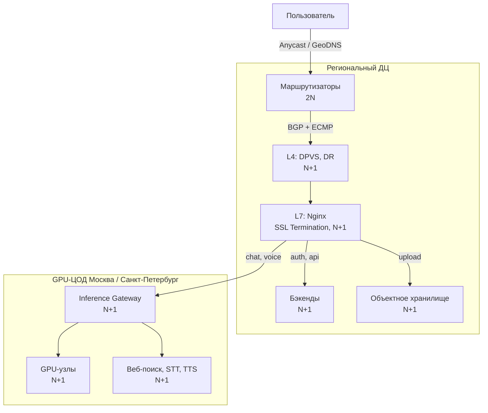
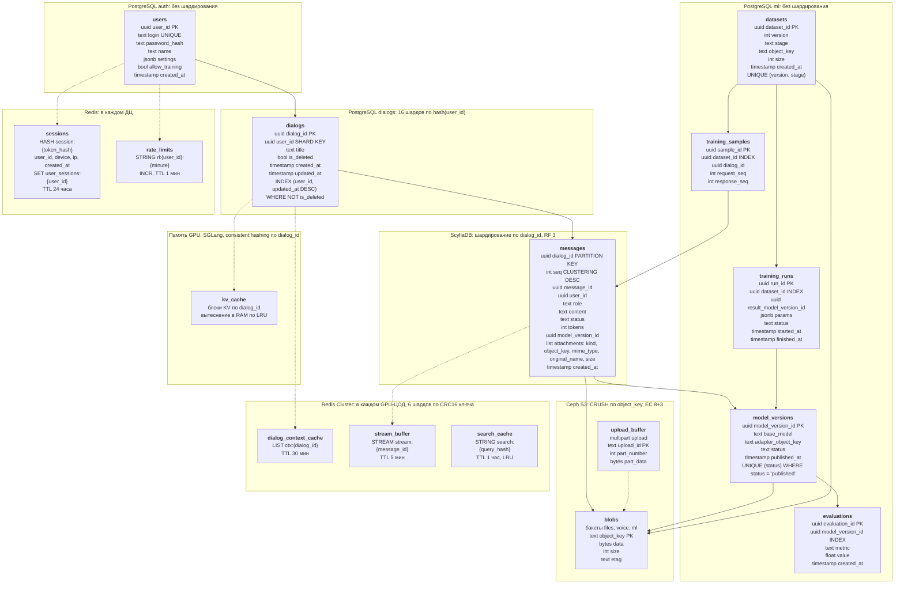

# Рассчетно-пояснительная записка для Курсовой работы по предмету "Разработка высоконагруженных приложений"

### 1. Тема и целевая аудитория

**Тип:** ИИ-сервис (аналог Алиса AI)

**Целевая аудитория:** 4,5 млн DAU, 19,0 млн WAU и 30,0 млн MAU по итогам Q4 2025[^1] (в Q2 2026 WAU достиг 33,2 млн[^2], но в отчете нет ни DAU, ни MAU, поэтому будем ориентироваться на 2025 год). Продукт ориентирован на российский рынок

**Основной функционал MVP:**

Инференс:
1. Регистрация/авторизация пользователя
2. Диалоги с ИИ
3. Голосовой ввод, голосовые ответы
4. Загрузка файлов
5. Интеграция с поиском Яндекса

Обучение:
1. Сбор данных, разрешенных для обучения
2. Подготовка обучающего датасета
3. Дообучение базовой модели
4. Оценка качества новой версии модели
5. Публикация модели в контур инференса

**Ключевые продуктовые решения:**
1. Ответ передается пользователю потоково
2. ИИ-агент самостоятельно вызывает разрешенные инструменты

---

### 2. Расчет нагрузки

Яндекс отчитался о 500-600 тыс. запросов о подборе товаров в сутки[^3]. Такие запросы составляют около 3% от общего количества[^4], поэтому получаем 16,6-20,0 млн запросов в сутки (отчеты были опубликованы с интервалом в два месяца, считаем, что метрики изменились несильно). Для расчетов принимаем среднее значение `(16,6+20,0) / 2 = 18,3`, то есть 18,3 млн. Найдем кол-во запросов в сутки одного пользователя: `18,3 / 4,5 = 4,07` запроса

**Продуктовые метрики:**

| Метрика | Значение |
|---|---:|
| DAU | 4,5 млн |
| MAU | 30,0 млн |

Предполагаем: 10% запросов голосовые, 10% содержат файл размером 10 МБ, а 60% вызывают один веб-поиск. Один поисковый запрос возвращает 5 результатов по 500 символов. Для расчетов принимаем 4 символа на токен, 2 байта на символ, скорость речи 900 символов в минуту, Opus 32 Кбит/с и коэффициент сжатия файлов 0,8 (большая часть форматов уже сжимает данные, например, JPEG, PDF, поэтому будем считать, что данные сжимаются несильно). Производные действия входят в запросы к ИИ и не суммируются с ними

Также предполагаем, что каждый DAU авторизуется или создает сессию один раз в сутки. Регистрации не учитываем, так как нагрузка существенно ниже общей нагрузки

| Тип действия | На пользователя в день | Всего в сутки |
|---|---:|---:|
| Запрос к ИИ | 4,07 | 18,30 млн |
| Голосовой запрос | 0,407 | 1,83 млн |
| Загрузка файла | 0,407 | 1,83 млн |
| Вызов веб-поиска агентом | 2,442 | 10,98 млн |
| Авторизация / создание сессии | 1,000 | 4,50 млн |

Обучение:

| Метрика | Значение |
|---|---:|
| Доля данных для обучения | 0,1% |
| Периодичность обучения | раз в месяц |
| Расчетный месяц | 30 дней |
| Размер базовой модели | 70 млрд параметров |
| Размер базовой модели в BF16 | 140 ГБ |
| Размер LoRA-адаптера | 2 ГБ |
| Хранимые адаптеры | 3 версии |
| Запас на checkpoints и оценки | 20% |

**Расчет хранилища:**

Яндекс не предоставляет публичную статистику по объему хранилища, поэтому возьмем за основу пост из блога OpenAI. OpenAI хранит более 500 ПБ данных для продуктов с аудиторией более 1 млрд пользователей в неделю[^5]. Грубо масштабируем этот объем на 19 млн WAU:

`500 ПБ * 19 млн / 1 млрд = 9,5 ПБ`.

Текущий объем хранилища — 9,5 ПБ

Возьмем из публичного датасета ShareChat средние размеры запроса/ответа: 135,04 токена в запросе и 1 115,30 токена в ответе[^6]

- Запрос: `135,04 * 4 = 540` символов
- Ответ: `1 115,30 * 4 = 4 461` символ
- Один запрос-ответ: `(540 + 4 461) * 2 = 10 002` байта
- Текст: `18,3 млн * 10 002 байта = 183 ГБ/сутки`
- Файлы после серверного сжатия: `18,3 млн * 10% * 10 МБ * 0,8 = 14,64 ТБ/сутки`
- Голосовой запрос: `540 / 900 * 60 * 4 000 = 0,144 МБ`
- Голосовой ответ: `4 461 / 900 * 60 * 4 000 = 1,19 МБ`
- Голосовые запросы: `1,83 млн * 0,144 МБ = 0,264 ТБ/сутки`
- Голосовые ответы: `1,83 млн * 1,19 МБ = 2,18 ТБ/сутки`
- Веб-поиск: `18,3 млн * 60% = 10,98 млн вызовов/сутки`; результаты не храним, но учитываем их передачу в модель: `10,98 млн * 5 * 500 * 2 = 54,90 ГБ/сутки`

Суточный прирост данных составляет 17,26 ТБ. Тогда один активный пользователь добавляет за год:

`17 260 ГБ / 4 500 000 * 365 = 1,40 ГБ/польз./год`

Прирост хранилища за год:

`17,26 ТБ * 365 = 6 299,90 ТБ = 6,30 ПБ`

Обучение:

Базовая модель в BF16 уже загружена и работает, она учитывается как исходный объем контура обучения

За месяц создается `18,3 млн * 30 = 549 млн` запрос-ответ. В один цикл обучения попадает `549 млн * 0,1% = 549 тыс.` запрос-ответ или `549 тыс. * 10 002 байта = 5,49 ГБ`

Для обучения хранятся исходная, очищенная и токенизированная версии датасета. Они занимают `5,49 ГБ * 3 = 16,47 ГБ` в месяц и `16,47 ГБ * 12 = 197,64 ГБ` за год. Три LoRA-адаптера занимают `2 ГБ * 3 = 6,00 ГБ`

Прирост хранилища обучения без резерва: `197,64 ГБ + 6,00 ГБ = 203,64 ГБ`

Резерв на checkpoints и оценку: `203,64 ГБ * 20% = 40,73 ГБ`. Поэтому полный прирост обучения за год составит `203,64 ГБ + 40,73 ГБ = 244,37 ГБ`

Внутренний сетевой трафик одного цикла (чтение выборки, три записи и передача датасета): `5,49 ГБ * 5 + 2,00 ГБ = 29,45 ГБ`. За первый год: `29,45 ГБ * 12 = 353,40 ГБ`; передача базовой модели не требуется

| Метрика | Значение |
|---|---:|
| Текущий объем хранилища инференса | 9,50 ПБ |
| Прирост на одного активного пользователя за год | 1,40 ГБ |
| Прирост хранилища инференса за год | 6,30 ПБ |
| Текущий объем хранилища обучения | 140,00 ГБ |
| Прирост хранилища обучения за год | 244,37 ГБ |

**Технические метрики:**

На основе расчетов выше легко заключить:

Объем хранилища:
| Тип данных | Количество объектов / сутки | Объем / сутки | Объем / 30 дней |
|---|---:|---:|---:|
| Текстовые сообщения | 18,30 млн | 0,18 ТБ | 5,49 ТБ |
| Загруженные файлы после сжатия | 1,83 млн | 14,64 ТБ | 439,20 ТБ |
| Голосовые запросы | 1,83 млн | 0,26 ТБ | 7,91 ТБ |
| Голосовые ответы | 1,83 млн | 2,18 ТБ | 65,31 ТБ |
| **Итого** | — | **17,26 ТБ** | **517,91 ТБ** |

Среднюю пропускную способность посчитаем как `трафик в сутки / 86 400`. Предположим, что 90% суточного трафика приходится на 6 активных часов, а остальные 10% равномерно распределены в течение оставшихся 18 часов. Средняя нагрузка в активный период составит `90% * 24 / 6 = 3,60` от среднесуточной; этот коэффициент используем для расчета пиковой нагрузки:
| Тип трафика | Объем / сутки | Средняя нагрузка | Пиковая нагрузка |
|---|---:|---:|---:|
| Текстовые сообщения | 1 464,40 Гбит | 0,02 Гбит/с | 0,06 Гбит/с |
| Загрузка файлов до серверного сжатия | 146 400,00 Гбит | 1,69 Гбит/с | 6,10 Гбит/с |
| Голосовые сообщения | 19 525,31 Гбит | 0,23 Гбит/с | 0,81 Гбит/с |
| Результаты веб-поиска | 439,20 Гбит | 0,01 Гбит/с | 0,02 Гбит/с |
| **Итого** | **167 828,91 Гбит** | **1,94 Гбит/с** | **6,99 Гбит/с** |

Аналогично посчитаем RPS как `запросов в день / 86 400`; для пикового RPS используем тот же коэффициент 3,60:
| Метод / тип запроса | Запросов в сутки | Средний RPS | Пиковый RPS |
|---|---:|---:|---:|
| Генерация ответа ИИ | 18,30 млн | 211,81 | 762,50 |
| Загрузка файла | 1,83 млн | 21,18 | 76,25 |
| Распознавание голосового ввода (STT) | 1,83 млн | 21,18 | 76,25 |
| Синтез голосового ответа (TTS) | 1,83 млн | 21,18 | 76,25 |
| Запрос к поиску | 10,98 млн | 127,08 | 457,50 |
| Авторизация / создание сессии | 4,50 млн | 52,08 | 187,50 |

В рамках инференса также посчитаем кол-во токенов в секунду. В таблице учтены пользовательские сообщения, ответы и результаты веб-поиска, без системного промпта и истории диалога

- Входные токены пользовательских сообщений: `18,3 млн * 135,04 / 86 400 = 28 602 токенов/с`
- Входные токены результатов веб-поиска: `10,98 млн * 5 * 500 / 4 / 86 400 = 79 427 токенов/с`
- Выходные токены: `18,3 млн * 1 115,30 / 86 400 = 236 227 токенов/с`
- Нагрузка в активный период: `средняя нагрузка * 3,60`

| Тип токенов | Среднее значение, токенов/с | Нагрузка в активный период, токенов/с |
|---|---:|---:|
| Входные токены пользовательских сообщений | 28 602 | 102 968 |
| Входные токены результатов веб-поиска | 79 427 | 285 938 |
| **Всего входных токенов** | **108 029** | **388 906** |
| Выходные токены | 236 227 | 850 416 |

---

### 3. Глобальная балансировка нагрузки

Ключевым в сервисе являются GPU-кластеры, поэтому многое будет зависеть от их расположения. Такие крупные центры обработки данных (ЦОД) требуют больших вложений и развитой инфраструктуры вокруг (например, наличие мощных электростанций), поэтому много где построить не получится

Большая часть населения РФ проживает в европейской части страны (порядка 4/5 населения[^7]), поэтому инфраструктура там развита хорошо, поэтому и кластеры должны быть там. Крупными городами являются Москва и Санкт-Петербург - размещать GPU-кластеры будем рядом с ними

Хоть и кластеры будут только в двух крупных ЦОД, точка входа для пользователя необязательна находится там же. Вся обработка, связанныая с инференсом LLM и работой агента должны происходить в ЦОД, а отдача статики, загрузка файлов, реплики данных можно распределить по стране, большую часть разместить в западной части и несколько дата-центров (ДЦ) в Сибири (Новосибирск) и на Дальнем Востоке (Хабаровск). Запросы от модели как правило небыстрые и пользователи знают об этом и могут подождать, но если главная страница будет загружаться долго или вход в аккаунт будет тормозить, то пользователи просто уйдут

Anycast лучше всего использовать для CDN, потому что это stateless запросы. Для коротких запросов, например, регистрация/авторизация, загрузка диалогов, также подойдет Anycast

DNS балансировку надо использовать для загрузки файлов и для потоковой передачи ответа пользователю, так как это долгие stateful операции

Таким образом, получаем разбиение по доменам

| Домен | Назначение | Балансировка |
|---|---|---|
| `ai.domain.ru` | Главная страница, статика (CDN) | Anycast |
| `auth.ai.domain.ru` | Регистрация, авторизация | Anycast |
| `api.ai.domain.ru` | История диалогов, настройки | Anycast |
| `chat.ai.domain.ru` | Потоковая передача ответа ИИ | DNS |
| `voice.ai.domain.ru` | Голосовой ввод и ответ | DNS |
| `upload.ai.domain.ru` | Загрузка файлов | DNS |

Так как пользователи напрямую не будут делать запросы в ЦОД, то для выполнения запроса будет выбираться наименее нагруженный ЦОД. Причем сессию пользователя необходимо закрепить за конкретным ЦОД на некоторое время, потому что там может сохранится KV-кэш предыдущего контекста

Будем считать, что распределение запросов будет примерно соответствовать распределению населения по стране, то есть на ДЦ в западной части страны будет приходится порядка 80% запросов

---

### 4. Локальная балансировка нагрузки

**Резервирование:**

| Уровень | Резервирование |
|---|---|
| Маршрутизаторы | 2N |
| DPVS | N+1 |
| Nginx | N+1 |
| Бэкенды, хранилище | N+1 |
| Inference Gateway | N+1 |
| GPU-узлы | N+1 |
| GPU-ЦОД | Второй GPU-ЦОД |

2N - для маршрутизаторов, так как их отказ отключает весь ДЦ. N+1 - для взаимозаменяемых узлов, отказ одного снижает только общую мощность

**L4 и L7:**

L4 - DPVS в режиме Direct Route (DR): пересылает входящие пакеты на Nginx, ответы идут клиенту напрямую. Узел Nginx выбирается через Maglev hashing, поэтому отказ узла DPVS не обрывает соединения

L7 - Nginx: SSL Termination и маршрутизация по домену

**Балансировка входящих запросов:**

Короткие запросы `auth` и `api` распределяются через round robin, а долгие `upload`, `chat` и `voice` через least connections

**Балансировка межсервисных запросов:**

Внутри ДЦ - service discovery и балансировка на стороне клиента (sidecar Envoy)

| Откуда - куда | Алгоритм |
|---|---|
| Бэкенды - бэкенды | Round robin |
| Бэкенды - БД | Запись в мастер, чтение round robin по репликам |
| Inference Gateway - GPU-узлы | Взвешенный consistent hashing по `dialog_id` |
| Inference Gateway - веб-поиск, STT, TTS | Least request |

Веса GPU-узлов пропорциональны их фактической скорости генерации; узел с заполненным KV-кэшем временно исключается

**Ограничители: SSL Termination и пропускная способность**

DPVS в режиме DR пропускает только входящий трафик и ограничителем не является, поэтому считаем L7

Пиковый RPS: `187,50 (auth) + 762,50 (chat) + 152,50 (voice) + 76,25 (upload) = 1 178,75`. Нагрузку на `api` в разделе 2 не считали. Предполагаем, что на каждый запрос к ИИ клиент делает 2 запроса к `api`: загрузка списка диалогов и истории выбранного диалога: `762,50 * 2 = 1 525,00`. Итого `2 704 RPS`. Статику отдает CDN

Считаем, что каждый запрос открывает новое TLS-соединение (оценка сверху)

- По данным 2017 года (RSA 2048, 428 CPS на ядро[^8]): `2 704 / 428 = 6,32 => 7 ядер`
- По данным 2019 года (4 433 TPS на ядро[^9]): `2 704 / 4 433 = 0,61 => 1 ядро`
- Сеть: пик 6,99 Гбит/с; 10 GbE при загрузке 70% - 7 Гбит/с

Распределение по ДЦ (80% - западная часть страны). Ядра CPU считаем по более строгим данным 2017 года: `RPS / 428`. Одного сервера (16 ядер, 10 GbE) хватает для каждого ДЦ, с резервом N+1 - по 2 сервера DPVS и 2 сервера Nginx

| ДЦ | Доля | Пиковый RPS | Пиковый трафик | Ядер CPU на SSL | Серверов DPVS | Серверов Nginx |
|---|---:|---:|---:|---:|---:|---:|
| Москва | 55% | 1 487,1 | 3,84 Гбит/с | 4 | 2 | 2 |
| Санкт-Петербург | 25% | 675,9 | 1,75 Гбит/с | 2 | 2 | 2 |
| Новосибирск | 12% | 324,5 | 0,84 Гбит/с | 1 | 2 | 2 |
| Хабаровск | 8% | 216,3 | 0,56 Гбит/с | 1 | 2 | 2 |
| **Итого** | 100% | 2 703,8 | 6,99 Гбит/с | - | **8** | **8** |

При отказе ДЦ в Москве Санкт-Петербург получает 80% нагрузки: 5,59 Гбит/с и `2 163 / 428 = 5,05 => 6 ядер`. Помещается в один сервер

Итого: 8 серверов DPVS, 8 серверов Nginx и 4 Inference Gateway (по 2 в каждом GPU-ЦОД)

**Итоговая схема балансировки:**

---

### 5. Логическая схема БД

**Расчеты:**

Допущения:

- Обычные таблицы считаем за год, кэши и буферы по пику. Пиковый QPS берем из раздела 2, средний = `пик / 3,60`
- Размер строки считаем как сумму полей: `uuid` 16 Б, `timestamp` 8 Б, `int` 4 Б, `float` 8 Б, `bool` и `enum` по 1 Б. Для строк, `json` и `bytes` берем среднюю длину
- Пользователей в 2 раза больше MAU, в диалоге 4,62 запроса (среднее по датасету ShareChat[^6])
- Сессия живет 24 часа, коэффициент наложения 1,5
- TTL: контекст диалога 30 мин, чанки ответа 5 мин, результаты поиска 1 час, доля попаданий в поиске 30%
- Модель генерирует 50 токенов/с, ответ в среднем 1 115 токенов, поэтому одна генерация идет 22,3 с. Ответ отдается чанками по 20 токенов, в тексте он занимает 8 922 Б
- KV-кэш модели 70B занимает 320 КБ на токен
- Файл 10 МБ грузится 8 с (канал 10 Мбит/с) частями по 5 МБ

| Таблица | Строк | Размер строки | Чтение, пик QPS | Запись, пик QPS |
|---|---|---|---|---|
| users | `30 млн * 2 = 60 млн` | `16 + 32 (логин) + 60 (bcrypt) + 32 (имя) + 256 (настройки) + 1 + 8 = 405 Б` | авторизация: 188 | < 1 |
| sessions | `4,5 млн * 1,5 = 6,75 млн` | `32 (SHA-256) + 16 + 64 (устройство) + 16 (IPv6) + 8 + 8 = 144 Б` | `1 525 (api) + 762,5 (chat) + 152,5 (voice) + 76,25 (upload) = 2 516` | авторизация: 188 |
| dialogs | `18,3 млн / 4,62 * 365 = 1,45 млрд` | `16 + 16 + 100 (название) + 1 + 8 + 8 = 149 Б` | список и открытие диалога: `762,5 * 2 = 1 525` | создание и обновление: `762,5 / 4,62 + 762,5 = 928` |
| messages | `18,3 млн * 2 * 365 = 13,36 млрд` | `16 + 16 + 4 + 1 + 5 001 (текст) + 1 + 4 + 16 + 8 = 5 067 Б` | открытие истории: 763 | запрос, ответ и обновление ответа: `762,5 * 3 = 2 288` |
| attachments | `1,83 млн * 3 * 365 = 2,00 млрд` (файлы, голосовые запросы и ответы) | `16 + 16 + 1 + 36 (ключ) + 16 (MIME) + 64 (имя файла) + 4 + 8 = 161 Б` | `76,25 * 3 = 229` | 229 |
| blobs | 2,00 млрд | `17,08 ТБ * 365 / 2,00 млрд = 3,1 МБ` (всего 6,24 ПБ) | 229 | 229 |
| model_versions | 12 версий | `16 + 32 + 36 + 1 + 8 = 93 Б` | < 1 | < 1 |
| training_samples | `549 тыс. * 12 = 6,59 млн` | `16 * 4 = 64 Б` | < 1 | < 1 |
| datasets | `3 * 12 = 36` | `16 + 4 + 1 + 36 + 4 + 8 = 69 Б` | < 1 | < 1 |
| training_runs | 12 | `16 * 3 + 512 (параметры) + 1 + 8 + 8 = 577 Б` | < 1 | < 1 |
| evaluations | `12 * 50 = 600` | `16 + 16 + 32 + 8 + 8 = 80 Б` | < 1 | < 1 |
| dialog_context_cache | `762,5 * 1 800 = 1,37 млн` | `16 + 3 375 токенов * 4 * 2 + 8 = 27 КБ` | 763 | запрос и ответ: 1 525 |
| kv_cache | `762,5 * 22,3 = 17 тыс.` | `3 375 токенов * 320 КБ = 1,11 ГБ` | каждый токен: 850 416 | каждый токен: 850 416 |
| stream_buffer | `17 тыс. + 762,5 * 300 = 246 тыс.` | `16 + 8 922 + 4 + 8 = 8,95 КБ` | чанки: `850 416 / 20 = 42 521` | 42 521 |
| search_cache | `320 * 3 600 = 1,15 млн` | `32 + 5 000 (5 результатов) + 8 = 5,04 КБ` | каждый вызов поиска: 458 | промахи: `457,5 * 0,7 = 320` |
| rate_limits | 4,5 млн | `16 + 8 + 4 = 28 Б` | `762,5 + 76,25 + 76,25 = 915` | 915 |
| upload_buffer | `76,25 * 8 * 2 = 1 220` | 5 МБ | `76,25 * 2 = 153` | 153 |

**Описание таблиц:**

| Таблица | Назначение | Строк | Объем | Чтение, QPS | Чтение пик, QPS | Запись, QPS | Запись пик, QPS |
|---|---|---:|---:|---:|---:|---:|---:|
| users | Профили пользователей | 60 млн | 24,3 ГБ | 52 | 188 | < 1 | < 1 |
| sessions | Сессии | 6,75 млн | 0,97 ГБ | 699 | 2 516 | 52 | 188 |
| dialogs | Диалоги | 1,45 млрд | 215 ГБ | 424 | 1 525 | 258 | 928 |
| messages | Сообщения | 13,36 млрд | 67,7 ТБ | 212 | 763 | 635 | 2 288 |
| attachments | Метаданные файлов и голоса | 2,00 млрд | 323 ГБ | 64 | 229 | 64 | 229 |
| blobs | Содержимое файлов, голоса, датасетов, весов | 2,00 млрд | 6,24 ПБ | 64 | 229 | 64 | 229 |
| model_versions | Версии модели | 12 | 1,1 КБ | < 1 | < 1 | < 1 | < 1 |
| training_samples | Примеры для обучения | 6,59 млн | 0,42 ГБ | < 1 | < 1 | < 1 | < 1 |
| datasets | Версии датасета | 36 | 2,5 КБ | < 1 | < 1 | < 1 | < 1 |
| training_runs | Запуски обучения | 12 | 6,9 КБ | < 1 | < 1 | < 1 | < 1 |
| evaluations | Оценки моделей | 600 | 48 КБ | < 1 | < 1 | < 1 | < 1 |
| dialog_context_cache | Контекст диалога | 1,37 млн | 37 ГБ | 212 | 763 | 424 | 1 525 |
| kv_cache | KV-кэш модели | 17 тыс. | 18,9 ТБ | 236 227 | 850 416 | 236 227 | 850 416 |
| stream_buffer | Чанки ответа | 246 тыс. | 2,2 ГБ | 11 811 | 42 521 | 11 811 | 42 521 |
| search_cache | Результаты веб-поиска | 1,15 млн | 5,8 ГБ | 127 | 458 | 89 | 320 |
| rate_limits | Счетчики запросов | 4,5 млн | 0,13 ГБ | 254 | 915 | 254 | 915 |
| upload_buffer | Части загружаемых файлов | 1 220 | 6,1 ГБ | 42 | 153 | 42 | 153 |

**Схема:**

Пунктиром отмечены кэши и буферы

```mermaid
erDiagram
    users ||--o{ sessions : "входит"
    users ||--o{ dialogs : "создает"
    dialogs ||--o{ messages : "содержит"
    messages ||--o{ attachments : "прикреплены"
    attachments }o--|| blobs : "содержимое"
    model_versions ||--o{ messages : "сгенерировала"
    messages ||--o{ training_samples : "отобраны"
    datasets ||--o{ training_samples : "включает"
    datasets }o--|| blobs : "файлы датасета"
    datasets ||--o{ training_runs : "используется"
    training_runs ||--o| model_versions : "создает"
    model_versions }o--|| blobs : "веса адаптера"
    model_versions ||--o{ evaluations : "оценена"

    dialogs ||..o| dialog_context_cache : "контекст"
    dialogs ||..o| kv_cache : "KV-кэш"
    messages ||..o| stream_buffer : "генерация"
    users ||..o{ rate_limits : "лимиты"
    users ||..o{ upload_buffer : "загрузка"

    users {
        uuid user_id PK
        string login UK
        string password_hash
        string name
        json settings
        bool allow_training
        timestamp created_at
    }
    sessions {
        string token_hash PK
        uuid user_id FK
        string device
        string ip
        timestamp created_at
        timestamp expires_at
    }
    dialogs {
        uuid dialog_id PK
        uuid user_id FK
        string title
        bool is_deleted
        timestamp created_at
        timestamp updated_at
    }
    messages {
        uuid message_id PK
        uuid dialog_id FK
        int seq
        enum role "user / assistant / tool"
        text content
        enum status "generating / done / error"
        int tokens
        uuid model_version_id FK
        timestamp created_at
    }
    attachments {
        uuid attachment_id PK
        uuid message_id FK
        enum kind "file / voice_in / voice_out"
        string object_key FK
        string mime_type
        string original_name
        int size
        timestamp created_at
    }
    blobs {
        string object_key PK
        bytes data
        int size
        string checksum
        timestamp created_at
    }
    model_versions {
        uuid model_version_id PK
        string base_model
        string adapter_object_key FK
        enum status "training / evaluating / published / archived"
        timestamp published_at
    }
    training_samples {
        uuid sample_id PK
        uuid dataset_id FK
        uuid request_message_id FK
        uuid response_message_id FK
    }
    datasets {
        uuid dataset_id PK
        int version
        enum stage "raw / clean / tokenized"
        string object_key FK
        int size
        timestamp created_at
    }
    training_runs {
        uuid run_id PK
        uuid dataset_id FK
        uuid result_model_version_id FK
        json params
        enum status
        timestamp started_at
        timestamp finished_at
    }
    evaluations {
        uuid evaluation_id PK
        uuid model_version_id FK
        string metric
        float value
        timestamp created_at
    }
    dialog_context_cache {
        uuid dialog_id PK
        json last_messages
        timestamp expires_at
    }
    kv_cache {
        uuid dialog_id PK
        bytes tensors
        int tokens
        timestamp expires_at
    }
    stream_buffer {
        uuid message_id PK
        text chunks
        int last_chunk_seq
        timestamp expires_at
    }
    rate_limits {
        uuid user_id PK
        timestamp window PK
        int counter
    }
    upload_buffer {
        uuid upload_id PK
        uuid user_id FK
        int part_number
        bytes part_data
        timestamp expires_at
    }
    search_cache {
        string query_hash PK
        json results
        timestamp expires_at
    }
```

**Консистентность:**

- Строго нужны уникальный логин, отзыв сессии, публикация версии модели и порядок сообщений (`seq`)
- Пользователь должен сразу видеть свое сообщение в messages, на других устройствах можно отстать. Диалоги и данные обучения согласуются в итоге
- blobs пишется раньше attachments, а объекты без метаданных потом чистит фоновая задача
- Кэши и буферы собираются заново из messages или повторным prefill, их потеря не критична

**Распределение нагрузки по ключам:**

- `user_id` - равномерно: пользователь в среднем делает всего 4 запроса в сутки, поэтому горячих ключей нет. Ботов и скрипты отсекает rate_limits
- `dialog_id` - почти вся нагрузка на диалоги последних часов, старые данные холодные; kv_cache привязан к GPU-узлу через consistent hashing
- `query_hash` - популярные запросы вроде погоды, курсов и новостей дают большую часть обращений, это горячие ключи
- `message_id` в stream_buffer - ключ живет несколько минут, но операций на него приходится больше всего
- Пик в активные часы в 3,60 раза выше среднего, 80% запросов из западной части страны

---

### 6. Физическая схема БД

**Схема:**

Пунктиром отмечены кэши и буферы

**Описание таблиц:**

| Таблица | СУБД | Ключ и индексы | Шардирование | Резервирование |
|---|---|---|---|---|
| `users` | PostgreSQL | PK `user_id`, UNIQUE `login` | Нет | Мастер в Москве, синхронная реплика в СПб, асинхронные реплики в региональных ДЦ |
| `sessions` | Redis | `session:{token_hash}`, `user_sessions:{user_id}` | Нет | Мастер в Москве, реплика в каждом ДЦ |
| `dialogs` | PostgreSQL | PK `dialog_id`, `(user_id, updated_at DESC)` | 16 логических шардов по `hash(user_id)` на 4 узлах | Мастер и синхронная реплика в разных GPU-ЦОД, асинхронные реплики в региональных ДЦ |
| `messages` | ScyllaDB | Partition `dialog_id`, clustering `seq DESC` | Кольцо токенов по `dialog_id` | RF 3 в Москве и СПб |
| `blobs`, `upload_buffer` | Ceph | Бакет и `object_key` | CRUSH по `object_key` | EC 8+3, multisite-репликация Москва - СПб |
| `model_versions`, `datasets`, `training_samples`, `training_runs`, `evaluations` | PostgreSQL | PK, индексы на FK, UNIQUE на опубликованную версию | Нет | Мастер и синхронная реплика |
| `dialog_context_cache`, `stream_buffer`, `search_cache` | Redis Cluster | `ctx:{dialog_id}`, `stream:{message_id}`, `search:{query_hash}` | 6 шардов по CRC16 ключа в каждом GPU-ЦОД | Реплика на шард |
| `rate_limits` | Redis | `rl:{user_id}:{minute}` | Нет, свой экземпляр в каждом ДЦ | Реплика |
| `kv_cache` | Память GPU (SGLang) | `dialog_id` | Consistent hashing по `dialog_id` (раздел 4) | Нет, при потере - повторный prefill |

Объем с учетом резервирования за год:

- `messages`: `67,7 ТБ * 3 (RF) / 2 (сжатие LZ4) = 102 ТБ` в каждом GPU-ЦОД, при 8 ТБ данных на узел - 13 узлов ScyllaDB
- `blobs`: `6,24 ПБ * 11 / 8 (EC 8+3) = 8,58 ПБ` дисков в каждом GPU-ЦОД
- `dialogs`: `215 ГБ / 4 = 54 ГБ` на узел PostgreSQL
- Redis Cluster: `37 + 2,2 + 5,8 = 45 ГБ`, по 7,5 ГБ и `(763 + 1 525 + 42 521 * 2 + 458 + 320) / 6 = 14,7 тыс.` операций/с на шард в пике

**Выбор СУБД:**

PostgreSQL взяли для небольших таблиц, где нужны транзакции и строгая консистентность: уникальный логин, одна опубликованная версия модели, список диалогов по `updated_at`

`messages` растет на 67,7 ТБ в год, пишется чаще, чем читается, и читается только по `dialog_id`, поэтому для нее ScyllaDB. Она масштабируется добавлением узлов, а `LOCAL_QUORUM` на запись и чтение дает read-your-writes

Файлы лежат в Ceph: петабайты данных с S3 API, а erasure coding экономит диски по сравнению с тройной репликацией. Redis нужен для данных с коротким TTL: в Streams лежат чанки ответа, на `INCR` сделаны лимиты. KV-кэш остается в памяти GPU, им управляет SGLang

**Денормализация:**

- Вложения (`attachments`) встроены в `messages` списком, поэтому история с файлами читается одним запросом
- `user_id` продублирован в `messages`, чтобы удалять данные пользователя, не заходя в `dialogs`
- `user_id` хранится в `sessions`, поэтому запрос авторизуется без чтения `users`
- `user_sessions:{user_id}` - обратный индекс, по нему при смене пароля отзываются все сессии
- `training_samples` ссылается на `(dialog_id, seq)`, то есть на ключ сообщения в ScyllaDB. Пример отбираем с вероятностью 0,1% при записи ответа, `messages` не сканируем
- `dialog_context_cache` - копия последних сообщений диалога для Inference Gateway

**Клиентские библиотеки:**

| СУБД | Go (бэкенды, Inference Gateway) | Python (обучение) |
|---|---|---|
| PostgreSQL | pgx | psycopg |
| ScyllaDB | scylladb/gocql | scylla-driver |
| Redis | go-redis | - |
| Ceph | aws-sdk-go-v2 (S3) | boto3 |

**Балансировка и мультиплексирование:**

- PostgreSQL - перед каждым узлом стоит PgBouncer в режиме transaction, он сводит тысячи соединений бэкендов к ~100. Мастера выбирает Patroni через etcd. Пишем в мастер, читаем по репликам round robin (раздел 4)
- dialogs - шард выбирает приложение: `hash(user_id) % 16`, а узел логического шарда берет из etcd. Когда узлов не хватает, шарды переносятся на новые узлы целиком, хэш не меняется
- ScyllaDB - драйвер token-aware и shard-aware: запрос идет сразу на узел и ядро CPU, которые владеют ключом. DC-aware - в ближайший GPU-ЦОД
- Redis Cluster - клиент хранит карту слотов и переходит по `MOVED`, чанки `stream_buffer` пишутся пайплайном
- Ceph - несколько RGW за Nginx, least connections

**Резервное копирование:**

| Данные | Схема |
|---|---|
| PostgreSQL | WAL-G: полный бэкап раз в неделю, инкрементальный раз в сутки, непрерывный архив WAL в Ceph другого ДЦ. Восстановление на любой момент за 30 дней |
| ScyllaDB | Scylla Manager: инкрементальный снапшот раз в сутки в Ceph другого ДЦ, хранение 30 дней |
| Ceph | Полную копию 6,24 ПБ не делаем: от отказа дисков защищает EC 8+3, от отказа ДЦ - multisite-репликация, от ошибочного удаления - версионирование бакетов на 7 дней |
| Redis sessions | RDB раз в час и AOF: после перезапуска пользователи не разлогиниваются |
| Остальные кэши и буферы | Не бэкапим, пересобираем из основных данных |

---

### Список источников

[^1]: [Финансовый отчет Яндекса Q4 2025](https://yandex.ru/company/news/17-02-2026)
[^2]: [Финансовый отчет Яндекса Q2 2026](https://yandex.ru/company/news/29-07-2026)
[^3]: [Яндекс дообучил Алису AI для удобного подбора товаров прямо в чате](https://yandex.ru/company/news/14-01-2026-01)
[^4]: [Яндекс рассказал, как применяют Алису AI в бытовых и профессиональных задачах](https://ir.yandex.ru/press-releases?id=06-03-2026-01&year=2026)
[^5]: [Scaling storage to one billion users (Part 1)](https://openai.com/index/scaling-storage-one-billion-users-part-one)
[^6]: [ShareChat: A Dataset of Chatbot Conversations in the Wild](https://github.com/raye22/ShareChat)
[^7]: [Территория и население России](https://basrah.mid.ru/ru/o_rossii/territoriya_i_naselenie_rossii/)
[^8]: [Testing the Performance of NGINX and NGINX Plus Web Servers](https://blog.nginx.org/blog/testing-the-performance-of-nginx-and-nginx-plus-web-servers)
[^9]: [Testing the Performance of NGINX Ingress Controllers in a Kubernetes Environment](https://blog.nginx.org/blog/testing-performance-nginx-ingress-controller-kubernetes)
